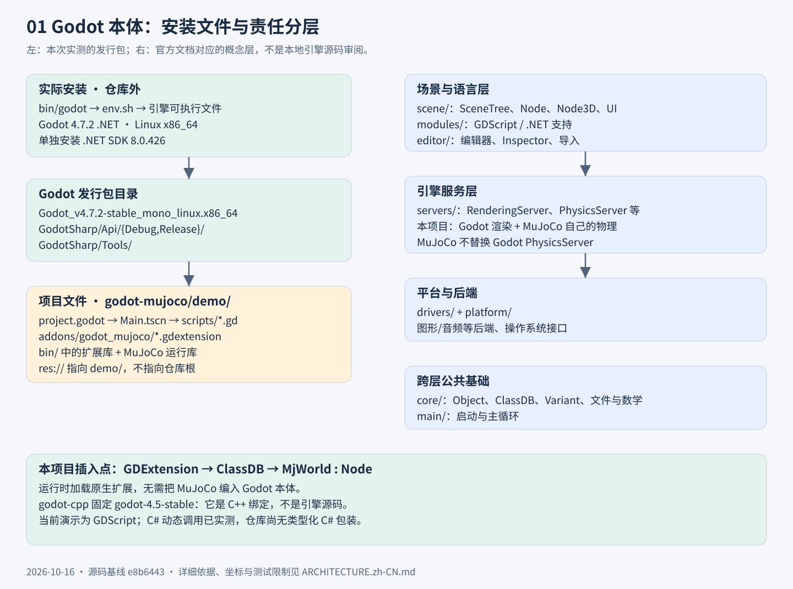
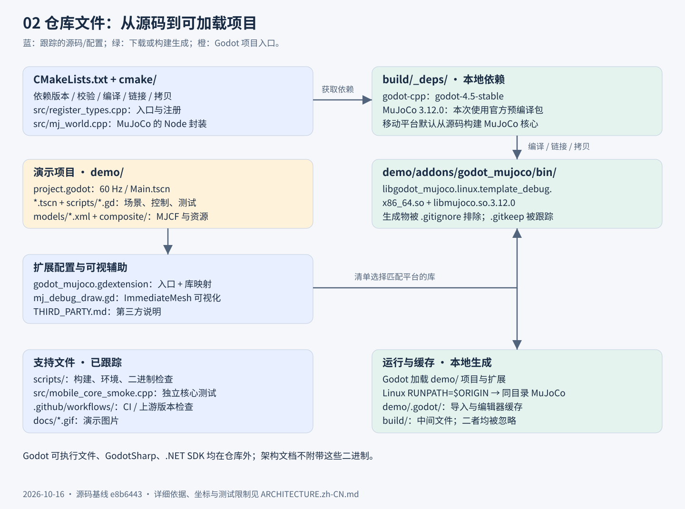
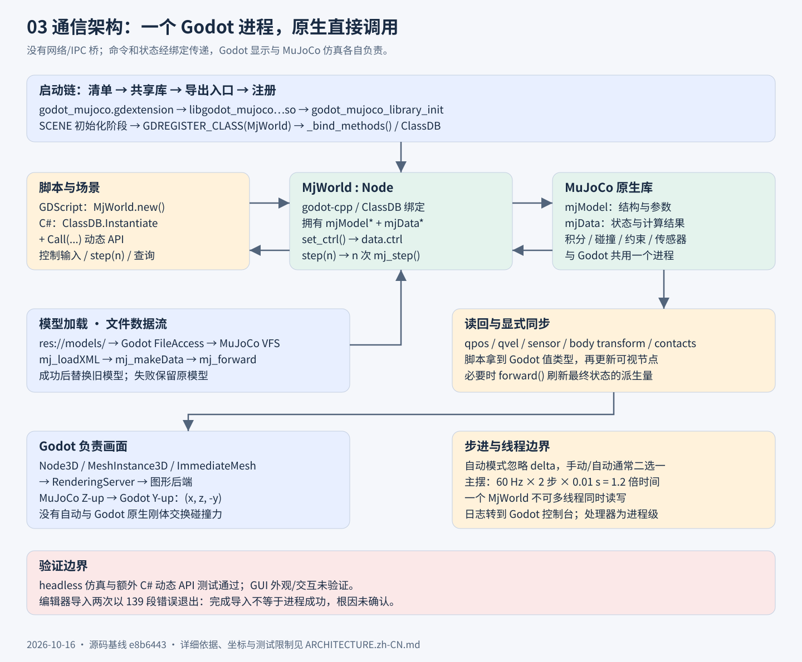

# Godot × MuJoCo：文件结构与通信架构

> 核对日期：2026-10-16。仓库基线：[`e8b6443`](https://github.com/zdYukino/godot-mujoco/tree/e8b64439999e0ede2b4785d8345acebf11b2e99a)。本文描述当前实现，不承诺尚未验证的平台或功能。

本项目把 MuJoCo 物理仿真封装为 Godot 的原生 `MjWorld` 节点。Godot 负责场景、脚本、输入、界面与渲染；MuJoCo 负责自己的模型和物理状态。两者在**同一个 Godot 进程**内通过 GDExtension 和原生函数调用交换数据，没有 Python 服务、Socket、HTTP 或跨进程桥接。

## 1. Godot 本体：安装目录与概念分层



本次实测使用 Linux x86_64 的 **Godot 4.7.2 .NET (`ed1daf0bf`)**、**.NET SDK 8.0.426**。这是已安装的官方发行包，不是本仓库编译出来的引擎。当前仓库的演示脚本仍是 GDScript；使用 .NET 版引擎不会自动把它们转换成 C#。

本次验证环境中的实际目录（仅作环境说明，不是仓库内容）：

```text
/workspace/shared/tools/
├── bin/godot                 # shell 启动器：读取 env.sh 后 exec 下方可执行文件
├── env.sh                    # 此环境的工具链配置
└── godot/Godot_v4.7.2-stable_mono_linux_x86_64/
    ├── Godot_v4.7.2-stable_mono_linux.x86_64
    └── GodotSharp/
        ├── Api/Debug/        # GodotSharp.dll、GodotSharpEditor.dll 等
        ├── Api/Release/      # 发行配置的托管 API
        └── Tools/            # .NET 工具、nupkgs 与语言资源
```

下列是依据 [Godot 官方架构文档](https://docs.godotengine.org/en/stable/engine_details/architecture/godot_architecture_diagram.html) 与 [上游目录结构](https://github.com/godotengine/godot) 整理的**源码职责导航**，不是声称已检出或逐行审阅 4.7.2 引擎源码。发行包也不会按这些源码目录展开：

| Godot 上游目录 | 职责与本项目的关系 |
|---|---|
| `main/` | 启动与主循环；驱动项目生命周期 |
| `core/` | Object、ClassDB、Variant、数学和文件访问等共同基础；`core/extension/` 是扩展机制相关代码 |
| `scene/` | SceneTree、Node、Node3D、资源与 UI；`MjWorld` 派生自 Node，演示挂在场景树上 |
| `servers/` | 渲染、物理、音频等底层服务；Godot 的 PhysicsServer 并未被本项目替换为 MuJoCo |
| `drivers/`、`platform/` | 图形等后端和操作系统适配；不是 MuJoCo 通信桥 |
| `modules/` | 引擎内建模块，例如 GDScript 和 .NET/C# 支持；本扩展不是必须重新编译引擎的内建模块 |
| `editor/` | 场景编辑、Inspector、导入等编辑器功能 |

`godot-cpp` 是 GDExtension 的 C++ 绑定依赖，**不是 Godot 引擎源码**。本仓库 CMake 固定到 `godot-4.5-stable`；扩展清单的最低兼容版本也是 `4.5`。实测引擎版本、绑定版本和最低版本是三个不同概念，不能把单机通过当成所有新旧版本均兼容。

## 2. 当前仓库：源码、模型与构建产物



```text
godot-mujoco/
├── CMakeLists.txt                  # 拉取依赖、构建扩展、拷贝运行库
├── src/
│   ├── register_types.{h,cpp}       # 导出入口、注册 MjWorld、MuJoCo 日志转发
│   ├── mj_world.{h,cpp}             # Node 封装、模型所有权、步进、控制与查询
│   └── mobile_core_smoke.cpp       # 独立 MuJoCo 核心测试，不启动 Godot
├── cmake/                          # 源码构建辅助及移动平台补丁
├── scripts/                        # 环境准备、移动构建、二进制检查、上游检查
├── .github/workflows/              # 构建测试与版本检查 CI
├── demo/                           # Godot 项目根；这里对应 res://
│   ├── project.godot               # main_scene=Main.tscn；物理回调频率 60 Hz
│   ├── Main.tscn / ChaosPendulum.tscn / VisualDebug.tscn
│   ├── *Test.tscn                  # 三个 headless 测试入口
│   ├── scripts/*.gd                # 交互、控制、状态到可视节点的映射及测试
│   ├── models/*.xml                # MJCF 模型；composite/ 包含 include 和 OBJ
│   └── addons/godot_mujoco/
│       ├── godot_mujoco.gdextension # 按平台/架构/debug-release 选择原生库
│       ├── mj_debug_draw.gd         # Godot ImmediateMesh 调试绘制
│       ├── THIRD_PARTY.md           # 第三方说明
│       └── bin/                    # .gitkeep 被跟踪；实际库是构建产物
├── docs/*.gif                      # 已跟踪的演示图片
├── build/                          # 本地生成、忽略：CMake 中间文件与 _deps/
└── demo/.godot/                    # 本地生成、忽略：Godot 导入/编辑器缓存
```

### 构建流（本次 Linux debug）

1. [`CMakeLists.txt`](CMakeLists.txt) 用 FetchContent 获取 `godot-cpp` 绑定以及校验 SHA-256 的 MuJoCo **3.12.0** 官方预编译包。
2. 将 [`register_types.cpp`](src/register_types.cpp)、[`mj_world.cpp`](src/mj_world.cpp) 编译为 GDExtension，共同链接 godot-cpp 和 MuJoCo。
3. 构建后放入 `demo/addons/godot_mujoco/bin/`：
   - `libgodot_mujoco.linux.template_debug.x86_64.so`
   - `libmujoco.so.3.12.0`（及构建生成的相关库链接）
4. Linux 扩展的 RUNPATH 为 `$ORIGIN`，动态加载器从扩展所在目录解析 MuJoCo 库。本次 `ldd` 已验证无需额外设置库搜索路径。

[`gitignore`](.gitignore) 将构建树、缓存和原生库排除。仅克隆源码不会得到可直接运行的二进制，需要先构建。移动平台默认从源码构建 MuJoCo 核心；桌面也有显式源码构建选项。这些分支的存在不是本次跨平台验证通过的证据。

本次架构交付只包含 Markdown/SVG 文档；不包含 Godot 可执行文件、GodotSharp、.NET SDK、依赖源码、缓存或仿真库。

## 3. 加载链与双向数据流



### 启动与注册

1. Godot 打开 [`demo/project.godot`](demo/project.godot)，导入/发现 [`godot_mujoco.gdextension`](demo/addons/godot_mujoco/godot_mujoco.gdextension)。清单声明平台库路径、依赖与 `entry_symbol`。
2. 加载扩展共享库和其 MuJoCo 动态依赖，调用导出入口 **`godot_mujoco_library_init`**。
3. 入口建立 godot-cpp 初始化对象，在 `MODULE_INITIALIZATION_LEVEL_SCENE` 注册 **`MjWorld`**；`_bind_methods()` 将方法与属性暴露到 Godot 的 ClassDB。
4. GDScript 可执行 `MjWorld.new()` 并挂入 SceneTree。C# 在 .NET 引擎中可以使用 `ClassDB.Instantiate("MjWorld")` 和 `Call(...)` 动态调用相同接口；本仓库**没有类型化 C# 包装类或 C# 项目**。

### 模型与所有权

[`MjWorld`](src/mj_world.h) 拥有一组 `mjModel*` 和 `mjData*`。前者保存编译后的模型结构、参数与配置；后者保存该实例的运行状态、控制输入与派生计算数据。

[`load_model()`](src/mj_world.cpp) 经 Godot `FileAccess` 读取 `res://` 数据，递归把模型目录中的文件放入 MuJoCo VFS，支持同目录树里的 MJCF include 和资源。接着 `mj_loadXML()` 编译、`mj_makeData()` 分配状态、`mj_forward()` 初始化派生量。成功后才替换旧模型；失败保留旧模型。析构/`free_model()` 释放资源。字符串加载只提供该内存 XML，不能据此假定任意外部资源都已可用。

读取路径使用 Godot 文件 API 是为了支持资源打包场景；**本次未验证导出/PCK 的资源包含配置和实际部署**。

### 每个仿真回合

- **命令流**：脚本 → ClassDB/godot-cpp 绑定 → `MjWorld.set_ctrl()` / `set_ctrl_array()` → `mjData.ctrl`；`step(n)` 直接调用 `mj_step(model, data)` 共 n 次。
- **状态流**：MuJoCo → `get_qpos()`、`get_qvel()`、`get_sensor()`、`body_world_transform()`、接触/能量查询 → Godot 数组、Vector3、Quaternion、Transform3D、Dictionary 等 → 脚本。
- **同步流**：脚本显式更新 Node3D/MeshInstance3D；例如主场景读铰链角并设置摆杆旋转，VisualDebug 场景读球体位置。没有自动从任意 MJCF 生成全部 Godot 场景的通用导入器。
- **绘制流**：Godot 的网格/材质/RenderingServer 完成显示；`MjDebugDraw` 用 ImmediateMesh 绘制接触力、关节轴等。当前封装不调用 MuJoCo `mjr_*` 绘制接口。
- **日志流**：进程级 `mju_setLogHandler()` 把 MuJoCo 日志转入 Godot 控制台；退出扩展时恢复为空处理器。

状态数组读取是值的封装/复制，不是给脚本一个可并发写入的 MuJoCo 裸指针。`set_qpos()` / `set_qvel()` 后，需按需调用 `forward()` 刷新派生位置、传感器等；对一步积分后的最终状态要做严格比较时，也应先 `forward()`，不能默认所有派生读数都对应刚更新的 qpos。

## 4. 使用时容易误解的边界

### 物理归属

`MjWorld` 是 Node，而不是 PhysicsServer3D 的替代实现。MuJoCo 世界中的碰撞/约束由 MuJoCo 求解；Godot 原生刚体与之没有自动双向碰撞和力传递。若要混合两套物理，必须另行设计显式同步，并避免两个求解器同时写同一个物体的姿态。

### 坐标与旋转

MuJoCo 查询返回 **Z-up 的原始世界坐标**；Godot 场景通常使用 **Y-up**。[`mj_debug_draw.gd`](demo/addons/godot_mujoco/mj_debug_draw.gd) 与 [`visual_debug.gd`](demo/scripts/visual_debug.gd) 使用：

```text
Godot(x, y, z) = MuJoCo(x, z, -y)
```

这是绕 X 轴 -90° 的旋转，保持右手性。C++ 的四元数方法仅将 MuJoCo 的 `(w,x,y,z)` 分量重排为 Godot 构造顺序 `(x,y,z,w)`，没有完成坐标基变换。对整体姿态，应根据网格局部坐标约定转换基；若局部与世界基都作同样转换，`R_g = C R_m C^-1`，位置为 `p_g = C p_m`，不能只交换四元数分量。主摆演示只需要把 MuJoCo +Y 铰链轴映射到 Godot -Z，因此使用 `rotation.z = -angle`。

### 时间与线程

- [`_physics_process()`](src/mj_world.cpp) 的自动模式忽略 `delta`，每次固定调用 `step(steps_per_tick)`，默认 `auto_step=false`、`steps_per_tick=1`。手动 `step()` 与自动模式同时使用会额外推进仿真，通常应二选一。
- 当前主摆演示：Godot 60 Hz × 每回调 2 步 × MJCF 步长 0.01 s = **理想情况下每现实秒推进 1.2 仿真秒**。这不是自动实时同步。主摆控制信号还使用墙钟时间；改变运行速度时需要明确时间基准。
- 需要实时匹配时，应明确设定步长/子步数量，或实现带余量累积的调度策略；也可直接以仿真时钟驱动离线实验。当前代码没有自动吸收 `delta` 的累计器。
- 一个 `MjWorld` 不能由多个线程同时读写/步进。多个实例可拥有独立模型/数据，但日志处理器是进程级；Godot 场景树和渲染更新仍须遵循引擎的线程约束。

## 5. 本次验证范围

以下是该源码基线在上述 Linux 工具链中的测试记录摘要，不是重新发布的跨平台质量保证：

| 项目 | 结果 |
|---|---|
| 默认 native debug 构建、MuJoCo 包校验、运行库解析 | 通过 |
| `HeadlessTest.tscn` | 通过，退出 0；模型、控制、状态、sensor、XML 字符串、include/mesh、错误长度和 step(0) 等覆盖；错误长度日志是预期负向测试 |
| `ChaosPendulumTest.tscn` | 通过，退出 0；扰动轨迹出现分离；能量漂移 -4.40% 只是输出，没有能量误差断言 |
| `VisualDebugTest.tscn` | 通过，退出 0；验证接触数据，不等于验证屏幕绘制效果 |
| 主场景 headless 运行 120 引擎帧 | 退出 0 |
| 额外隔离 C# 动态 API smoke | 构建零警告/错误、运行通过；300 步推进 3 秒，检查状态/传感器/Transform3D；该临时测试不在仓库内 |
| 编辑器导入 | **失败：两次均在完成导入及注册后以段错误 139 退出**；同引擎的空项目导入退出 0，根因未确认 |

尚未验证：GUI 外观/交互、release 构建、导出/PCK、其他操作系统与移动端、长期稳定性、性能、完整类型化 C# 封装。命令与测试入口以 [README](README.md)、[CI](.github/workflows/cmake-build.yml) 和 [测试脚本](demo/scripts/) 为准。

## 6. 继续阅读

- [扩展入口与日志处理](src/register_types.cpp)
- [MjWorld API 与线程说明](src/mj_world.h)、[实现与绑定](src/mj_world.cpp)
- [平台库清单](demo/addons/godot_mujoco/godot_mujoco.gdextension)
- [主摆控制/可视同步](demo/scripts/mj_pendulum_demo.gd)、[调试绘制](demo/addons/godot_mujoco/mj_debug_draw.gd)
- [构建与依赖配置](CMakeLists.txt)、[默认模型步长](demo/models/pendulum.xml)
- [Godot 官方架构概览](https://docs.godotengine.org/en/stable/engine_details/architecture/godot_architecture_diagram.html)、[Godot 上游](https://github.com/godotengine/godot)

图中箭头分别表示构建/加载依赖或数据调用方向，框的颜色用于区分责任边界，不表示独立进程。SVG 可直接在 GitHub 或浏览器中查看与放大。
