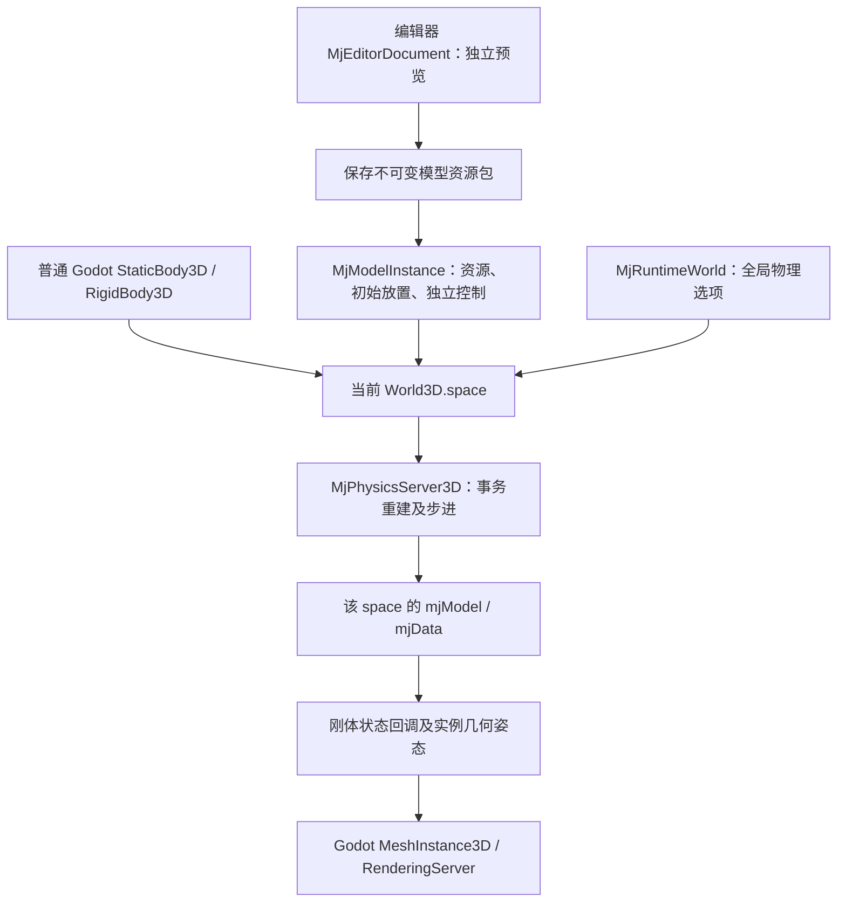

# Godot × MuJoCo：文件结构与通信架构

> 核对日期：2026-10-18。当前实现基线：[`c568aec`](https://github.com/zdYukino/godot-mujoco/tree/c568aec065dc5e3eb2c9fe62d2f9edc0333b8089)，开发分支 `codex/portable-model-runtime`。本文区分当前实现、云端已验证范围与历史记录；dot 对该提交的独立验收正在进行，不能据此视为已经合入 main。

Godot 负责场景、脚本、输入、界面与渲染，MuJoCo 负责物理模型和求解。两者在**同一个 Godot 进程**内通过 GDExtension 原生调用通信，没有 Python 服务、Socket、HTTP 或跨进程桥接。当前有三个不同的模型所有权边界，不能把早期 `MjWorld` 的限制套用到整个项目：

| 层 | 所有者与用途 | 与 Godot 原生刚体的关系 |
| --- | --- | --- |
| 独立 `MjWorld` API | 每个 Node 自有 `mjModel` / `mjData`，供显式加载、步进、控制和查询 | 不自动接入 Godot PhysicsServer3D space，不自动与普通刚体互相碰撞 |
| 原生 MuJoCo 后端 | `MjPhysicsServer3D` 派生自 `PhysicsServer3DExtension`；每个 space 管理自己的物理世界与 RID 生命周期 | 在项目设置选择 MuJoCo 并重启后，受支持的普通 Godot 物理体由此后端求解 |
| 编辑器模型文档 | 每个 `MjEditorDocument` 自有 spec、model、data；插件管理编辑、预览、撤销和保存 | 预览独立于运行时 space；预览步进不会推进运行场景或其他文档 |

可移植运行时节点 `MjRuntimeWorld` / `MjModelInstance` 构建在**第二层**之上，不另开一个 `MjWorld` 求解器。模型实例和普通 `StaticBody3D` / `RigidBody3D` 可处于同一个 `World3D.space`，一起进入同一个原生 MuJoCo 模型，产生真实接触。

## 1. 固定版本、引擎与构建边界

当前 Linux 开发和验收固定为：

- **Godot 4.7.2 .NET**：实际发行标识 `4.7.2.stable.mono.official.ed1daf0bf`。
- **MuJoCo 3.16.0**：CMake 默认版本、编译依赖和运行库均按此版本核验。早期提交标题中的 `3.1.6` 是笔误，不是依赖版本。
- **.NET SDK 8**：本轮环境实际为 `8.0.426`；SDK 与 .NET 运行时版本不是同一个编号。
- **Linux x86_64**：本轮不做 Windows 适配；仓库存在其他平台构建配置不等于这些平台已经验收。

Godot 是安装的官方发行包，不是本仓库编译的引擎。`godot-cpp` 是 GDExtension C++ 绑定，**不是 Godot 引擎源码**。[CMake](CMakeLists.txt) 固定绑定标签 `godot-4.5-stable`，扩展清单最低兼容版本为 `4.5`；它们与实际验收引擎 4.7.2 是三个不同概念，不能外推所有版本都兼容。

本环境的工具入口为 `/workspace/shared/tools/env.sh` 和 `/workspace/shared/tools/bin/godot`。这些是机器环境路径，不属于项目依赖路径；搬迁项目不应依赖这些绝对路径。

Linux 默认构建流：

1. CMake 获取绑定及带 SHA-256 校验的 MuJoCo **3.16.0** 官方预编译包。
2. 编译独立 API、编辑器文档和原生物理后端，共同链接 godot-cpp、MuJoCo。
3. 将扩展 `libgodot_mujoco.linux.template_debug.x86_64.so` 和 `libmujoco.so.3.16.0` 等运行库放入 `demo/addons/godot_mujoco/bin/`。
4. Linux 扩展通过 `$ORIGIN` RUNPATH 解析同目录运行库。实际链接验证见[Linux 基线](docs/headless-baseline.md)。

原生库、构建树及 `.godot` 缓存被忽略；只克隆源码需要先构建。源码构建选项及移动平台配置仍保留，但不是本轮跨平台质量保证。

## 2. 当前文件结构与职责

```text
godot-mujoco/
├── CMakeLists.txt
├── src/
│   ├── register_types.{h,cpp}       # SERVERS 注册后端；SCENE 注册独立 API / 文档
│   ├── mj_world.{h,cpp}             # 独立 MjWorld API
│   ├── mj_editor_document.{h,cpp}   # 隔离编辑文档、事务编辑、快照和资源解析
│   └── physics/
│       ├── mj_physics_server.*     # space / RID、原生体、重建与步进
│       ├── mj_scene.cpp            # 动态实例事务、状态与几何查询
│       ├── mj_runtime_model.cpp    # 可移植模型配置、组合、控制和释放
│       ├── mj_g1_import.h          # 原始 G1 的显式运行时适配
│       ├── mj_options.h            # 完整 mjOption 比较与导出
│       └── mj_assets.h             # 通过 C API / XML 处理资源路径
├── demo/
│   ├── addons/godot_mujoco/
│   │   ├── godot_mujoco.gdextension
│   │   ├── model/                 # 资源打包、运行时 world / instance、场景和可视化
│   │   └── bin/                   # 构建产物，不提交
│   ├── addons/mujoco_editor/       # 编辑器主工作区、属性表单、预览和历史管理
│   ├── assets/robots/unitree_g1/   # 原始资产、来源清单及明确区分的派生测试文件
│   ├── models/                    # 早期独立 MjWorld 演示模型
│   └── *Test.tscn                 # MjWorld 回归场景
├── tests/
│   ├── native_backend/            # 原生后端验收
│   ├── dynamic_scene/             # 动态 G1 / 障碍物场景验收
│   ├── editor_plugin/             # 插件、实际按钮信号和恢复回归
│   ├── portable_runtime/          # 打包、搬迁、共享 space、编辑器到运行时、C#
│   └── g1_actuation/              # C++ / GDScript / C# 关节驱动回归
├── scripts/import_headless.sh     # 固定引擎版本下的冷导入流程
└── docs/                         # 各阶段契约、证据与局限
```

仓库已有 C# 验收项目，例如 `tests/g1_actuation/G1ActuationTests.csproj` 和 `tests/portable_runtime/PortableRuntime.csproj`。扩展没有完整类型化 C# 包装层；测试通过 `ClassDB.Instantiate` / `Call` 或运行时节点的 `Call` 访问接口。不能再写成“没有 C# 项目或只有仓库外临时 smoke”。

## 3. 注册、共享 space 与运行时数据流

[扩展入口](src/register_types.cpp) 在 `MODULE_INITIALIZATION_LEVEL_SERVERS` 将名为 **MuJoCo** 的后端工厂注册到 `PhysicsServer3DManager`。后端及 direct-state 类由服务器创建，注册为抽象类，不能用无所属 space 的裸对象代替。`MODULE_INITIALIZATION_LEVEL_SCENE` 注册 `MjWorld`、`MjEditorDocument` 并安装 MuJoCo 日志处理器。

用户需在项目设置中选择 **Physics → 3D → Physics Engine → MuJoCo** 并重启。仅放入插件或创建一个 `MjWorld` 节点，不会自动选择该后端。



- **space 所有权**：各 space 独立；模型实例 RID 是模型句柄，不等于普通 Body RID，也不把每个 URDF link 变成一个 Godot PhysicsBody3D。
- **模型实例**：原生名字加独立前缀，初始关节、控制与激活状态独立。组合保留多自由根及世界几何；编译后检查关节、几何、驱动、等式约束、腱和传感器数量，拒绝丢失元素的组合。这不等于完整 Godot 关节兼容。
- **事务边界**：拓扑加载/替换在暂停且非物理回调期间进行。候选编译成功才替换现有模型；失败保留现有状态。兼容的命名状态在插入/删除后保留，不能缓存 MuJoCo 数组索引。回调中的模型释放延迟到回调清理结束。
- **全局选项**：同一 World3D 只允许一个 `MjRuntimeWorld` 所有者；其 `world_model` 决定完整 `mjOption`。实例的重力、时间步、求解器等任何选项不一致都会被拒绝，并报告字段名。普通 Godot 默认 area 的重力设置不能覆盖该配置。
- **命令与状态**：GDScript 或 C# 调用实例 `set_control` / `state`；MuJoCo 求解结果通过原生体状态同步和模型几何姿态更新 Godot 可视节点。返回值是 Godot 数组、字典及数学类型，不向脚本公开可并发写入的 MuJoCo 裸指针。
- **显示**：使用 Godot 网格与渲染服务，不调用 MuJoCo `mjr_*`。目前显示网格/基本形状及平面颜色，不承诺纹理材质渲染完全一致。

## 4. 编辑器预览与可移植资源

插件通过 `MjEditorDocument` 预览、编辑、撤销/重做；每个文档有独立的原生模型/状态。预览状态不共享给运行实例，资源快照也不会被预览直接修改。属性编辑经事务编译后生效，未应用的字段与已提交模型明确区分。

**Save project model** 创建项目内不可变包：

- `model.tres`：`MjModelResource`，保存模型快照、初始状态、依赖哈希和来源信息。
- `model.xml`：展开 include 的规范 MJCF；运行时依赖采用相对路径。
- `assets/<sha256>.<扩展名>`：按内容保存的依赖，包含已测试的六面立方体纹理文件。
- `sources/<sha256>.xml`：原始来源文件归档；搬迁后再编辑保存仍保留原文。

先在临时目录复制、校验、编译，再原子发布。相同内容去重，同名不同内容使用不同包；缺失或损坏依赖明确报错，不能覆盖已有发布结果。来源中的旧绝对路径仅作记录，不参与运行时依赖解析。旧 `.gmj.json` 仍可打开，但必须显式 **Save project model** 才完成迁移。

**Create runtime scene** 将明确保存的资源版本写入 `.tscn`，生成 `MjRuntimeWorld` 与 `MjModelInstance`。随后可在普通 Godot 场景里添加其他实例、地板和刚体。保存新资源版本不会自动更新所有旧场景引用；已加载实例要在安全边界卸载、换资源、重载。节点变换是初始放置，不是每帧强制指定物理姿态。

当前可移植契约针对**文件系统项目**：复制完整项目及所需运行库即可，原始外部模型路径不必存在。PCK/ZIP 内无文件系统路径的资源加载/导出仍未验收，不能由 `MjWorld` 的 VFS 路径支持推导出 portable runtime 已支持 PCK。

完整流程和 GDScript/C# 示例见[可移植模型与运行场景](docs/portable-models.md)。

## 5. 坐标、时间与 G1 的不同测试边界

原生后端在 Godot 与 MuJoCo 之间使用保持右手性的坐标基变换：

```text
Godot → MuJoCo: (x, y, z) → (x, -z, y)
MuJoCo → Godot: (x, y, z) → (x, z, -y)
```

后端转换位置、基、几何及查询数据。**独立 `MjWorld` API** 的原始坐标返回约定仍需由调用者处理：其四元数分量重排不能代替整体坐标基转换。对两端局部/世界坐标基均变换的姿态，使用 `R_g = C R_m C^-1`，位置使用 `p_g = C p_m`。

时间调度也必须分层理解：

- `MjWorld` 自动模式每次固定推进 `steps_per_tick`，不自动匹配 `delta`；手动和自动步进叠加会多推进。
- 早期动态实例空间使用后端子步及 `implicitfast`，详见[动态世界阶段契约](docs/dynamic-world.md)。该文记录的是当时的接口范围，不是 portable runtime 的全部能力清单。
- 当前 `MjRuntimeWorld` 使用余量累计器，以所保存的 MuJoCo 时间步消费 Godot 的物理帧时间；最小接受步长为 0.0001 秒。不能再概括为“整个项目没有 delta 累计器”。

运行时增删、场景树和渲染操作遵循主线程/回调边界；一个 model/data 不可由多个线程同时读写或步进。MuJoCo 日志处理器仍是进程级。

Unitree `g1_29dof_mode_18` 的 **36 个原始文件保持字节不变**。需要区分两类验收：

1. `tests/g1_actuation`：固定基座、无重力、无接触的独立关节驱动回归。
2. 动态及 portable 场景：原始 G1 的显式适配，保留固定基座、添加受限位置驱动及机器人重力补偿，配置碰撞掩码；世界重力及与普通障碍物的接触仍启用。编辑质量、驱动等发生在派生文档/spec 中，不重写原始资产。

两者都**不是步行验收**，也不是通用 URDF 导入器或步行策略。

## 6. 已验证范围与仍有限制（2026-10-18）

以下为 `c568aec` 的云端 Linux 证据；完整命令、退出码、日志和二进制哈希见[验收记录](docs/portable-model-runtime-validation.md)。本次文档修正不重新构建或宣称产生新的功能验收结果。

| 范围 | 已有验证 |
| --- | --- |
| 固定版本构建与原生后端 | 构建退出 0；207 项后端检查通过，覆盖 space/RID、受支持的静态/刚体、box/sphere/plane、重力接触、状态同步、射线及图层/排除 |
| 动态场景 | 86 项检查及 UI 冒烟通过 |
| 编辑器插件 | 116 项检查通过；真实渲染旧套件为 119 项（含 3 张截图） |
| 资源与 portable runtime | 打包/冲突/回滚/来源与六面纹理搬迁通过；搬迁前后各 30 项运行时检查通过 |
| 编辑器 → 保存 → 重启运行 | 9 项编辑器流程检查、C# 控制与真实运动、独立进程重新运行生成场景通过；真实渲染新流程 11 项通过 |
| 既有回归 | MjWorld 三个场景及 G1 C++ / GDScript / C# 回归通过；原始 36 文件 SHA-256 和 Git blob 哈希一致 |

`HeadlessTest` 的错误 qpos 长度日志是预期负向测试，不是整体失败。云端有真实 OpenGL 渲染证据，但不是 dot 独立 GUI 最终验收的替代品；**dot 对 c568aec 的验收仍在进行**。

仍有限制：CharacterBody3D、Area3D、完整 Godot 关节兼容尚未完成；导入模型的网格不因此获得完整原生射线查询支持。Portable 组合明确拒绝全局 userdata、mocap 和 keyframes；不承诺任意 MJCF 插件、全部求解器内部状态序列化或所有高级模型组合均兼容。PCK 导出、纹理视觉一致性、其他操作系统/移动端、本轮 release 构建、长期稳定性与性能没有由上述结果完成验收。

**2026-10-18 独立验收补充**：dot 在带帧延迟的首次 headless 导入中仍出现 139。云端随后通过 GDB/watchpoint 复现并定位到 Godot 清空文档对象后仍执行延迟文档生成的退出时序问题；固定版本引擎尚未修复，首次导入稳定性仍是验收阻碍。失败重入和 manifest 完整性缺陷已另行修复并补充回归，详见[独立验收修复记录](docs/portable-edge-fixes.md)。不要用此前通过次数或 GUI 导入成功覆盖这些首次失败。

## 7. 历史记录与阅读入口

- **2026-10-16，e8b6443 阶段**：原文以独立 `MjWorld` 为主，记录 MuJoCo 3.12.0、仓库外 C# smoke 及两次编辑器导入 139。它们是旧基线事实，不是当前依赖或全项目能力描述。
- **2026-10-17，3.16.0 基线复核**：裸 `--headless --editor --import` 的快速退出仍出现过 139；使用 [`scripts/import_headless.sh`](scripts/import_headless.sh) 的固定版本/帧延迟流程完成多次独立冷导入。详见[历史导入记录](docs/headless-baseline.md)，不能把规避流程等同于已证明所有裸导入方式都无竞态。
- **2026-10-18，原生后端至 portable 阶段**：增加原生共享 space、隔离编辑器和可移植资源运行时。开发中的 ABI、惯量编辑、延迟释放和截图等待问题及修复证据保留在[阶段记录](docs/portable-model-runtime-validation.md)，不列作当前未解决故障。

旧 SVG：[Godot 本体](ARCHITECTURE-godot.svg)、[文件结构](ARCHITECTURE-files.svg)、[通信流](ARCHITECTURE-runtime.svg) **仅保留为 2026-10-16 历史图**。其中版本和“MuJoCo 不替换 PhysicsServer”等文字不适用于当前后端；当前分层以本文表格和流程图为准。

当前源码入口：

- [注册与日志](src/register_types.cpp)、[独立 MjWorld](src/mj_world.h)
- [原生后端](src/physics/mj_physics_server.h)、[资源运行时组合](src/physics/mj_runtime_model.cpp)
- [编辑器文档](src/mj_editor_document.h)、[插件界面](demo/addons/mujoco_editor/panel.gd)
- [资源和运行时节点](demo/addons/godot_mujoco/model/)、[使用与限制](docs/portable-models.md)
