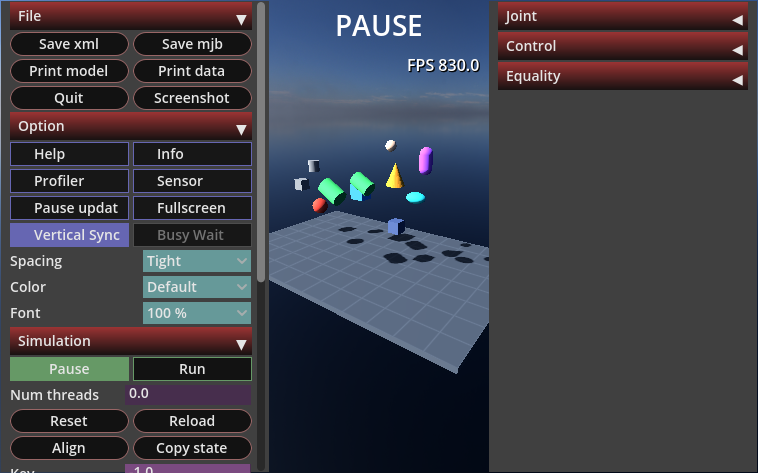
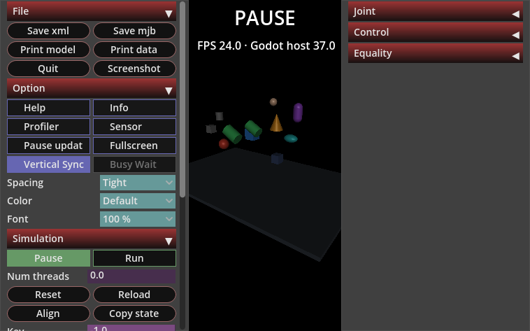
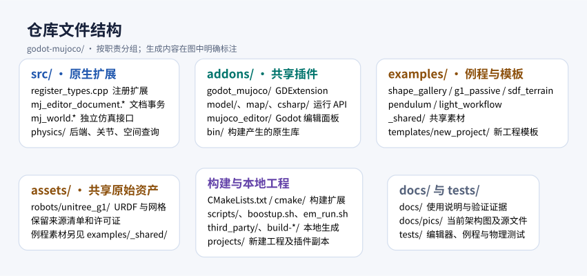
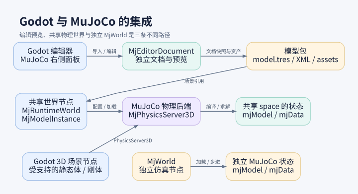
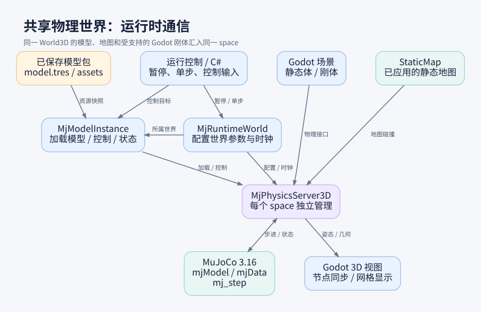

# godot-mujoco

Import, edit and run MuJoCo models in Godot, with static maps and supported Godot bodies in the same physics world.

[中文](README.md) · [Example catalog](examples/README.md) · [Installation and troubleshooting (Chinese)](docs/linux-install.zh-CN.md) · [Documentation index](docs/README.zh-CN.md)

## Quick start

The current baseline is Linux x86_64, Godot 4.7.2 .NET, MuJoCo 3.16.0 and .NET SDK 8.0.426. Source checkouts do not contain compiled native libraries; run the setup wizard before first use.

```bash
./boostup.sh                      # Check the environment, install or import tools, and build the addon
./boostup.sh --check              # Inspect existing tools
./boostup.sh --rebuild            # Rebuild with installed tools
./boostup.sh --configure          # Choose tool sources again or reinstall
./em_run.sh                       # Open the Godot project manager
./em_run.sh --exp                 # Choose an example
./em_run.sh --exp shape_gallery   # Open a specific example
./em_run.sh --new my-project      # Create and open a local project
```

The wizard can download or import Godot Mono and .NET. On Ubuntu 22.04/24.04 it can install missing system dependencies after confirmation; other Linux distributions require those dependencies to be prepared manually. See the [installation guide](docs/linux-install.zh-CN.md).

## Repository layout

```text
godot-mujoco/
├── src/          # Native extension source
├── addons/       # Runtime and editor addons
├── assets/       # Shared assets
├── examples/     # Examples and project template
├── projects/     # Locally created projects (generated, Git-ignored)
├── scripts/      # Setup, build and launch scripts
├── tests/        # Tests and acceptance checks
├── docs/         # Documentation and architecture diagrams
└── third_party/  # Local tools and environment (generated, Git-ignored)
```

<details>
<summary>Detailed repository layout</summary>

`[generated, ignored]` denotes local output absent from a fresh clone; `[optional]` appears only when needed.

```text
godot-mujoco/
├── README.md / README.en.md       # Chinese and English entry documentation
├── boostup.sh                     # Install, configure, check and build wizard
├── em_run.sh                      # Launch Godot, an example or a new project
├── CMakeLists.txt                 # Native build, dependency pins and addon staging
├── global.json                    # Pinned .NET SDK selection
├── .gitignore / .gitattributes    # Git ignore and file attribute rules
├── .github/workflows/             # CI builds, acceptance and upstream version checks
├── .vscode/                       # [generated, ignored] Local VS Code settings and index
├── src/                           # C/C++ GDExtension source
│   ├── register_types.*           # GDExtension type registration
│   ├── mj_world.*                 # Independent MjWorld simulation interface
│   ├── mj_editor_document.*       # MJCF documents and editing transactions
│   └── physics/                   # MuJoCo backend, bodies, joints and spatial queries
├── cmake/                         # Build helpers, symbol export map and mobile patches
├── scripts/                       # Setup, launch, build and validation implementation
│   ├── bootstrap.py               # Download/import tools, configure and build
│   ├── local_tools.py             # Tool paths, version checks and local state
│   ├── em_run.py                  # --exp / --new implementation
│   ├── setup.sh / setup.py        # Lower-level check / build / smoke interface
│   ├── ci/toolchain.json          # Pinned versions, official URLs and checksums
│   ├── ci/install_godot.py        # Verified Godot download and extraction
│   └── build_*.sh / verify_*.sh    # Android / iOS builds and binary checks
├── addons/                        # Canonical plugin source and staged libraries
│   ├── godot_mujoco/             # GDExtension config, runtime scripts and C# API
│   │   └── bin/                  # [generated, ignored] Native/MuJoCo libraries; .gitkeep retained
│   └── mujoco_editor/            # MuJoCo editor plugin source
├── assets/                       # Shared original assets maintained with source
│   └── robots/unitree_g1/        # Original G1 URDF, meshes, provenance and license
├── examples/                      # Example source and required assets
│   ├── _shared/                  # Shared sky, floor shader and UI script; no project.godot
│   ├── shape_gallery/            # Falling shapes and collisions
│   ├── g1_passive/               # Uncontrolled G1 robot
│   ├── sdf_terrain/              # SDF stairs, depression and rough terrain
│   ├── pendulum/                 # Shared-backend pendulums and independent API diagnostics
│   ├── light_workflow/           # C# control and terrain developer example
│   ├── templates/new_project/   # --new template: project.godot, Main.tscn, README, .gitignore
│   └── <each of the five ready examples>/
│       ├── addons -> ../../addons  # [generated, ignored] Shared addon link from setup
│       ├── .godot/               # [generated, ignored] Cache created on opening
│       └── bin/ / obj/           # [optional, generated, ignored] .NET build output
├── third_party/                  # [generated, ignored] Local tools and environment
│   ├── godot/                    # Complete Godot Mono engine and GodotSharp/
│   ├── dotnet/                   # .NET SDK: dotnet, sdk/, shared/, etc.
│   ├── cmake/                    # [optional] Installed when system CMake is too old
│   ├── cache/                    # [optional] Downloaded tool archives
│   ├── environment.json          # Relative tool paths, versions and build status
│   ├── environment.sh            # Environment variables for terminal use
│   └── .boostup.lock             # Prevents concurrent setup processes
├── build-linux/                  # [generated, ignored] Default build; --build-dir overrides it
│   ├── CMakeCache.txt / CMakeFiles/ # CMake configuration and intermediate files
│   ├── _deps/                    # godot-cpp / MuJoCo dependencies and sub-builds, depending on SDK mode
│   └── libgodot_mujoco*.so        # Linux extension, staged into shared addon bin/
├── projects/                     # [generated, ignored] User projects created by --new
│   └── <project-name>/
│       ├── project.godot / Main.tscn # New project and flat-ground falling-ball scene
│       ├── addons/               # Complete addon/library copies, independently movable
│       ├── global.json / README.md / .gitignore
│       └── .godot/               # [optional] Import cache created on opening
├── tests/                        # Setup, examples, physics backend and editor acceptance
│   ├── setup/                    # Isolated bootstrap and launcher tests
│   ├── example_projects/         # Acceptance for five examples and the project template
│   └── native_*/ / spatial_queries/ / …
├── docs/                         # Installation, features, known issues and validation evidence
│   └── pics/                     # Architecture diagrams and their sources
├── ARCHITECTURE.zh-CN.md         # Architecture documentation and history
└── LICENSE                       # Project license
```

</details>

## Run an example

After the one-time [addon build](docs/linux-install.zh-CN.md), run `./em_run.sh --exp` to choose an example. Alternatively, import its `project.godot` in the Godot project manager, wait for resource import and press F5.

| Example | Project file | Main scene |
|---|---|---|
| [Shape gallery](examples/shape_gallery/README.md) | `examples/shape_gallery/project.godot` | `Main.tscn` |
| [Passive G1](examples/g1_passive/README.md) | `examples/g1_passive/project.godot` | `G1.tscn` |
| [SDF terrain](examples/sdf_terrain/README.md) | `examples/sdf_terrain/project.godot` | `Main.tscn` |
| [Editable pendulums](examples/pendulum/README.md) | `examples/pendulum/project.godot` | `Main.tscn` |
| [Light C# workflow](examples/light_workflow/README.zh-CN.md) | `examples/light_workflow/project.godot` | `Main.tscn` |

Keep the repository layout intact so examples can use shared addons and assets. All five visual examples use the shared MuJoCo backend and persistent author nodes. The light C# example needs an ordinary .NET build. Independent MjWorld remains available for API and diagnostic tests. G1 has no standing or walking controller and is expected to fall; multi-robot hot-add has [known limitations](examples/g1_passive/README.md).

## Choose the F5 renderer

Use **F5 渲染** at the top of the **right-hand MuJoCo dock** to select **Godot** or **MuJoCo 原生**. The **MuJoCo 显示** menu in the 3D viewport offers the same choices. The choice is saved in the current `project.godot` and applies to the next F5 run; stop and restart an existing game. The editing viewport continues to use Godot. The runtime window (F11) reports the actual renderer. A failed native start keeps the Godot picture and displays the fallback reason.

`shape_gallery` selects native MuJoCo initially. Without a built bridge it falls back to Godot; you can also explicitly select Godot in the toolbar. Other projects without a choice retain their scene defaults.

G1 exceeds the default 64 MiB native model transport limit. To display it natively, explicitly set `rendering/mujoco_native_view/max_model_mib` to 192. The default limit falls back to Godot while retaining shared interaction.

Build native-view support once before selecting it. Close the editor, install the OpenGL and X11 development libraries (Ubuntu: `sudo apt install libgl-dev libx11-dev`), then run from the repository root:

```bash
cmake -S . -B build-linux -DGMJ_NATIVE_VIEW_EXPERIMENTAL=ON
cmake --build build-linux --parallel 2
./em_run.sh --exp shape_gallery
```

Reopen the editor to load the new extensions. The native option is disabled, with a reason in its tooltip, if the bridge is missing, the session is not X11, the renderer is not Compatibility, or physics uses a separate thread. The project setting is `rendering/mujoco_native_view/renderer`: `0` selects Godot and `1` selects MuJoCo. An absent setting retains the previous scene default. An explicit project choice overrides the old per-scene experimental flags.

Both renderers use **the same MuJoCo physics world**. Changing the renderer does not change collision algorithms, simulation timestep or physical accuracy.

| Aspect | Godot rendering | Native MuJoCo rendering |
|---|---|---|
| Image generation | Convert models to Godot meshes and draw with Godot | Draw with MuJoCo `mjv` / `mjr`, then display the GPU texture in Godot |
| Strengths | Godot materials, HDR environments, grid shaders, lighting and custom shaders; useful for game and scene presentation | MuJoCo's model appearance and less model-node pose synchronization; useful for inspecting MuJoCo visual geometry |
| Appearance | Authored Godot materials and lighting | MuJoCo materials and lighting; Godot skies, grid shaders and custom 3D effects are excluded. Camera and interaction state are shared |
| Interaction | Shared MuJoCo camera, selection, tracking and perturbation | The same controller uses official `mjv_*` APIs and changes authoritative simulation data |
| Simulation controls / UI | Tab / Shift+Tab original sidebars, F1–F4 original overlays; F11 Godot extras only | The same panels and shortcuts; simulate adapted to Godot controls, with independent F2 Info and Godot performance |
| Diagnostics | Official camera/diagnostic primitives adapted to Godot; unsupported surface effects disabled explicitly | Draw the authoritative CPU scene, including actual contact diagnostics, within rigid-model/resource limits |
| Performance | Node synchronization and Godot drawing costs | Revisioned model snapshots, shared CPU scene generation, GLX context switching and GPU synchronization costs; **faster rendering is not guaranteed** and must be measured per scene |
| Support | Standard display path, following existing addon platform support | Experimental: Linux x86_64, X11, OpenGL, one main runtime window and main-thread physics; model and memory budgets apply |

Normal GPU texture composition uses the pinned official Godot build. The editor switch does not enable direct-to-screen presentation; that remains a separate [custom-engine experiment](docs/development/native-view-r17/README.md). Device-failure recovery, platform/model support and resource admission remain limited; see the [native-view notes](addons/godot_mujoco/native_view/README.md).

Actual F5 captures of the same `shape_gallery` in its initial paused state. Interaction and initial camera are shared; materials and lighting differ. These are not performance measurements:

| Godot | Native MuJoCo |
|---|---|
| [](docs/pics/f5-renderer-godot.png) | [](docs/pics/f5-renderer-native.png) |

## Shared runtime interaction and performance

Both renderers use the MuJoCo 3.16 camera, picking and perturbation APIs and the original simulate panel organization. **Tab / Shift+Tab** toggle the left / right native-style panels; Alt+section letter folds the corresponding group. **F1/F2/F3/F4** independently toggle Help / MuJoCo Info / Profiler / Sensors overlays. **F11** opens only the movable, resizable **Godot extras** window: renderer choice, FPS/system metrics, example extensions and additional tools. Visibility changes do not pause simulation. Editor input stays unchanged.

- Left/right/middle drag orbit/pan/zoom; wheel zooms, Shift changes direction, Alt swaps mouse buttons. Double-click selects, PageUp selects the parent, right double-click centers, Ctrl+right double-click tracks.
- Ctrl+left/right drag rotate/translate a perturbation. Running applies forces; paused editing follows MuJoCo free-joint/mocap semantics. Release, focus loss and opening a panel cancel perturbation.
- Space runs/pauses; arrows browse history or take one new step; `-`/`=` select official 0.1–100% speed tiers. `[`/`]` cycle fixed cameras, Esc selects free camera; F6/F7 cycle frames/labels. Backtick retains Body Tree. Within F11, Tab/Shift+Tab move control focus; text editing has priority.
- Backspace resets the design initial state at time zero. Capture/Restore Snapshot are separate. Ctrl+L transactionally reloads the last saved design; failure preserves the current world. Legacy `reset_simulation()` keeps checkpoint semantics; new APIs include `reset_initial()` and `restore_snapshot()`.
- Ctrl+C / Ctrl+Shift+C copy state; Ctrl+M/D/P write model/data/composed screenshots into timestamped `user://mujoco_viewer/` folders by default; Ctrl+Q quits the game. F5 fullscreen works standalone; embedded GameView explains its editor-managed limitation. F8–F10 remain Godot debugger controls.

The Godot performance overlay initially shows **FPS only**, controlled independently by F11 → Performance. **F2 controls MuJoCo Info only**; neither switch changes the other. Every performance metric, including FPS, can be disabled. Optional CPU/RAM/GPU/VRAM use **whole-system/card** counters, with a verified render-device match. Missing counters are disabled with a reason. CPU/GPU milliseconds are labeled separately from utilization; native update FPS is separate from Godot host FPS. Info refreshes at 5 Hz, OS counters at 1 Hz. Personal preferences live under each project's `user://`.

File includes XML/MJB saves and model/data text exports. Simulation includes keyframes, control noise, solver workers and history scrubbing. Keyframe controls follow model capabilities: the existing shared-world composer still rejects source models containing keyframes, with an explicit UI reason. Physics design settings stay read-only; Busy Wait is disabled because Godot owns the host scheduler. Godot controls adapt the pinned simulate definitions; native 3D rendering still uses `mjr_render`. All examples, templates and generated playgrounds install the viewer automatically. Example-specific controls live in F11 → Examples; exact N-step and manual snapshot tools live in F11 → Tools. See the [runtime viewer contract](addons/godot_mujoco/viewer/README.md) for capabilities, C# APIs, budgets and validation.

The [validation record](docs/development/runtime-viewer-validation-2026-10-30.json) includes both renderers, the native-GL-disabled build, F5, examples and reload checks, plus p50/p95 frame times and memory samples with the overlay off, FPS only, all metrics and analysis charts. These capped fixture measurements do not establish which renderer is faster. The subsequent panel/F11 separation has its own [control comparison](docs/development/mujoco-simulate-ui-parity.md) and [validation record](docs/development/runtime-panels-validation-2026-10-30.json).

## Import and run a model

1. Open a saved 3D scene. In the right **MuJoCo → MJCF 层级模型** panel choose **载入 MJCF**.
2. Import creates persistent body / geom / joint scene nodes. Edit typed Inspector fields and native Gizmos; Ctrl+D duplicates, and native Undo/Redo and Ctrl+S apply.
3. The isolated compiler is cancellable and has a configurable 120-second timeout. Incomplete designs can be saved; F5 requires validation of the current model.
4. Editing the local author scene during F5 pauses actual physics, compiles the combined world and commits atomically. Resume manually after success. Add/remove models and edit terrain in the editor. Runtime actions change simulation state without writing back design.

MJCF import accepts XML only. Legacy model packages and upgrade paths have been removed. See the [node authoring guide (Chinese)](docs/node-authoring.zh-CN.md).

## Import a map and configure collisions

1. Create and save a 3D scene with a **Node3D** root.
2. In the **MuJoCo** dock select **静态地图草稿**. Under **导入 / 独立包**, browse to a `.glb`, `.gltf`, `.obj` or `.stl` file.
3. Select the source units and up axis, then click **导入（保留脏数据）**.
4. Select each mesh in the map tree, choose a collision representation and click **验证并应用碰撞草稿**. Use **聚焦全图** and the viewport's **MuJoCo 显示** menu to inspect it.
5. Click **保存独立地图包**, then **Apply 到编辑场景**; save and run the host scene. Apply, save and rerun after changing collisions.

Reopen a saved map package using **打开地图包** and its `manifest.json`. See the [SDF terrain example’s map workflow (Chinese)](examples/sdf_terrain/README.md).

## Save and reopen

| Content | Save / open action |
|---|---|
| Author hierarchy and parameters | Ctrl+S saves `.tscn`; project dependencies live under `mujoco_models/` |
| Collision settings | Per-geom hull/SDF settings and six world-wide collision controls; see [details (Chinese)](docs/geom-collision.zh-CN.md) |
| Static map | **保存独立地图包 / 打开地图包**: `manifest.json`; keep the entire package |
| Scene layout | Godot **Save Scene**: `.tscn` |

## Architecture diagrams

### Repository layout: source, addons, examples and local projects

[](docs/pics/ARCHITECTURE-files.svg)

### Godot integration: editor preview, shared backend and independent MjWorld

[](docs/pics/ARCHITECTURE-godot.svg)

### Runtime communication: models, maps, bodies and the physics world

[](docs/pics/ARCHITECTURE-runtime.svg)

## Limits and further reading

Cold-import exit 139 and heavy G1/multi-G1 operation have known issues; see [known issues (Chinese)](docs/known-issues.zh-CN.md) and the [G1 limits](examples/g1_passive/README.md). SDF continuous sweeps still have unresolved exact-contact and grazing cases; callers must check query status and must not treat uncertified results as collision-free. The default 0.5 mm total spatial error budget applies to the compiled SDF; public sweeps do not establish dynamic-body CCD. See the [spatial query matrix](docs/development/spatial-query-matrix.md).

[Editor guide](docs/mjcf-editor.md) · [Heightfields](docs/static-heightfield.md) · [Typed control API](docs/typed-control.md) · [Runtime edits](docs/runtime-safe-editing.md) · [GUI workflow audit (Chinese)](docs/gui-workflow-audit.zh-CN.md)

Licensed under [MIT](LICENSE). See [third-party notices](addons/godot_mujoco/THIRD_PARTY.md); Unitree assets retain their original licenses and provenance.
