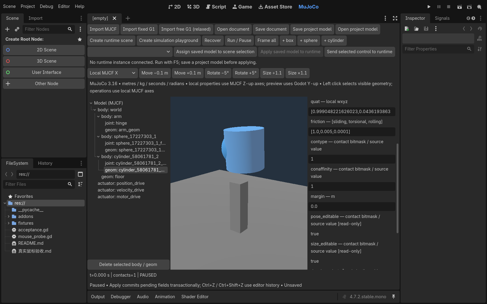
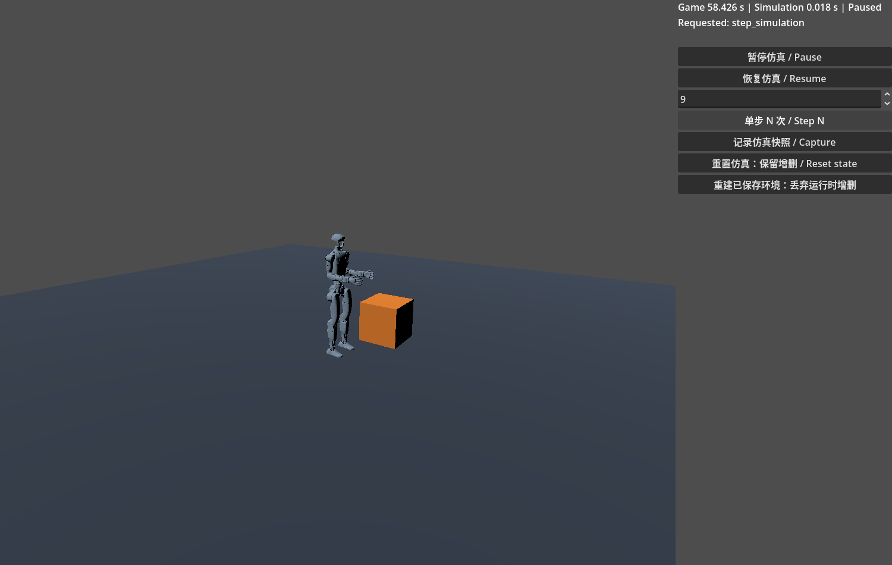

# godot-mujoco

在 Godot 中导入、编辑和运行 MuJoCo 模型。项目由 C++ GDExtension、MuJoCo 编辑器插件和场景运行组件组成：既可以编辑 MJCF，也可以把保存的模型放入 Godot 场景，与受支持的普通刚体共享物理空间。

[English](README.en.md) · [安装详解](docs/linux-install.zh-CN.md) · [中文文档](docs/README.zh-CN.md) · [开发基线](docs/linux-development-baseline-20261022.zh-CN.md)



*仓库现有真实编辑器截图，展示球、圆柱与属性编辑；截图中的夹具和生成文件不是安装所需内容。*

## 功能与支持范围

- **MJCF 编辑**：body/joint/geom/actuator 树、视口选择、移动/旋转/尺寸操作、质量与惯量、关节限位/阻尼/摩擦、适用的位置 PD 参数，以及撤销/重做。
- **模型资源与场景**：保存包含依赖资产的模型包，使用 `MjRuntimeWorld` 和 `MjModelInstance` 组织独立实例；支持整个文件系统项目搬迁。
- **运行编辑**：明确选择运行实例并应用保存的设计；结构修改在物理步边界编译、迁移兼容状态，失败回滚。
- **仿真控制**：每个世界独立暂停、精确 N 步、内存快照、状态重置和已保存环境重建；游戏 UI 与输入继续运行。
- **原生物理后端**：支持普通 Godot 刚体的 box/sphere/plane/cylinder、ray 和[第一阶段原生 overlap 查询](docs/native-overlap-stage1.zh-CN.md)。并非完整替代 Godot 的全部物理节点及 API。

| 项目 | 当前要求 |
|---|---|
| 操作系统 | Linux x86_64；Windows 尚未适配本开发基线，其他平台不在支持范围 |
| Godot | **4.7.2 .NET 官方版**（`ed1daf0bf`） |
| MuJoCo | **3.16.0**，构建时取得对应运行库 |
| 编译工具 | Git、Python 3、CMake ≥ 3.24、C/C++17 工具链及 Make 或 Ninja |
| C# | .NET SDK 8；不使用 C# 的 GDScript 示例无需编译 C# 项目 |

Ubuntu 22.04 是用户目标环境；当前独立图形验收使用 Debian 环境及工作区 Mesa 配置，**不等于 Ubuntu 22.04 已完成同等验收**。请在目标机核对 CMake 版本、动态库依赖及图形驱动。构建文件中的其他平台分支、`.gdextension` 中的最低兼容版本和 godot-cpp 的 `godot-4.5-stable` API 目标，都不扩大上述支持范围。

## 安装

截至 2026-10-18，仓库 [GitHub Releases](https://github.com/zdYukino/godot-mujoco/releases) 没有已发布预编译包。以下采用源码构建和本地插件复制流程，不依赖 AssetLib 或一键安装。

### 1. 构建并打开示例项目

首次配置会联网获取 godot-cpp 和固定版本 MuJoCo；默认使用 MuJoCo 官方预编译运行库，并编译本项目扩展。

```bash
git clone https://github.com/zdYukino/godot-mujoco.git
cd godot-mujoco
cmake --version                    # 必须 >= 3.24
cmake -S . -B build -DMUJOCO_VERSION=3.16.0
cmake --build build -j2

export GODOT_BIN="/absolute/path/to/Godot_v4.7.2-stable_mono_linux.x86_64"
"$GODOT_BIN" --version
"$GODOT_BIN" --editor --path demo --rendering-method gl_compatibility
```

将 `GODOT_BIN` 改为实际官方引擎路径。构建产物自动放到 `demo/addons/godot_mujoco/bin/`，包括 `libgodot_mujoco.linux.template_debug.x86_64.so`、`libmujoco.so.3.16.0` 及运行库副本。首次使用优先通过图形编辑器初始化项目；无需先执行 headless import。

`demo/Main.tscn` 是可直接运行的独立 `MjWorld` 摆杆示例，使用脚本手动步进和更新网格。它不需要启用编辑器插件或切换 PhysicsServer；**共享世界与可视化编辑请继续下面的设置**。

### 2. 安装到现有 Godot 项目

先关闭目标项目编辑器，备份同名 addon，再从已构建仓库复制：

```bash
TARGET_PROJECT="/absolute/path/to/your-godot-project"
mkdir -p "$TARGET_PROJECT/addons"
cp -a demo/addons/godot_mujoco "$TARGET_PROJECT/addons/"
cp -a demo/addons/mujoco_editor "$TARGET_PROJECT/addons/"
```

必须包含 `bin/` 内的 native 库；只复制 GDScript 无法运行。不要把整个仓库直接当作 addon。已有模型包及其 `assets/` 需要另外一起搬迁；内置 G1 导入还需要 [Unitree 资产目录](demo/assets/robots/unitree_g1/g1_29dof_mode_18/)。详见[现有项目安装和动态库检查](docs/linux-install.zh-CN.md)。

### 3. 分别启用编辑器和物理后端

1. 打开项目，等待 GDExtension 和脚本导入。如果刚更新 native 库，完全退出并重开编辑器。
2. 在 **Project → Project Settings → Plugins** 启用 **MuJoCo Model Editor**（目录 `mujoco_editor`）。顶部出现 **MuJoCo** 工作区；独立 MJCF 预览不依赖更换项目 PhysicsServer。
3. 若要运行生成的 `MjRuntimeWorld` 场景，在项目设置搜索 **3D Physics Engine**，选择 **MuJoCo**（`physics/3d/physics_engine`），按提示重启。保持 `physics/3d/run_on_separate_thread=false`。

插件工作区与物理后端是两项独立设置。顶部工作区出现，并不代表共享物理世界已配置好；反之，仅切换后端也不会启用编辑器 UI。

## 第一个模型：导入、编辑、运行

在 `demo` 项目完成上述设置后：

1. 进入 **MuJoCo**，点 **Import MJCF**，选择 `res://models/pendulum.xml`。左侧选择 `joint: hinge`，修改可编辑的 damping，点 **Apply to physics**。有未提交字段时先 Apply 或 Discard，再切换对象。
2. 使用 **Run / Pause** 查看编辑器独立预览；需要固定初始姿态时先暂停并设置设计值。此按钮不控制 F5 游戏中的运行实例。
3. 用 **Save document** 保存可继续编辑的 `.gmj.json`；再用 **Save project model** 发布可搬迁资源包。新包位于 `res://mujoco_models/model_<内容哈希>/model.tres`，包含规范化 MJCF 和资产副本。
4. 点 **Create simulation playground**，保存为 `res://PendulumPlayground.tscn`。打开该场景按 **F6**，或把它设为主场景后按 **F5**。生成的 playground 带相机和控制面板，初始暂停；点击 **Resume** 开始仿真。
5. 回到编辑器选择 `actuator: hinge_motor`，编辑 control 并单独 Apply；在运行目标下拉框选中正确实例，点击 **Send selected control to runtime**。该例是 motor，control 不是目标关节角；只有合适的位置 actuator 才将控制量解释为目标位置。

也可用 **Create runtime scene** 生成仅含世界与模型的基础场景，保存为 `res://PendulumRuntime.tscn`，实例化到自己的游戏场景并添加相机、光照和 UI。生成器不擅自添加地面；需要接触时明确加入支持的地面刚体。原来的 `Main.tscn` 不会自动变成新模型场景。

### 界面速览

| 区域/控件 | 用途 |
|---|---|
| Import MJCF / Import fixed G1 / Import free G1 (relaxed) | 普通模型、固定基座 G1、显式自由基座 G1 导入 |
| 左侧模型树、中央视口 | 选择 body/joint/geom/actuator；视口左键选几何，右键拖动和滚轮控制相机 |
| 右侧属性面板 | 编辑支持字段；只读项保留说明；Apply 提交、Discard 放弃草稿，Ctrl+Z / Ctrl+Shift+Z 撤销/重做 |
| Local MJCF X/Y/Z、Move、Rotate、Size | 沿局部模型轴操作；尺寸修改对应真实物理几何，不靠节点非均匀缩放伪装形状 |
| + box / + sphere / + cylinder | 新增基础几何；选中后可移动、旋转、改尺寸或删除 |
| Save/Open document、Save/Open project model | 编辑文档与可搬迁资源包是两类文件；有变更时重新发布模型包 |
| Assign saved model to scene selection | 给本地场景节点赋值；还需保存场景，才能在重新启动时保留 |
| 运行目标下拉框、Apply saved model to runtime | 对指定运行实例应用已保存设计；显示 revision、pending 和设计差异 |

数值采用米、千克、秒、弧度；旋转按钮单独标注角度步长。模型参数采用 MJCF Z-up，Godot 预览为 Y-up。球尺寸为 `[r,0,0]`，圆柱为 `[r,半高,0]`，盒为三个半尺寸；球不支持缩成椭球。质量/密度推导与手动惯量、PD 分类、frame/fromto 只读规则见[编辑器指南](docs/mjcf-editor.zh-CN.md)。

### 设计、运行实例与仿真状态

| 对象 | 保存或修改的内容 |
|---|---|
| 编辑设计 | MJCF、属性和有意保存的初始状态；`.gmj.json` 可能仍依赖外部源文件 |
| 模型资源 | `MjModelResource` 不可变包；修改后保存新版本，再明确更新场景或运行实例 |
| 运行实例 | `MjModelInstance` 的独立身份、revision 与运行状态；多个实例可共享资源，但不共享正在推进的数据 |
| 仿真快照 | 当前世界的兼容状态与时间，保存在内存；不会自动写回设计资源 |

控制量可单独发送。结构、惯量等修改采用“请求 → 物理步边界暂停 → 候选编译 → 兼容状态迁移 → 提交或回滚 → 恢复原暂停/运行状态”。保存文件不会自动替换全部运行实例；不要直接从 UI 修改正在 step 的原生 model/data。详见[运行安全编辑](docs/runtime-safe-editing.zh-CN.md)。

### 暂停、单步和两种重置



*现有真实运行截图用于展示控件；图中的 G1 场景不代表重负载或站立控制通过。截图夹具 timestep=0.002，9 步为 0.018s；上面的摆杆模型 timestep=0.01，9 步为 0.09s。*

- **Pause / Resume**：只暂停 MuJoCo 世界，游戏 UI、相机和输入继续运行。
- **Step N**：仅暂停时执行 N 个 MuJoCo timestep，不是 N 个渲染帧。
- **Capture**：记录运行中内存快照。
- **Reset state**：恢复兼容快照状态，保留当前实例增删和已提交的设计修改。
- **重建已保存环境**：重新实例化保存的环境，丢弃运行时增删；候选失败则保留原世界。两种重置均保留原暂停/运行状态。

API 的 bool 返回值表示请求是否入队；完成结果通过信号报告。见[仿真时钟与重置](docs/runtime-clock.zh-CN.md)。

## GDScript / C# 例程

先用上面的摆杆资源生成 `res://PendulumRuntime.tscn`。将下列脚本挂在一个新场景的普通 Node 上，运行后会实例化世界、发送 motor 控制并在暂停状态精确步进。需要画面时在父场景添加相机和光照。示例中的 actuator 名称来自该摆杆 MJCF；换模型必须使用其实际 actuator 名称。

```gdscript
extends Node

func _ready() -> void:
    var scene := load("res://PendulumRuntime.tscn") as PackedScene
    var world := scene.instantiate() as MjRuntimeWorld
    world.start_paused = true
    add_child(world)
    if not world.ready_for_models:
        push_error(world.last_error)
        return
    # _ready 会排队初始快照，先等它完成。
    if world.command_request != 0:
        await world.command_finished
    if not world.last_error.is_empty():
        push_error(world.last_error)
        return
    var model := world.get_node("Model") as MjModelInstance
    if not model.set_control("hinge_motor", 0.1):
        push_error("Motor control rejected")
        return
    if world.step_simulation(10):
        var result: Dictionary = await world.command_finished
        if result.success:
            print(world.info().time, " ", model.state())
        else:
            push_error(result.error)
    else:
        push_error(world.last_error)
```

C# 推荐使用插件内 `GodotMuJoCo.WorldHandle` / `InstanceHandle` 类型化门面，支持继承的包装节点、状态快照、控制和带完成反馈的请求；详见[类型化 API 与例程](docs/typed-control.md)。绑定后仍须检查 `Success`，入队的 `Accepted` 不代表执行成功。旧的 Godot `Call` / `Get` 动态调用保持兼容；以下是同一场景的动态调用片段，放入已初始化 C# 项目的 Node 派生类 `_Ready()` 中。暂停/步进的动态写法见[现有 C# 时钟例程](tests/runtime_clock/ClockBinding.cs)。

```csharp
var world = GD.Load<PackedScene>("res://PendulumRuntime.tscn").Instantiate<Node3D>();
world.Set("start_paused", true);
AddChild(world);
if (!world.Get("ready_for_models").AsBool()) {
    GD.PushError(world.Get("last_error").AsString());
    return;
}
var model = world.GetNode<Node>("Model");
if (!model.Call("set_control", "hinge_motor", 0.1).AsBool())
    GD.PushError("Motor control rejected");
// 此时世界仍暂停。等待初始 command_finished 后再请求步进/恢复。
```

更多可读源码：[独立 MjWorld 摆杆](demo/scripts/mj_pendulum_demo.gd)、[portable C# 实例控制](tests/portable_runtime/RuntimeBinding.cs)、[模型资源及搬迁](docs/portable-models.zh-CN.md)。测试中的场景由对应 runner 准备，不是仓库已提交的通用示例场景。

## 文件结构与运行关系

```text
godot-mujoco/
├── CMakeLists.txt              # 依赖获取、C++ 编译和 native 库复制
├── src/                       # C++ GDExtension 注册、MjWorld、MJCF 编辑文档
│   └── physics/               # PhysicsServer、共享场景、模型事务、时钟/状态迁移
├── cmake/                     # 链接导出表及历史平台构建辅助
├── demo/
│   ├── project.godot / Main.tscn
│   ├── addons/
│   │   ├── godot_mujoco/       # .gdextension、可视化及运行包装脚本
│   │   │   ├── bin/           # 构建生成：扩展 .so 与 MuJoCo 运行库
│   │   │   └── model/         # 资源、world、instance、场景生成和控制 UI
│   │   └── mujoco_editor/     # EditorPlugin、面板、设计状态及调试通信
│   ├── models/                # 摆杆、接触及组合 MJCF 示例
│   ├── scripts/               # 独立 MjWorld 示例和辅助演示
│   └── assets/robots/         # Unitree 原始资产及来源/哈希清单
├── scripts/                   # 导入/环境/构建辅助，不是产品安装器
├── tests/                     # 原生、编辑器、运行事务、C# 等隔离验证项目
└── docs/                      # 使用指南、架构、已知问题与历史证据
```

CMake 将 godot-cpp 获取到构建目录并静态链接进扩展，将 MuJoCo 动态运行库放在扩展旁。EditorPlugin 使用 C++ `MjEditorDocument` 驱动独立预览；F5 的编辑应用通过 EditorDebugger 与运行桥传递请求，再由 `MjModelInstance` / `MjRuntimeWorld` 调用原生 PhysicsServer 在物理边界处理。Godot 渲染节点按模拟结果更新，MuJoCo 负责物理；旧 `MjWorld` 则独立持有 model/data。进一步结构见[架构说明](ARCHITECTURE.zh-CN.md)。

## 验证、限制与开发

可复用的[Linux 固定工具链轻量检查](tests/mjworld_smoke/README.md)提供版本/哈希核验、独立正负例、阶段状态和日志归档；它不替代 GUI 或重负载验收。

当前保存的是带已知限制的[Linux 开发稳定基线（2026-10-22）](docs/linux-development-baseline-20261022.zh-CN.md)，不是稳定 release。dot 已完成约定的轻量真实 GUI、保存重开和运行编辑验收；**重型 G1/多 G1 压力未通过，交用户手测**。原始失败日志保留，不用后续重试覆盖。

- cold import 退出 **139** 未修复，按当前使用范围作为非阻断遗留；不能证明仅发生在无窗口模式。图形初始化后 API 编辑已有文件是已验证路径。
- 要求主线程物理；同步候选编译可能阻塞 UI。一个 World3D 仅一个 `MjRuntimeWorld`，其他世界使用独立 World3D。
- 支持专用静态 `MjStaticHeightField`；不支持通用 `HeightMapShape3D`、动态地形、完整 Godot body/joint 兼容、Area、CharacterBody；文件系统模型包可搬迁，PCK/ZIP 内资产加载未验证。
- G1 默认固定基座；自由基座导入没有重力补偿、站立或步行控制，倒伏是预期行为。
- Ubuntu 22.04 及其他宿主需独立核验动态库/驱动；Windows 等其他平台未适配本基线。

问题分类见[已知问题](docs/known-issues.zh-CN.md)，后续人工验证见[手测清单](docs/linux-baseline-manual-checklist.zh-CN.md)。新增改动请选择与其相关的[测试项目](tests/)，保留版本、命令、退出码和日志；普通运行出现 ERROR/SCRIPT ERROR/leak 即使 exit0 也失败。预期负例应在隔离进程精确匹配，不混入正常日志。不要把所有历史报告的计数合并为当前版本测试结果。

提交问题或改动时请说明复现步骤、最小 MJCF、运行环境及行为前后差异；避免提交生成的 `.godot` 缓存、native 二进制和私有模型。修改依赖版本需要独立构建目录和对应验证，不直接复用不同 MuJoCo 版本的 CMake cache。

## 许可证与第三方

本项目采用 [MIT License](LICENSE)，署名 **Copyright (c) 2026 godot-mujoco contributors**。MuJoCo 采用 Apache-2.0，godot-cpp 采用 MIT；二进制再分发请保留相应许可和声明，见 [THIRD_PARTY.md](demo/addons/godot_mujoco/THIRD_PARTY.md)。Unitree G1 资产保留 [BSD-3-Clause 许可证及原作者署名](demo/assets/robots/unitree_g1/g1_29dof_mode_18/LICENSE)与[来源说明](demo/assets/robots/unitree_g1/g1_29dof_mode_18/README.md)，不属于本项目自行创作的模型；原始资产保持字节不变，派生设计另存。

[类型化 C# 控制 API](docs/typed-control.md)：请求入队与完成反馈、生命周期与轻量验证。原生 [`CylinderShape3D`](tests/native_cylinder/README.zh-CN.md) 支持普通静态/刚体圆柱；MJCF 圆柱编辑仍为独立模型入口。本轮圆柱改动等待 dot 独立构建与 GUI 验收。

[静态固定网格高度场](docs/static-heightfield.md)：`MjStaticHeightField` / `MjHeightFieldData`，安全边界增删/替换、匹配可见网格和碰撞；不等于通用 `HeightMapShape3D` 支持。

专用地形现提供[编辑面板](docs/heightfield-editor.zh-CN.md)和[类型化 C# TerrainHandle](docs/typed-terrain.zh-CN.md)：场景草稿/预览/撤销、运行目标及完成反馈；已独立验收并通过 PR #2 合入，不改变已冻结基线记录。

[轻量综合工作流](examples/light_workflow/README.zh-CN.md)：两个固定基座模型、专用地形、普通 box，类型化控制、暂停/精确步进及 checkpoint 重置；本轮新增示例等待独立 GUI 验收。

插件新增[普通场景对象创建](docs/scene-objects.zh-CN.md)与[文档级控制参数预设](docs/control-presets.zh-CN.md)，本轮功能分支等待独立 GUI 验收；运行整套预设批量事务见下方独立入口。

[运行整份预设事务](docs/runtime-presets.zh-CN.md)：安全边界提交目标与PD、失败回滚及取消；新分支待dot验收。

[原生物理后端推进计划（仅供审查）](docs/native-backend-plan-review.zh-CN.md)：查询、CharacterBody、Area、形状、关节与生命周期依赖及验收门槛，未实施的新能力不算已支持。
