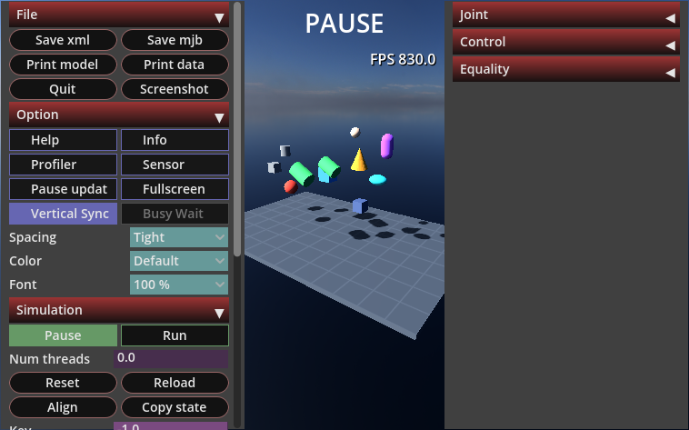
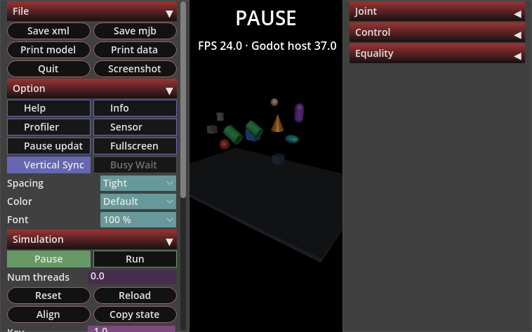
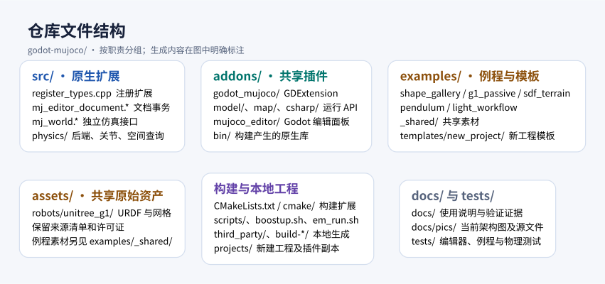
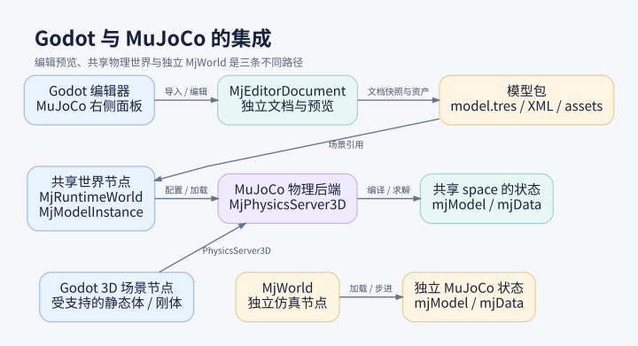
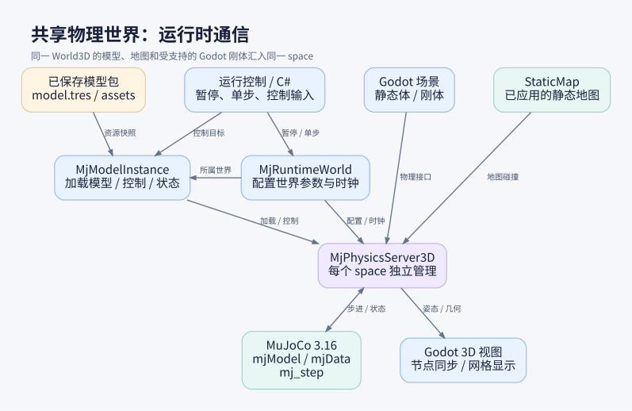

# godot-mujoco

在 Godot 中导入、编辑和运行 MuJoCo 模型，将机器人、静态地图及受支持的 Godot 刚体放进同一个物理世界。

[English](README.en.md) · [例程目录](examples/README.md) · [安装与故障排查](docs/linux-install.zh-CN.md) · [使用文档](docs/README.zh-CN.md)

## 快速开始

当前基线为 Linux x86_64、Godot 4.7.2 .NET、MuJoCo 3.16.0 和 .NET SDK 8.0.426。源码不包含编译后的原生库，首次使用需运行配置向导。

```bash
./boostup.sh                      # 检查环境、安装或导入工具并构建插件
./boostup.sh --check              # 检查已有环境
./boostup.sh --rebuild            # 使用已安装工具重新构建
./boostup.sh --configure          # 重新选择工具来源或安装
./em_run.sh                       # 打开 Godot 项目管理器
./em_run.sh --exp                 # 选择例程
./em_run.sh --exp shape_gallery   # 打开指定例程
./em_run.sh --new my-project      # 创建并打开本地工程
```

向导支持下载或导入 Godot Mono 和 .NET；Ubuntu 22.04/24.04 可经确认安装缺少的系统依赖。其他 Linux 发行版需自行准备依赖。详见[安装指南](docs/linux-install.zh-CN.md)。

## 项目目录结构

```text
godot-mujoco/
├── src/          # 原生扩展源码
├── addons/       # 运行时与编辑器插件
├── assets/       # 共享素材
├── examples/     # 例程和工程模板
├── projects/     # 本地创建的工程（生成，Git 忽略）
├── scripts/      # 配置、构建和启动脚本
├── tests/        # 测试与验收
├── docs/         # 使用文档和架构图
└── third_party/  # 本地工具和环境配置（生成，Git 忽略）
```

<details>
<summary>详细项目目录</summary>

`[生成·忽略]` 表示本地生成且不随克隆获得；`[按需]` 表示仅在对应操作后出现。

```text
godot-mujoco/
├── README.md / README.en.md       # 中英文入口文档
├── boostup.sh                     # 环境安装、配置、检查和编译向导
├── em_run.sh                      # 打开 Godot、选择例程或创建工程
├── CMakeLists.txt                 # 原生扩展构建入口、依赖版本和产物部署
├── global.json                    # 固定 .NET SDK 版本
├── .gitignore / .gitattributes    # Git 忽略与文件属性规则
├── .github/workflows/             # CI 构建、验收和上游版本检查
├── .vscode/                       # [生成·忽略] 本机 VS Code 配置与索引
├── src/                           # C/C++ 原生扩展源码
│   ├── register_types.*           # GDExtension 类型注册
│   ├── mj_world.*                 # 独立 MjWorld 仿真接口
│   ├── mj_editor_document.*       # MJCF 文档与编辑事务
│   └── physics/                   # MuJoCo 物理后端、刚体、关节和空间查询
├── cmake/                         # 构建辅助、符号导出表和移动端补丁
├── scripts/                       # 环境、启动、构建及验证实现
│   ├── bootstrap.py               # 下载或导入工具，配置环境并编译
│   ├── local_tools.py             # 工具路径、版本校验和本地配置读写
│   ├── em_run.py                  # --exp / --new 的实现
│   ├── setup.sh / setup.py        # check / build / smoke 底层入口
│   ├── ci/toolchain.json          # 锁定版本、官方下载地址和校验值
│   ├── ci/install_godot.py        # Godot 下载与解压校验
│   └── build_*.sh / verify_*.sh    # Android / iOS 构建与产物检查
├── addons/                        # 插件唯一源码与部署位置，各例程共同使用
│   ├── godot_mujoco/             # GDExtension 配置、运行脚本和 C# API
│   │   └── bin/                  # [生成·忽略] 扩展及 MuJoCo 库；保留 .gitkeep
│   └── mujoco_editor/            # MuJoCo 编辑器插件源码
├── assets/                       # 共享原始素材，随源码维护
│   └── robots/unitree_g1/        # G1 原始 URDF、网格、来源清单与许可证
├── examples/                      # 可直接打开的例程源码和必需资源
│   ├── _shared/                  # 共用天空、地板着色器和界面脚本，无 project.godot
│   ├── shape_gallery/            # 形状下落与碰撞
│   ├── g1_passive/               # 无控制 G1 机器人
│   ├── sdf_terrain/              # SDF 台阶、洼地和崎岖地形
│   ├── pendulum/                 # 共享后端摆杆与独立 API 诊断
│   ├── light_workflow/           # C# 控制与地形开发例程
│   ├── templates/new_project/   # --new 使用的工程模板：project.godot、Main.tscn、README、.gitignore
│   └── <五个可直接打开的例程>/
│       ├── addons -> ../../addons  # [生成·忽略] 向导建立的共享插件链接
│       ├── .godot/               # [生成·忽略] 首次打开后生成的缓存
│       └── bin/ / obj/           # [按需·生成·忽略] .NET 构建产物
├── third_party/                  # [生成·忽略] 仓库本地工具与环境配置
│   ├── godot/                    # 完整 Godot Mono 引擎和 GodotSharp/
│   ├── dotnet/                   # .NET SDK：dotnet、sdk/、shared/ 等
│   ├── cmake/                    # [按需] 系统 CMake 不足时安装
│   ├── cache/                    # [按需] 自动下载的工具压缩包缓存
│   ├── environment.json          # 工具相对路径、版本及构建完成状态
│   ├── environment.sh            # 提供给终端加载的环境变量
│   └── .boostup.lock             # 防止安装向导同时运行的锁文件
├── build-linux/                  # [生成·忽略] 默认构建目录，可用 --build-dir 改位置
│   ├── CMakeCache.txt / CMakeFiles/ # CMake 配置和中间文件
│   ├── _deps/                    # godot-cpp / MuJoCo 依赖与子构建，视 SDK 模式而定
│   └── libgodot_mujoco*.so        # Linux 原生扩展；构建后部署到共享插件 bin/
├── projects/                     # [生成·忽略] --new 创建的用户工程
│   └── <project-name>/
│       ├── project.godot / Main.tscn # 新工程配置与平地落球场景
│       ├── addons/               # 完整插件副本和运行库，可移出仓库独立使用
│       ├── global.json / README.md / .gitignore
│       └── .godot/               # [按需] 打开工程后的导入缓存
├── tests/                        # 环境入口、例程、物理后端、编辑器等验收
│   ├── setup/                    # 配置向导和启动脚本隔离测试
│   ├── example_projects/         # 五个例程和模板的验收
│   └── native_*/ / spatial_queries/ / …
├── docs/                         # 安装、功能说明、已知问题与验收证据
│   └── pics/                     # 文件、Godot 集成和运行时架构图及源文件
├── ARCHITECTURE.zh-CN.md         # 架构说明和历史记录
└── LICENSE                       # 项目许可证
```

</details>

## 运行例程

完成一次[插件构建](docs/linux-install.zh-CN.md)后，运行 `./em_run.sh --exp` 选择例程；也可在 Godot 项目管理器中导入对应的 `project.godot`，等待资源导入后按 F5 运行。

| 例程 | 项目文件 | 主场景 |
|---|---|---|
| [形状下落与碰撞](examples/shape_gallery/README.md) | `examples/shape_gallery/project.godot` | `Main.tscn` |
| [无控制 G1](examples/g1_passive/README.md) | `examples/g1_passive/project.godot` | `G1.tscn` |
| [SDF 地形](examples/sdf_terrain/README.md) | `examples/sdf_terrain/project.godot` | `Main.tscn` |
| [可编辑摆杆](examples/pendulum/README.md) | `examples/pendulum/project.godot` | `Main.tscn` |
| [轻量 C# 综合例程](examples/light_workflow/README.zh-CN.md) | `examples/light_workflow/project.godot` | `Main.tscn` |

保持仓库目录结构完整，以便例程使用共享插件和素材。五个图形例程均使用共享 MuJoCo 物理后端和可保存的作者场景；轻量例程需要正常构建 C#。独立 MjWorld 保留为 API 与诊断入口。G1 没有站立或行走控制，倒地是预期行为；多机器人热添加仍有[已知限制](examples/g1_passive/README.md)。

## F5 选择 Godot 或 MuJoCo 原生渲染

在 **右侧 MuJoCo 面板顶部 → F5 渲染** 下拉框中选择 **Godot** 或 **MuJoCo 原生**。也可使用 **3D 视图顶部 → MuJoCo 显示 → F5 渲染** 菜单。选择会保存到当前工程的 `project.godot`，下次 F5 生效；切换后需停止并重新运行。编辑视图始终由 Godot 绘制。运行浮窗（F11）的状态会标明实际使用的渲染方式；原生启动失败时保留 Godot 画面并显示回退原因。

`shape_gallery` 预选 MuJoCo 原生；尚未构建原生桥时会回退到 Godot，也可在工具栏中明确选择 Godot。其他工程未设置时沿用场景默认值。

G1 的原生模型传输超过默认 64 MiB；需要原生显示时，在项目设置中将 `rendering/mujoco_native_view/max_model_mib` 显式设为 192。默认限额下会回退 Godot，并保留共享操作。

原生渲染需要先构建一次原生桥。关闭已打开的编辑器，安装 OpenGL / X11 开发库（Ubuntu：`sudo apt install libgl-dev libx11-dev`），然后在仓库根目录运行：

```bash
cmake -S . -B build-linux -DGMJ_NATIVE_VIEW_EXPERIMENTAL=ON
cmake --build build-linux --parallel 2
./em_run.sh --exp shape_gallery
```

重新打开编辑器后即可选择 **MuJoCo 原生**。缺少原生库、使用非 X11 会话、非 Compatibility 渲染或物理独立线程时，该选项会禁用，悬停可查看原因。项目选择保存在 `rendering/mujoco_native_view/renderer`：`0` 为 Godot，`1` 为 MuJoCo；未设置时保持原有场景默认值。项目选择优先于旧的场景实验属性。

两种画面使用**同一个 MuJoCo 物理世界**，切换渲染方式不会改变碰撞算法、时间步或物理精度。

| 对比 | Godot 渲染 | MuJoCo 原生渲染 |
|---|---|---|
| 画面来源 | 将模型转换为 Godot Mesh，再由 Godot 绘制 | 用 MuJoCo `mjv` / `mjr` 生成画面，通过 GPU 纹理显示在 Godot 中 |
| 优势 | 保留 Godot 材质、HDR 环境、网格地板、灯光及自定义 Shader；适合游戏和场景表现 | 使用 MuJoCo 模型的原生显示方式，减少模型节点姿态同步；适合检查 MuJoCo 模型外观 |
| 视觉差别 | 保留 Godot 材质与灯光 | 使用 MuJoCo 材质与灯光；不绘制 Godot 天空、地板 Shader 或自定义 3D 特效。两者共用相机与交互状态 |
| 运行操作 | 共享 MuJoCo 相机、选择、跟踪、施力与暂停姿态操作 | 同一共享控制器，调用官方 `mjv_*` API；操作真实仿真数据 |
| 仿真控制 / UI | Tab / Shift+Tab 原版左右面板，F1–F4 原版叠加；F11 仅 Godot 附加功能 | 使用同一套面板和快捷键；Godot 控件适配 simulate，F2 Info 与 Godot 性能独立 |
| 显示与诊断 | 官方相机与诊断图元转换为 Godot 显示；不支持的表面效果明确禁用 | 公共 CPU 场景直接交给 MuJoCo 绘制，包括真实接触诊断；支持项遵守刚体与资源限制 |
| 性能取舍 | 有节点同步和 Godot 绘制成本 | 有版本化模型快照、公共 CPU 场景、GLX 上下文切换和 GPU 同步成本；**不能据此保证更快**，需针对实际场景测量 |
| 平台与成熟度 | 常规显示路径，沿用现有插件支持范围 | 实验功能；目前限 Linux x86_64、X11、OpenGL、单个主运行窗口、主线程物理；有模型与内存预算 |

普通 GPU 纹理合成使用仓库锁定的官方 Godot，无需替换引擎。编辑器开关不启用“直出屏幕”；后者仍需[自定义 Godot 补丁](docs/development/native-view-r17/README.md)。原生视图仍有设备故障恢复、平台和模型资源限制，详见[原生视图说明](addons/godot_mujoco/native_view/README.md)。

下图为同一 `shape_gallery` 的 F5 实拍；两种渲染共用交互和初始相机，材质与灯光不同，不作为性能比较：

| Godot | MuJoCo 原生 |
|---|---|
| [](docs/pics/f5-renderer-godot.png) | [](docs/pics/f5-renderer-native.png) |

## 统一运行操作与性能显示

两种渲染均使用 MuJoCo 3.16 的相机、拾取和扰动 API，并按原版 simulate 组织左右面板。**Tab** 显隐左侧原版菜单，**Shift+Tab** 显隐右侧 Joint / Control / Equality；Alt+分组字母折叠对应组。**F1 / F2 / F3 / F4** 分别开关原版 Help / Info / Profiler / Sensors 叠加。**F11** 仅打开可拖动、缩放的 **Godot 附加功能**浮窗，提供渲染后端、FPS/系统性能、示例扩展和附加工具。菜单显隐不暂停仿真；编辑器原有操作不变。

- 左拖旋转、右拖平移、中键 / 滚轮缩放，Shift 调整方向，Alt 交换左右键。左双击选择，PageUp 选择父级，右双击居中，Ctrl+右双击跟踪。
- Ctrl+左拖施加旋转扰动、Ctrl+右拖平移扰动；运行时施力，暂停时按 MuJoCo 的自由关节 / mocap 规则调整姿态。松键、失焦或打开浮窗会取消扰动。
- Space 暂停 / 继续；← 后退历史，→ 前进历史或单步；`-` / `=` 调整 0.1%～100% 速度；`[` / `]` 固定相机，Esc 自由相机。F6/F7 循环坐标系 / 标签，原生反引号 Body Tree 保留。F11 内 Tab / Shift+Tab 移动控件焦点；文本编辑优先消费按键。
- Backspace 回到设计初始状态、时间归零；手动记录 / 恢复快照独立，不改变初始重置。Ctrl+L 事务式重载最后保存的设计，失败保留当前世界。旧 `reset_simulation()` 保留 checkpoint 兼容语义，新代码可用 `reset_initial()` / `restore_snapshot()`。
- Ctrl+C / Ctrl+Shift+C 复制状态；Ctrl+M/D/P 输出模型 / 数据 / 含 UI 的截图，默认保存到 `user://mujoco_viewer/` 时间戳目录；Ctrl+Q 退出运行。F5 全屏适用于独立运行，嵌入式 GameView 提示编辑器管理限制；F8–F10 保留 Godot 调试操作。

Godot 性能叠加首次默认只显示 **FPS**，由 F11 → Performance 独立控制；**F2 只控制 MuJoCo Info**，与 FPS/系统性能开关互不影响。所有性能指标包括 FPS 都可关闭。可选 CPU / 内存 / GPU / 显存采用**整机 / 整卡**口径，GPU 采样必须匹配实际渲染设备；不可用时明确禁用。CPU/GPU 毫秒耗时单独标注。原生帧更新率与 Godot 宿主 FPS 分开显示。信息约 5 Hz 刷新，系统占用约 1 Hz 采样，偏好保存在各项目的 `user://`。

原版 File 提供 XML / MJB 保存和模型/数据文本输出；Simulation 提供关键帧、控制噪声、线程数和历史拖动。关键帧控件按模型能力启用；当前共享世界组合仍不接受含 keyframe 的来源模型，界面会明确说明。Physics 设计参数保持只读；Busy Wait 由 Godot 主循环管理，因此禁用并解释限制。面板采用 Godot 控件适配固定版本定义，原生渲染仍通过 `mjr_render` 绘制三维画面。所有示例、模板与生成的 playground 自动接入，示例专用运行控件位于 F11 → Examples，精确 N 步和手动快照位于 F11 → Tools。完整能力、C# 接口、资源预算及验收方法见[运行查看器说明](addons/godot_mujoco/viewer/README.md)。

[本次验收记录](docs/development/runtime-viewer-validation-2026-10-30.json)包含双后端、原生 GL 关闭构建、F5、示例与重载检查，以及关闭叠加 / 仅 FPS / 全部指标 / 分析图表四种配置的 p50/p95 帧耗时和内存样本。限帧测试不能用于证明哪种后端更快。原版面板与 F11 拆分的新一轮验收另见[界面对照](docs/development/mujoco-simulate-ui-parity.md)和[验收记录](docs/development/runtime-panels-validation-2026-10-30.json)。

## 导入模型并运行

1. 打开并保存 3D 场景，在右侧 **MuJoCo → MJCF 层级模型** 点击 **载入 MJCF**，选择 `.xml`。
2. 模型自动成为正式场景树中的 body / geom / joint 层级。选择节点，在 Godot Inspector 修改参数，用原生 Gizmo 移动、旋转；Ctrl+D 复制，Ctrl+Z 撤销。
3. Ctrl+S 保存场景。后台验证成功后按 F5；未完成模型也可保存，当前无效设计禁止运行。
4. F5 期间编辑本地设计会自动暂停实际物理，后台编译整个世界并原子提交；成功后手动继续。增删模型、地形等设计操作在编辑器执行；运行窗口只修改仿真状态，不回写设计。

原始 MJCF 及依赖只读，项目保存副本和完整 XML 作者树。模型导入仅接受 MJCF XML；旧模型包、自动转换和升级入口已移除。详见 [层级节点编辑指南](docs/node-authoring.zh-CN.md)。

选中 geom，可在 **MJCF 碰撞** 中选择网格凸包或 SDF、设置凸包顶点上限或 SDF 深度。SDF 深度只保存在 Godot 工程，导出 XML 使用引擎默认深度，详见[碰撞设置](docs/geom-collision.zh-CN.md)。

## 导入地图并设置碰撞

1. 新建以 **Node3D** 为根的 3D 场景并保存。
2. 在 **MuJoCo** 面板选择 **静态地图草稿**，在 **导入 / 独立包** 中浏览并选择 `.glb`、`.gltf`、`.obj` 或 `.stl` 文件。
3. 设置来源单位和坐标方向，点击 **导入（保留脏数据）**。
4. 在地图树中逐个选择网格，设置碰撞方式，点击 **验证并应用碰撞草稿**。使用 **聚焦全图** 和视图中的 **MuJoCo 显示** 菜单检查结果。
5. 点击 **保存独立地图包**；再点击 **Apply 到编辑场景**，保存宿主场景并运行。修改碰撞后重新 Apply、保存并重跑。

已保存的地图包可通过 **打开地图包** 选择 `manifest.json` 重开。详见 [SDF 地形例程的地图操作步骤](examples/sdf_terrain/README.md)。

## 保存与重开

| 内容 | 保存 / 打开方式 |
|---|---|
| MJCF 作者层级及参数 | Ctrl+S 保存正式 `.tscn`，依赖位于项目 `mujoco_models/` |
| 碰撞设置 | geom Inspector 的 **MJCF 碰撞**；World 管理六项全局检测参数 |
| 静态地图 | **保存独立地图包 / 打开地图包**：`manifest.json`，保留整个地图包 |
| 场景布局 | Godot **保存场景**：`.tscn` |

## 架构图

### 文件结构：源码、插件、例程与本地工程

[](docs/pics/ARCHITECTURE-files.svg)

### Godot 集成：编辑预览、共享后端与独立 MjWorld

[](docs/pics/ARCHITECTURE-godot.svg)

### 运行时通信：模型、地图、刚体和物理世界

[](docs/pics/ARCHITECTURE-runtime.svg)

## 限制与更多文档

冷导入退出 139、重型 G1 与多 G1 操作仍有已知问题，见[已知问题](docs/known-issues.zh-CN.md)和 [G1 例程限制](examples/g1_passive/README.md)。SDF 连续扫掠在精确切触和擦边等情况下仍有未完成边界；调用方须检查查询状态，未认证结果不能视为无碰撞。默认 0.5 mm 总空间误差预算适用于编译后的 SDF，公共 sweep 不等于动态刚体 CCD。详见[空间查询矩阵](docs/development/spatial-query-matrix.md)。

[编辑器操作](docs/mjcf-editor.zh-CN.md) · [静态高度场](docs/static-heightfield.md) · [类型化控制 API](docs/typed-control.md) · [运行时安全编辑](docs/runtime-safe-editing.zh-CN.md) · [图形化工作流分析](docs/gui-workflow-audit.zh-CN.md)

本项目使用 [MIT](LICENSE) 许可。第三方声明见 [THIRD_PARTY](addons/godot_mujoco/THIRD_PARTY.md)；Unitree 资产保留原有许可和来源。
