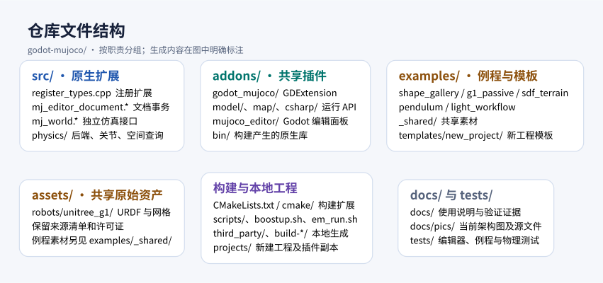
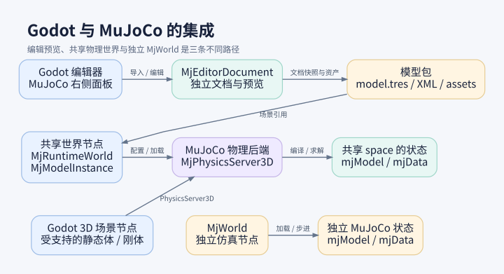
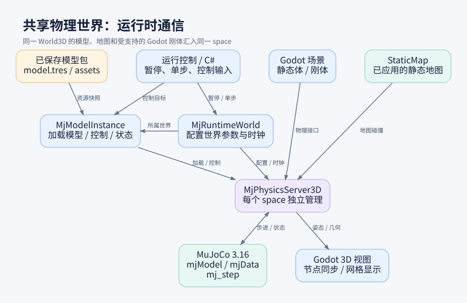

# godot-mujoco

在 Godot 中导入、编辑和运行 MuJoCo 模型，将机器人、静态地图及受支持的 Godot 刚体放进同一个物理世界。

[English](README.en.md) · [例程目录](examples/README.md) · [安装与故障排查](docs/linux-install.zh-CN.md) · [使用文档](docs/README.zh-CN.md)

## 快速开始

当前基线为 Linux x86_64、Godot 4.7.2 .NET、MuJoCo 3.16.0 和 .NET SDK 8.0.426。源码不包含编译后的原生库，首次使用需运行配置向导。

```bash
./boostup.sh                      # 检查环境、安装或导入工具并构建插件
./boostup.sh --check              # 检查已有环境
./boostup.sh --rebuild            # 使用已安装工具重新构建
./boostup.sh --configure          # 重新选择工具来源或安装
./em_run.sh                       # 打开 Godot 项目管理器
./em_run.sh --exp                 # 选择例程
./em_run.sh --exp shape_gallery   # 打开指定例程
./em_run.sh --new my-project      # 创建并打开本地工程
```

向导支持下载或导入 Godot Mono 和 .NET；Ubuntu 22.04/24.04 可经确认安装缺少的系统依赖。其他 Linux 发行版需自行准备依赖。详见[安装指南](docs/linux-install.zh-CN.md)。

## 项目目录结构

```text
godot-mujoco/
├── src/          # 原生扩展源码
├── addons/       # 运行时与编辑器插件
├── assets/       # 共享素材
├── examples/     # 例程和工程模板
├── projects/     # 本地创建的工程（生成，Git 忽略）
├── scripts/      # 配置、构建和启动脚本
├── tests/        # 测试与验收
├── docs/         # 使用文档和架构图
└── third_party/  # 本地工具和环境配置（生成，Git 忽略）
```

<details>
<summary>详细项目目录</summary>

`[生成·忽略]` 表示本地生成且不随克隆获得；`[按需]` 表示仅在对应操作后出现。

```text
godot-mujoco/
├── README.md / README.en.md       # 中英文入口文档
├── boostup.sh                     # 环境安装、配置、检查和编译向导
├── em_run.sh                      # 打开 Godot、选择例程或创建工程
├── CMakeLists.txt                 # 原生扩展构建入口、依赖版本和产物部署
├── global.json                    # 固定 .NET SDK 版本
├── .gitignore / .gitattributes    # Git 忽略与文件属性规则
├── .github/workflows/             # CI 构建、验收和上游版本检查
├── .vscode/                       # 本机 VS Code 配置、索引；当前未整体忽略
├── src/                           # C/C++ 原生扩展源码
│   ├── register_types.*           # GDExtension 类型注册
│   ├── mj_world.*                 # 独立 MjWorld 仿真接口
│   ├── mj_editor_document.*       # MJCF 文档与编辑事务
│   └── physics/                   # MuJoCo 物理后端、刚体、关节和空间查询
├── cmake/                         # 构建辅助、符号导出表和移动端补丁
├── scripts/                       # 环境、启动、构建及验证实现
│   ├── bootstrap.py               # 下载或导入工具，配置环境并编译
│   ├── local_tools.py             # 工具路径、版本校验和本地配置读写
│   ├── em_run.py                  # --exp / --new 的实现
│   ├── setup.sh / setup.py        # check / build / smoke 底层入口
│   ├── ci/toolchain.json          # 锁定版本、官方下载地址和校验值
│   ├── ci/install_godot.py        # Godot 下载与解压校验
│   └── build_*.sh / verify_*.sh    # Android / iOS 构建与产物检查
├── addons/                        # 插件唯一源码与部署位置，各例程共同使用
│   ├── godot_mujoco/             # GDExtension 配置、运行脚本和 C# API
│   │   └── bin/                  # [生成·忽略] 扩展及 MuJoCo 库；保留 .gitkeep
│   └── mujoco_editor/            # MuJoCo 编辑器插件源码
├── assets/                       # 共享原始素材，随源码维护
│   └── robots/unitree_g1/        # G1 原始 URDF、网格、来源清单与许可证
├── examples/                      # 可直接打开的例程源码和必需资源
│   ├── _shared/                  # 共用天空、地板着色器和界面脚本，无 project.godot
│   ├── shape_gallery/            # 形状下落与碰撞
│   ├── g1_passive/               # 无控制 G1 机器人
│   ├── sdf_terrain/              # SDF 台阶、洼地和崎岖地形
│   ├── pendulum/                 # 原 demo/ 的独立 MjWorld 摆杆与诊断工程
│   ├── light_workflow/           # C# 控制与地形开发例程
│   ├── templates/new_project/   # --new 使用的工程模板：project.godot、Main.tscn、README、.gitignore
│   └── <四个可直接打开的例程>/
│       ├── addons -> ../../addons  # [生成·忽略] 向导建立的共享插件链接
│       ├── .godot/               # [生成·忽略] 首次打开后生成的缓存
│       └── bin/ / obj/           # [按需·生成·忽略] .NET 构建产物
├── third_party/                  # [生成·忽略] 仓库本地工具与环境配置
│   ├── godot/                    # 完整 Godot Mono 引擎和 GodotSharp/
│   ├── dotnet/                   # .NET SDK：dotnet、sdk/、shared/ 等
│   ├── cmake/                    # [按需] 系统 CMake 不足时安装
│   ├── cache/                    # [按需] 自动下载的工具压缩包缓存
│   ├── environment.json          # 工具相对路径、版本及构建完成状态
│   ├── environment.sh            # 提供给终端加载的环境变量
│   └── .boostup.lock             # 防止安装向导同时运行的锁文件
├── build-linux/                  # [生成·忽略] 默认构建目录，可用 --build-dir 改位置
│   ├── CMakeCache.txt / CMakeFiles/ # CMake 配置和中间文件
│   ├── _deps/                    # godot-cpp / MuJoCo 依赖与子构建，视 SDK 模式而定
│   └── libgodot_mujoco*.so        # Linux 原生扩展；构建后部署到共享插件 bin/
├── projects/                     # [生成·忽略] --new 创建的用户工程
│   └── <project-name>/
│       ├── project.godot / Main.tscn # 新工程配置与平地落球场景
│       ├── addons/               # 完整插件副本和运行库，可移出仓库独立使用
│       ├── global.json / README.md / .gitignore
│       └── .godot/               # [按需] 打开工程后的导入缓存
├── tests/                        # 环境入口、例程、物理后端、编辑器等验收
│   ├── setup/                    # 配置向导和启动脚本隔离测试
│   ├── example_projects/         # 四个可直接打开例程的验收
│   └── native_*/ / spatial_queries/ / …
├── docs/                         # 安装、功能说明、已知问题与验收证据
│   └── pics/                     # 文件、Godot 集成和运行时架构图及源文件
├── ARCHITECTURE.zh-CN.md         # 架构说明和历史记录
└── LICENSE                       # 项目许可证
```

</details>

## 运行例程

完成一次[插件构建](docs/linux-install.zh-CN.md)后，运行 `./em_run.sh --exp` 选择例程；也可在 Godot 项目管理器中导入对应的 `project.godot`，等待资源导入后按 F5 运行。

| 例程 | 项目文件 | 主场景 |
|---|---|---|
| [形状下落与碰撞](examples/shape_gallery/README.md) | `examples/shape_gallery/project.godot` | `Main.tscn` |
| [无控制 G1](examples/g1_passive/README.md) | `examples/g1_passive/project.godot` | `G1.tscn` |
| [SDF 地形](examples/sdf_terrain/README.md) | `examples/sdf_terrain/project.godot` | `Main.tscn` |
| [独立世界摆杆](examples/pendulum/README.md) | `examples/pendulum/project.godot` | `Main.tscn` |

保持仓库目录结构完整，以便例程使用共享插件和素材。前三个例程使用共享 MuJoCo 物理后端，摆杆使用独立 MjWorld。G1 没有站立或行走控制，倒地是预期行为；多机器人热添加仍有[已知限制](examples/g1_passive/README.md)。

## 导入模型并运行

1. 打开 3D 场景，在右侧 **MuJoCo** 面板选择 **MJCF 文档**，展开 **文档 / 导入 / 发布**，勾选 **显示 MJCF 草稿（独立于正式场景）**。
2. 点击 **Import MJCF**，选择模型的 `.xml`，并保留配套的 include、网格和纹理。点击 **聚焦模型** 查看。
3. 在模型树或视图中选择对象并修改参数，点击 **Apply** 或 **Discard**；使用 **Run / Pause** 控制草稿预览。
4. 点击 **Save project model** 保存模型包，再点击 **Create simulation playground** 保存仿真场景。
5. 打开生成的场景，按 F6 运行当前场景，再点击 **恢复仿真 / Resume**。

G1 可使用 **Import fixed G1** 或 **Import free G1 (relaxed)** 选择 URDF。**Create runtime scene** 生成适合继续搭建的世界和模型节点；保存的模型包可用 **Open project model** 打开。详见 [MJCF 编辑器指南](docs/mjcf-editor.zh-CN.md)和[模型包说明](docs/portable-models.zh-CN.md)。

## 导入地图并设置碰撞

1. 新建以 **Node3D** 为根的 3D 场景并保存。
2. 在 **MuJoCo** 面板选择 **静态地图草稿**，在 **导入 / 独立包** 中浏览并选择 `.glb`、`.gltf`、`.obj` 或 `.stl` 文件。
3. 设置来源单位和坐标方向，点击 **导入（保留脏数据）**。
4. 在地图树中逐个选择网格，设置碰撞方式，点击 **验证并应用碰撞草稿**。使用 **聚焦全图** 和视图中的 **MuJoCo 显示** 菜单检查结果。
5. 点击 **保存独立地图包**；再点击 **Apply 到编辑场景**，保存宿主场景并运行。修改碰撞后重新 Apply、保存并重跑。

已保存的地图包可通过 **打开地图包** 选择 `manifest.json` 重开。详见 [SDF 地形例程的地图操作步骤](examples/sdf_terrain/README.md)。

## 保存与重开

| 内容 | 保存 / 打开方式 |
|---|---|
| MJCF 编辑文档 | **Save document / Open document**：`.gmj.json`，源素材仍在原位置 |
| 可搬迁模型 | **Save project model / Open project model**：`model.tres`，搬迁时复制整个模型包 |
| 静态地图 | **保存独立地图包 / 打开地图包**：`manifest.json`，保留整个地图包 |
| 场景布局 | Godot **保存场景**：`.tscn` |

## 架构图

### 文件结构：源码、插件、例程与本地工程

[](docs/pics/ARCHITECTURE-files.svg)

### Godot 集成：编辑预览、共享后端与独立 MjWorld

[](docs/pics/ARCHITECTURE-godot.svg)

### 运行时通信：模型、地图、刚体和物理世界

[](docs/pics/ARCHITECTURE-runtime.svg)

## 限制与更多文档

冷导入退出 139、重型 G1 与多 G1 操作仍有已知问题，见[已知问题](docs/known-issues.zh-CN.md)和 [G1 例程限制](examples/g1_passive/README.md)。SDF 连续扫掠在精确切触和擦边等情况下仍有未完成边界；调用方须检查查询状态，未认证结果不能视为无碰撞。默认 0.5 mm 总空间误差预算适用于编译后的 SDF，公共 sweep 不等于动态刚体 CCD。详见[空间查询矩阵](docs/development/spatial-query-matrix.md)。

[编辑器操作](docs/mjcf-editor.zh-CN.md) · [静态高度场](docs/static-heightfield.md) · [类型化控制 API](docs/typed-control.md) · [运行时安全编辑](docs/runtime-safe-editing.zh-CN.md) · [图形化工作流分析](docs/gui-workflow-audit.zh-CN.md)

本项目使用 [MIT](LICENSE) 许可。第三方声明见 [THIRD_PARTY](addons/godot_mujoco/THIRD_PARTY.md)；Unitree 资产保留原有许可和来源。
