# Independent runtime UI components

The plugin provides two optional `CanvasLayer` components. Add either, both or
neither to a saved scene; each binds directly to exactly one `world` or
`environment_host`. Neither creates or requires the other.

| Saved component | Owns | When absent or disabled |
|---|---|---|
| `MjRuntimeViewer` | MuJoCo sidebars, F1–F4, official actions, camera, picking and perturbation | Gameplay keeps its camera/input; no original panel shortcuts |
| `MjGodotExtras` | F11, FPS/system metrics, renderer choice, exact steps/snapshots and example widgets | No F11 handler or optional system sampling; original interaction continues |
| Neither | Simulation and selected renderer only | Native rendering follows the gameplay camera; no runtime UI |
| Both | One shared simulation/presentation session, separate UI ownership | Disabling one does not disable the other |

`shape_gallery` saves sibling `Runtime`, `RuntimeViewer` and `GodotExtras` nodes
under a neutral scene root. `enabled` controls each component's runtime ownership;
hiding its panel only changes visibility. A bare World never creates UI.

## Add from the editor

Select an editable `MjRuntimeWorld` or `MjEnvironmentHost` in the scene tree and
press **添加 MuJoCo 运行面板** in the right MuJoCo dock. The preset creates and
selects a saved, bound `MjRuntimeViewer` sibling, with Undo/Redo. If the target
already has a viewer, it selects that viewer instead. It adds no Extras, example
provider, binding, model or camera. Missing/ambiguous/uneditable selection shows a
reason. A target that is itself the scene root needs an ordinary parent first;
the preset never silently restructures the scene.

For manual authoring, search **MjRuntimeViewer** or **MjGodotExtras** in **Add
Child Node**, place it beside the target and assign exactly one Inspector target.
Keep the default **UI Scene**, save and run F5. Each node independently exposes
**Enabled**, **UI Scene**, **UI Theme**, configuration and pure editor preview.
The standard UI needs no `DisplayControls` or Binding child.

Public MuJoCo node types have different scene-tree/Create Node icons: a globe for
`MjRuntimeWorld`, layers for `MjModelInstance`, a cube for `MjBody3D`, linked circles
for `MjJoint3D`, shapes for `MjGeom3D`, terrain for `MjStaticHeightField`, and a
crosshair for `MjDebugDraw`. The viewer uses a monitor, Extras a controls icon, `MjEnvironmentHost` an
inset viewport, and `MjViewerExtensionBinding` a chain link.

## Author and customize

- `ui_scene` selects an editable/inheritable `MjViewerUI` PackedScene for the
  original component or `MjExtrasUI` for Extras. Edit either in the 2D editor.
  Defaults are `default_ui.tscn` and `extras_ui.tscn`.
- `ui_theme` supplies the authored Theme. Runtime view state never rewrites the
  saved scene, Theme or configuration resource.
- `configuration` defines group and individual action availability. Buttons,
  keyboard, help and component commands use the same policy. Gameplay World APIs
  remain independent; hiding a control does not disable its action.
- Original viewer `layout_mode` selects reserved space or overlay. Extras never
  owns a 3D region or camera. The UI contract identifies one
  rectangular 3D display/input region; drawing, projection and picking use it on
  both backends. Missing required bindings report configuration errors rather
  than silently replacing a custom scene.
- `preview_in_editor` shows authored layout/style with labeled sample data. It
  never starts simulation, native GL, system sampling or viewer input.
- `restore_preferences` permits allowed per-component personal view state.
  `preferences_id` can give a stable unique identity; otherwise scene identity
  and node path define the namespace. Scene capabilities and Theme binding win.

World/Host replacement rebinds the live scene-owned component only after commit.
World exit does not delete a sibling UI. Invalid targets and duplicate ownership
(one original viewer and one Extras owner per target 3D viewport) give explicit reasons.

For a custom layout, inherit `res://addons/godot_mujoco/viewer/default_ui.tscn`
and save it in your project, then assign that PackedScene to `ui_scene`. Changing
its saved controls, margins or Theme does not require editing the controller.
A fully replaced scene must extend `MjViewerUI`, export one descendant `Control`
as `render_region`, and emit `action_requested(action_id, arguments)` for its
widgets. Set `use_default_presenters = false` when replacing the supplied panel
modules. A missing optional panel disables its view action with an explanation;
a missing/out-of-bounds required region is a configuration error. The controller
never reconstructs the removed default layout over a custom scene. An Extras
replacement extends `MjExtrasUI` and provides a descendant controls `Window`,
performance HUD `Label`, or both; it needs no `render_region`.

`MjViewerConfiguration.disabled_groups` accepts `camera`, `selection`,
`perturbation`, `simulation`, `output`, `visualization`, `analysis`, `interface`
and `performance`. `disabled_actions` accepts an action or selector such as
`camera:0`, `vis:2` or `metric:cpu`; `allowed_metrics` limits metric choices.
`allowed_preferences` limits the categories `layout`, `visibility`, `metrics`,
`display`, `output` and `style`. These are authored limits, not saved simulation
settings. Internal session commands are not part of `execute()`.

Reserved layout moves the target viewport's whole 3D view into the declared
rectangle, including gameplay meshes outside the Runtime subtree in the same
World3D. Other viewports and 2D game UI stay independent. Overlay mode keeps the
full 3D viewport behind the custom controls. Rendering several independent 3D
regions within one component is outside this component's scope.

## Optional example extensions

`DisplayControls` is a saved **example-owned node name**, not a plugin node type
or a viewer-generated child. In ShapeGallery it is a plain `Node` with
`res://gallery.gd` attached, saved under `Runtime`. That script supplies the
example's floor grid and help text. It therefore does not appear as
"DisplayControls" in Add Child Node. Other projects supply their own scripts.

Saved example tools connect through an explicit `MjViewerExtensionBinding`.
Assign **Viewer** for F1 help, **Extras** for F11 widgets, or both. Set **Provider
Path** relative to each destination's committed World (`DisplayControls` in
ShapeGallery, `.` when the World itself supplies the provider), never relative to
the Binding. Binding may be a sibling of both components and does no provider
work in the editor.

Providers implement independent methods:

```gdscript
func get_viewer_help() -> Dictionary:
    return {"key": "my_example", "title": "My example", "text": "Instructions"}

func register_extras(extras: MjGodotExtras) -> String:
    var widget := Label.new()
    widget.text = "Example tools"
    extras.add_extension("my_example", "My example", widget)
    return "my_example"
```

Native-only help does not construct unused tool widgets. Each binding follows
its destination's successful committed-world replacement and retires old
callbacks; failed reload preserves the previous world and tools. Removing a
binding removes only its content. Example grid/drive/SDF behavior remains in the
example script.

Programmatic composition uses `SceneBuilder.attach_viewer(parent, target)`,
`attach_extras(parent, target)` and optional
`attach_extension(parent, viewer, extras, provider_path)`. Either extension
destination may be null. `with_runtime_ui(world)` is the explicit convenience
constructor for a neutral root plus both components; `with_viewer` is removed.
Plain physics scene creation installs neither UI.

## Controls

| Input | Action |
|---|---|
| Tab / Shift+Tab | Toggle the original left / right panels independently |
| Alt+F/O/S/W/P/R/V/G/L/J/C/E | Fold the corresponding original section |
| F11 (Extras installed) | Open/close Godot extras only (renderer, performance, tools, examples) |
| F1 / F2 / F3 / F4 | Original Help / MuJoCo Info / Profiler / Sensors overlays |
| Left / right / middle drag; wheel | Orbit / pan / zoom; Shift changes the direction |
| Left double-click / PageUp | Select body / select parent |
| Right double-click / Ctrl+right double-click | Center / track |
| Ctrl+left / Ctrl+right drag | Rotate / translate perturbation |
| Space / ← / → | Run/pause / history back / history forward or one new step |
| - / = | Official 0.1–100% speed tiers |
| [ / ] / Esc / Ctrl+A | Fixed cameras / free camera / model framing |
| F6 / F7 / backtick | Frames / labels / Body Tree |
| 0–5 / Shift+0–5 | Geom / Site group visibility |
| Ctrl+C / Ctrl+Shift+C | Copy state as key XML / high precision |
| Backspace / Ctrl+L | Initial reset / reload last saved scene design |
| Ctrl+M / D / P / Q | Model text / data text / composed screenshot / quit game |
| F5 | Standalone fullscreen; embedded GameView reports its editor-managed limitation |

F8–F10 remain Godot debugger controls. In the simulation and original panels,
Tab/Shift+Tab toggle the left/right sidebars; within F11 they move control focus.
Text fields consume editing shortcuts before scene actions. F11 remains available
with an embedded window, text field or popup focused. The help includes the linked
MuJoCo version's display/group shortcuts, renderer differences and example notes.

The left panel contains File, Option, Simulation, Watch, Physics, Rendering,
Visualization, Group enable and Logging in original order. The right contains
Joint, Control and Equality. Both initially appear, independently of F11. Help
and Info draw in the central scene; the four profiler figures stack along its
right edge. Sensors use an overlay without a separate window/title bar.
Godot controls adapt the fixed 3.16 definitions, input and theme; this is not an
embedded GLFW/mjui main loop or a claim of pixel-identical native widget drawing.

Runtime perturbation adds a viewer-owned wrench to existing external forces.
Paused perturbation follows MuJoCo's free-joint/mocap rules. Releasing the mouse,
opening a panel, losing application focus, changing worlds/renderers or stopping
cancels the gesture. No arbitrary-joint IK or editor design writeback is performed.

## State and diagnostics

Backspace and `reset_initial()` restore the compiled design's initial pose at time
zero, clear velocities/forces and retain camera/run state. Capture and explicit
Restore Snapshot use `mjSTATE_INTEGRATION`; Capture does not redefine Backspace.
Legacy `reset_simulation()` retains its previous checkpoint semantics for callers.
`WorldHandle.Read().HasSnapshot` retains that legacy checkpoint meaning;
the viewer frame's `has_snapshot` reports the full integration snapshot.
History is a bounded official-style ring (up to 2000 states and 100,000,000 bytes).
Snapshots/history are invalidated on a new model revision.
Simulation includes Pause/Run, Reset, Reload, Align, Copy state, model keyframe
load/save, control noise, solver workers and a history scrubber. Noise follows the
original Ornstein–Uhlenbeck update and actuator limits. Solver workers use
`mju_threadpool` (0–10). Pause update runs forward diagnostics and updates the
solver warm start without advancing simulation time/history.

F11 → Tools exposes additional exact batches of 1–1000 integration steps and
manual full-integration snapshots. These are separate from original keyframes.
The existing shared-world composer rejects source models containing keyframes
(as it does global userdata/mocap sources). This model-support restriction is
preserved: Key/Load key/Save key remain visible, disabled with a reason when the
compiled model has none; successful keyframe composition is not claimed.
Physics design fields are read-only. The original Busy Wait control is disabled
because the Godot main loop owns scheduling. UI spacing/color/font and supported
VSync/fullscreen options keep their original Option placement.

Joint sliders edit scalar hinge/slide qpos while paused. Control and Equality edit
true runtime data. Clear Control uses `mj_resetCtrl`, including neutral quaternion
controls. Physics parameters are read-only. All Rendering/Visualization/Group
entries are listed; unavailable backend effects are disabled with an explanation.
Godot keeps authored materials/lighting; MuJoCo OpenGL effects are native-only.

Profiler samples the real integration step before the server's final forward
update. CPU timers are milliseconds and are unavailable if another owner installed
an incompatible clock callback. Sensors show normalized values, and support the
simulate user-image convention (width/height integer parameters, RGB values and a
final version marker); a model must supply the data. Watch is a bounds-checked
numeric mjData lookup. Logging Console/File/topics control the actual handler.

MuJoCo Info (F2) and the Godot performance overlay are independent. F2 does not
change FPS/system metrics. F11 → Performance controls the Godot overlay, initially
FPS-only; every metric, including FPS, can be disabled. Optional CPU/RAM/GPU/VRAM numbers
refer to the whole system/card. GPU selection must match the renderer, otherwise
it is unavailable. GPU milliseconds are elapsed render time, not utilization.
Native update FPS and Godot host FPS are labeled separately. With Extras alone,
an explicitly disabled Godot SubViewport reports zero target FPS; conditional
update modes have no reliable per-target counter and display labeled host FPS
with an availability explanation. The supported EnvironmentHost uses UPDATE_ALWAYS
after commit and provides a measured target update rate. Information refreshes
at 5 Hz, optional OS samples at 1 Hz; no optional polling without a visible consumer.

Preferences use independent role/component namespaces under `user://mujoco_components/`;
even identical IDs in the two roles do not share state. Old mixed viewer
preferences are not imported. Only allowed window/layout/visibility/display and
performance choices are stored. Target, Enabled, feature restrictions, Theme/UI
resource binding and simulation state never enter personal preferences. Restore
can be disabled. F11 starts closed; original sidebars default visible and F1–F4
hidden. Outputs default to timestamped folders under `user://mujoco_viewer`;
Output commands can supply an explicit `path`; output preferences belong to the
component issuing the output, never an absent counterpart.
Original File includes XML/MJB saves, print exports and screenshots. XML exports
the committed compiled world with its session keyframes; it never uses the
process-global last-XML parser slot or writes back editor design. State copying
remains the original key XML operation, including high-precision Ctrl+Shift+C.
Reload is transactional: invalid saved resources preserve the current world.

## Component API

Bind the explicit component node, not a World lookup:

```gdscript
@export var extras: MjGodotExtras

func step_exactly() -> void:
    var request := extras.execute("step", {"count": 10})
    if request == 0:
        push_warning(extras.last_error)
        return
    # Poll action_result(request) or observe action_finished(request, result).
```

- Both roles expose `read_state()`, `execute(action_id, arguments)`,
  `action_result(id)`, `action_finished(id, result)` and `target_changed(world)`.
  Commands return a request ID or 0 with `last_error`; snapshots contain values,
  not live authority pointers. Original viewer snapshots also contain the
  model catalog, inspection details and presentation state.
- Original: `show_native_panels(left, right)`, `show_info(enabled)`,
  `add_help(key, title, text)`, `remove_help(key)` and official MuJoCo commands.
- Extras: `show_performance(enabled)`, `show_extras(visible)`,
  `add_extension(key, title, Control)`, `remove_extension(key)`, `step`,
  `capture_snapshot`, `restore_snapshot` and renderer/metric commands.
- Each API rejects the other role's actions; it never creates an invisible UI
  counterpart to execute them.
- C#: `ViewerHandle.Bind(viewer)` provides `ShowNativePanels`, `ShowInfo`,
  `SetControl`, `SetJoint`, `SetEquality` and `ResetInitial`.
  `ExtrasHandle.Bind(extras)` provides `ShowExtras`, `ShowPerformance`,
  `CaptureSnapshot` and `RestoreSnapshot`. Both expose `Execute`, `Read` and
  `SetEnabled`, and follow only their explicit component's lifetime.
- Low-level authority interfaces remain `scene_viewer_request`,
  `scene_viewer_frame`, `scene_viewer_ack` and `scene_viewer_result`. The internal
  world presentation session owns their lifetimes and never installs UI.

This is a breaking refactor. The former World viewer lookup, automatic installation,
old GDScript/C# wrapper calls and hidden SimulationControls are removed. There are
no compatibility aliases or old-preference migration. Update scenes and scripts
to explicit components. Existing gameplay physics APIs keep their domain behavior.

The core uses public `mjv_*` APIs and adapted MuJoCo 3.16 simulate logic, with no
GLFW or second simulation loop. Frozen scenes use `mjv_copyData`; packets contain
only values and pointer-free SDK structs with an ABI/version check. Picking retains
the displayed CPU frame and its frozen visibility settings. Sidebar layout
changes update both camera projection and native framebuffer/render rectangles;
inputs wait for a matching presented layout before picking. Queued inputs pin
their frames until processed, and at most three frozen scene slots are retained/reused.
A per-world cancellation latch releases perturbation at the next command boundary
even when input/result queues are full; earlier motions cannot restart it.
The CPU viewer owns its model header/display settings and borrows the current
revision's immutable model arrays only on the main thread. Its header/scenes/history
have a 256 MiB admission budget; optional native GPU transport has its own existing
asset/lease limits. These owned-buffer limits do not bound total process RSS.
The core remains available with `GMJ_NATIVE_VIEW_EXPERIMENTAL=OFF`.

See `src/viewer/UPSTREAM.md` and `src/viewer/LICENSE-MUJOCO` for source and licensing.

## Validation

`python3 tests/runtime_viewer/run.py --out build-runtime-viewer/godot`
checks real Godot input, authoritative operations, outputs and saved-scene reload.
Add `--native` for the GLX path or `--headless` for the display-free path.
`tests/runtime_clock/run.sh` retains the authoritative clock/C# regression checks.
Add `--component-only` for actual no-UI rendering and game-camera/lifecycle cases,
or `--contract-only` for inherited UI/Theme, feature policy, rectangular layout
and independent per-viewport preferences. These focused modes do not replace the
full interaction and all-entry regressions. `tests/native_view/run.py --preset-only`
checks the actual editor preset, ownership, Undo/Redo and saved bindings. `--saved-scenes-only` independently
checks nested saved data freshness, cached executing Script identity and scoped
loader removal; `--bindings-only` checks real same-ID model commits and stale
model widgets. Deliberately invalid component configurations are accepted only
when their exact diagnostic occurs once and its matching rejection assertion
passes; unrelated errors remain fatal.
The component probe records overlay-off/FPS/all supported metrics/analysis and
absent/disabled p50/p95 and RSS with paused physics. Optional CPU sampling warms
up at its real 1 Hz rate; unavailable GPU counters retain their driver reason.
Graphical runs check actual presented-backend FPS and stop optional consumers
after teardown, including the following real integration batch.
The full graphical fixture also records p50/p95 frame times and process RSS with VSync off
and a 120 FPS cap for overlay off/FPS/all metrics/analysis modes. These short,
capped fixture samples are not uncapped throughput or production benchmarks.

The historical panel-separation acceptance captured both renderers with the four sidebar
combinations, F1–F4 and F11; it tests real keyboard/focus routing, central picking,
resize/SubViewport, orthographic/fixed/tracking/off-axis cameras, native-control
outputs and independent data consumers. Historical viewer results predate these
UI criteria; new evidence is recorded separately.


## Historical component captures

The following images and [validation scopes, hashes and raw evidence](../../../docs/development/runtime-viewer-component-validation-2026-10-31.json)
cover the earlier combined-viewer implementation, including native/Godot/OFF
and rejection cases. They do not certify the new independent-component split;
the independent split has its own evidence below.

These are actual editor previews. Sample rows are labeled and runtime services
are inactive; the custom scene inherits saved widgets and uses an authored Theme.
The editor images show the visible canvas at its native zoom; the runtime pair
below shows the complete custom viewport.

| Default editor preview | Custom editor preview |
|---|---|
| 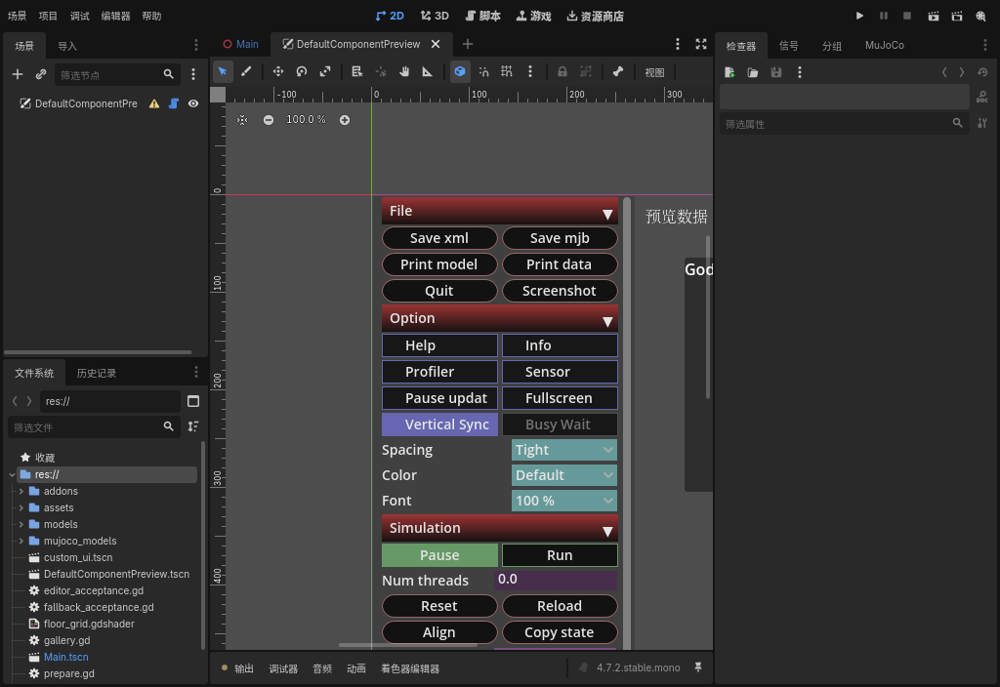 | 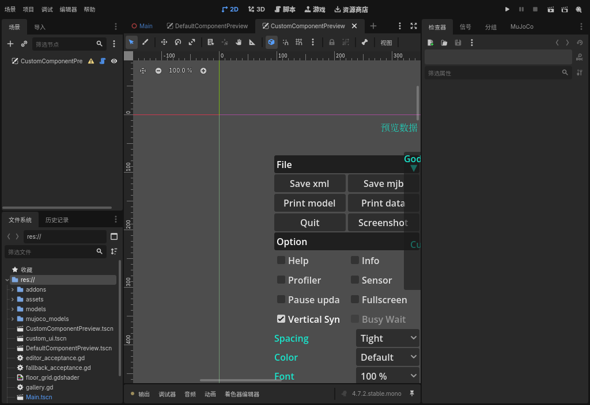 |

These actual custom fixture captures use a reduced rectangular 3D region with
horizontal and vertical margins. Both backends use the shared frozen-frame
interaction core. Godot retains gameplay 3D/materials; native MuJoCo draws its
supported MuJoCo geometry and lighting.

| Custom Godot layout | Custom native MuJoCo layout |
|---|---|
| 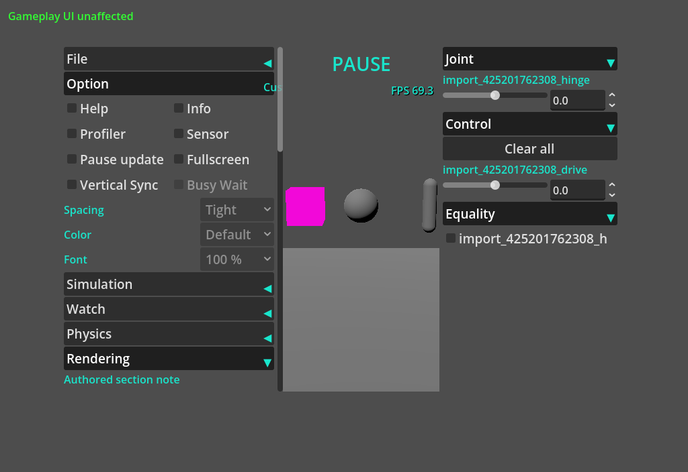 | 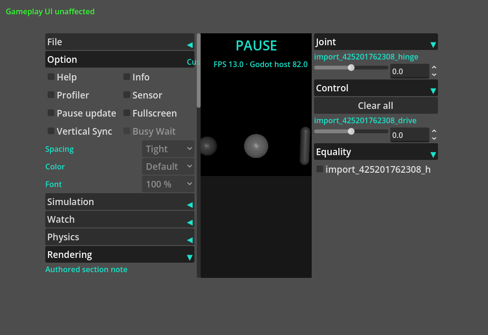 |

## Independent component captures

The [independent split validation record](../../../docs/development/runtime-ui-split-validation-2026-10-31.json) records exact scopes, source hashes, expected diagnostics and performance limitations.
These actual captures show the split components, without compositing or bitmap edits.
The editor preset adds only the original panel; the Extras preview is separately authored.

| Godot rendering | Native MuJoCo rendering |
|---|---|
| 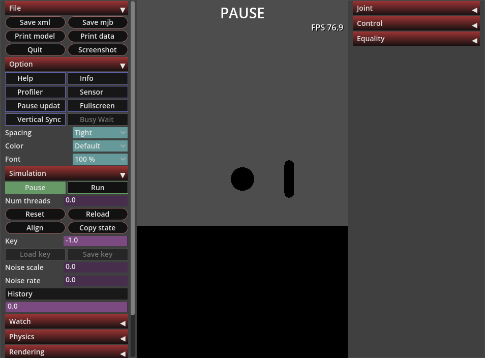 | 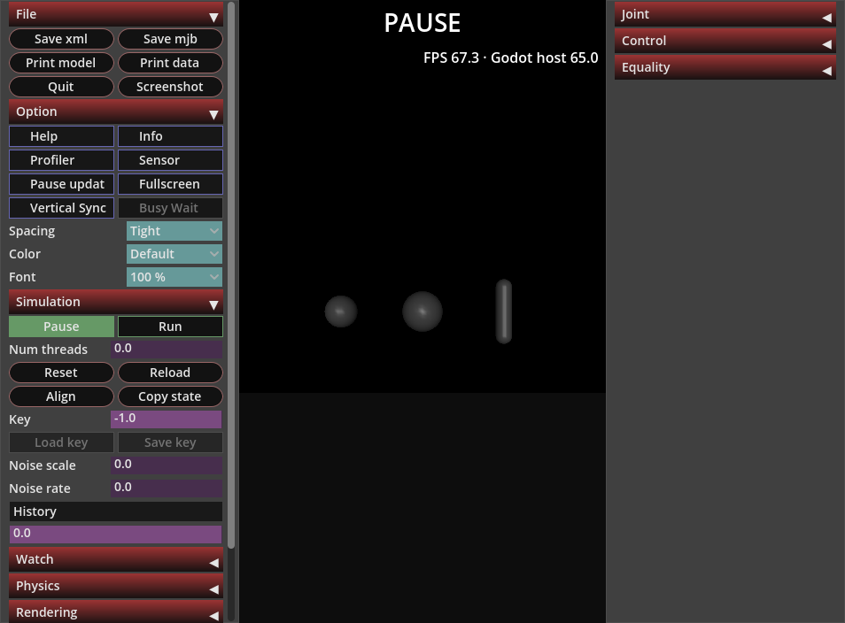 |

| Independent F11 Extras | Editor preset |
|---|---|
| 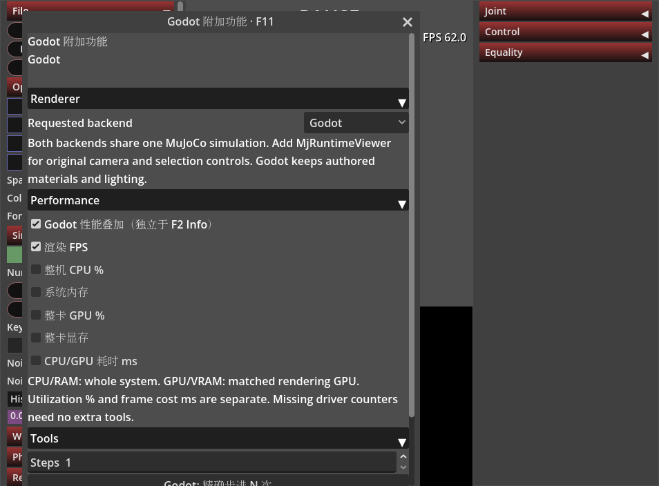 | 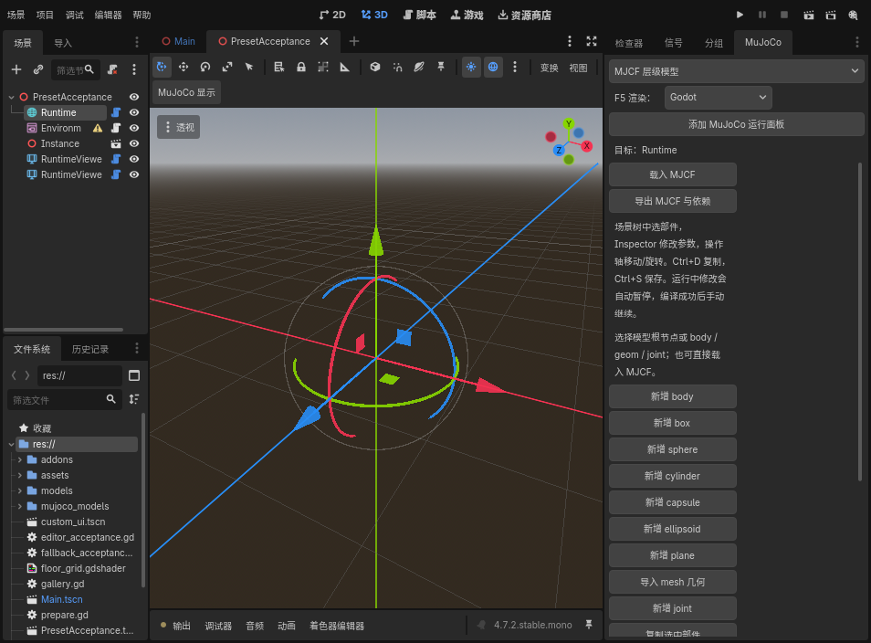 |

| Original editor preview | Extras editor preview |
|---|---|
| 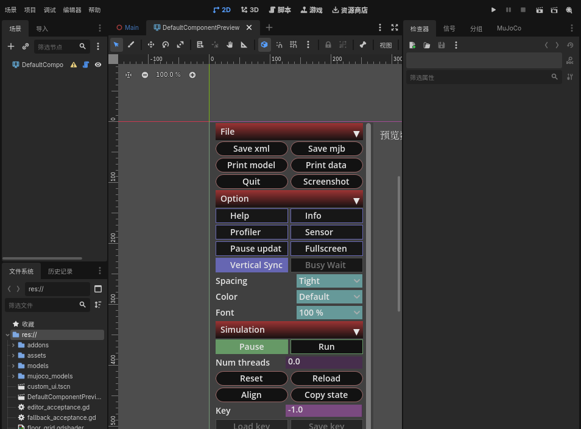 | 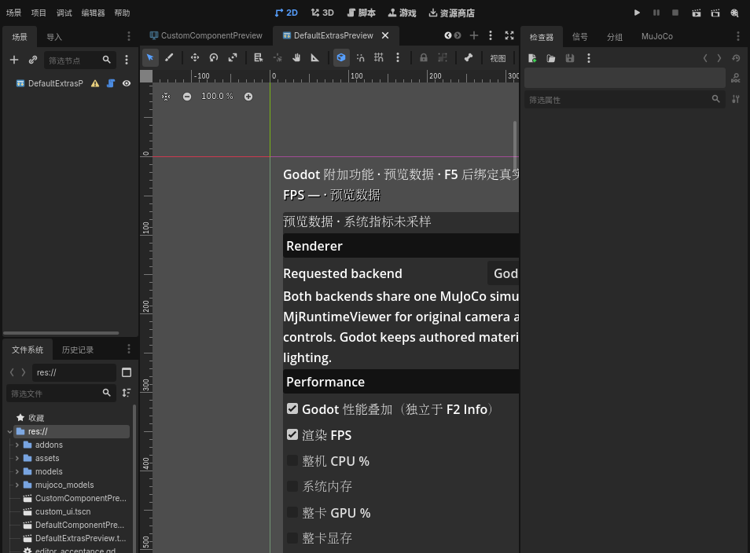 |

The actual Add Child Node dialog lists both public components. Its abstract shared base is not creatable.

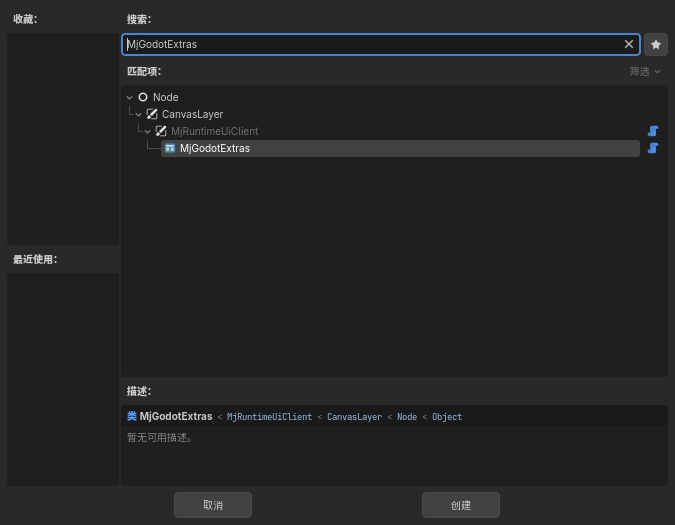
