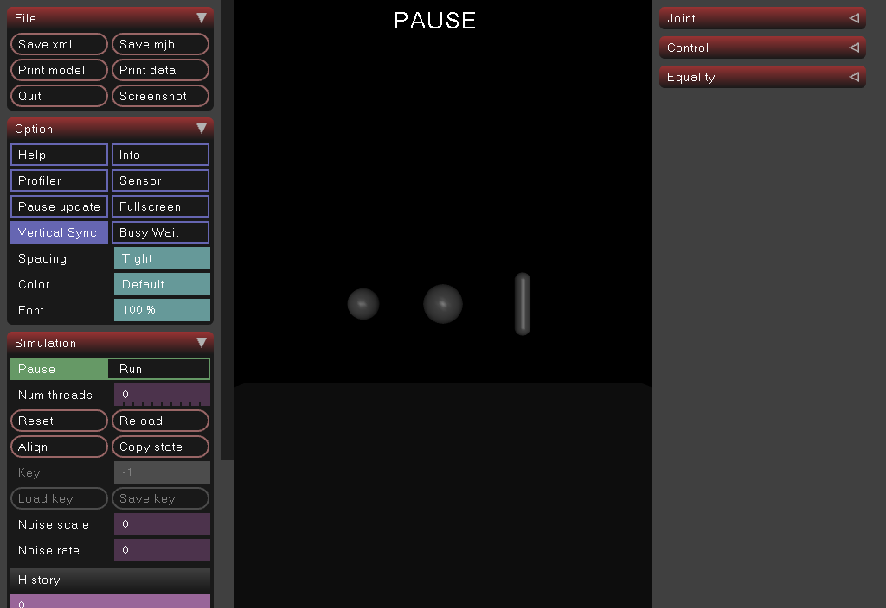
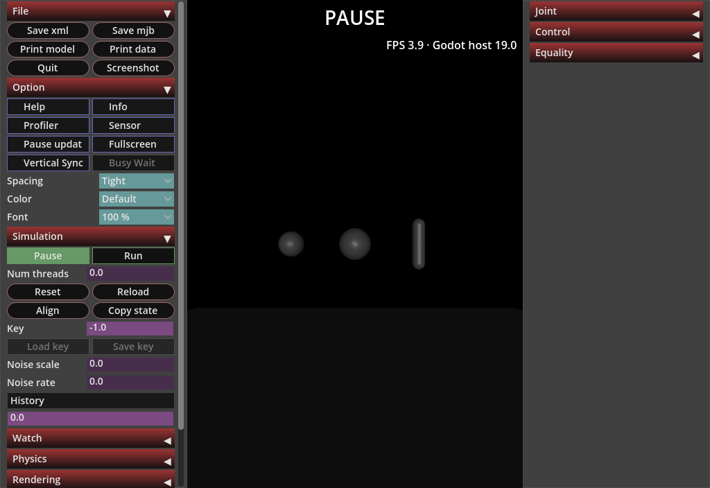
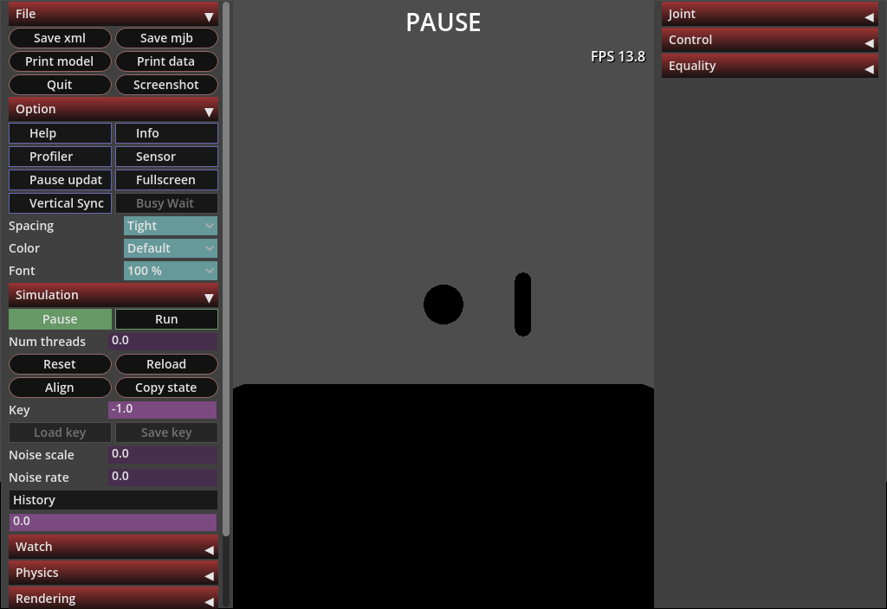

# MuJoCo 3.16 simulate panel parity

The game adapts the original simulate definitions to Godot Controls on both renderers. F11 owns only Godot extras. This is a control/ownership inventory and GUI review record, not a claim of pixel-identical mjui drawing.

Source: [fixed simulate.cc](https://github.com/google-deepmind/mujoco/blob/3.16.0/simulate/simulate.cc), [simulate.h](https://github.com/google-deepmind/mujoco/blob/3.16.0/simulate/simulate.h). Apache-2.0 attribution and modification notes: [UPSTREAM](../../src/viewer/UPSTREAM.md).

Existing restrictions remain visible: Physics design settings read-only; Busy Wait belongs to the Godot host scheduler; shared-world composition rejects source keyframes/global userdata/mocap sources. Original key controls remain present with a reason. Unsupported OpenGL effects are disabled on Godot; current rigid models have no flex/skin. Model-conditional controls follow the original creation rule.

## Fixed definition inventory

| Section | Original item | Original type | Godot | Native |
|---|---|---|---|---|
| File | [Save xml](https://github.com/google-deepmind/mujoco/blob/3.16.0/simulate/simulate.cc#L120) | button | available | available |
| File | [Save mjb](https://github.com/google-deepmind/mujoco/blob/3.16.0/simulate/simulate.cc#L121) | button | available | available |
| File | [Print model](https://github.com/google-deepmind/mujoco/blob/3.16.0/simulate/simulate.cc#L122) | button | available | available |
| File | [Print data](https://github.com/google-deepmind/mujoco/blob/3.16.0/simulate/simulate.cc#L123) | button | available | available |
| File | [Quit](https://github.com/google-deepmind/mujoco/blob/3.16.0/simulate/simulate.cc#L124) | button | available | available |
| File | [Screenshot](https://github.com/google-deepmind/mujoco/blob/3.16.0/simulate/simulate.cc#L125) | button | available | available |
| Physics | [Integrator](https://github.com/google-deepmind/mujoco/blob/3.16.0/simulate/simulate.cc#L803) | select | disabled — Physics design is read-only at runtime. Edit in Godot editor. | disabled — Physics design is read-only at runtime. Edit in Godot editor. |
| Physics | [Cone](https://github.com/google-deepmind/mujoco/blob/3.16.0/simulate/simulate.cc#L804) | select | disabled — Physics design is read-only at runtime. Edit in Godot editor. | disabled — Physics design is read-only at runtime. Edit in Godot editor. |
| Physics | [Jacobian](https://github.com/google-deepmind/mujoco/blob/3.16.0/simulate/simulate.cc#L805) | select | disabled — Physics design is read-only at runtime. Edit in Godot editor. | disabled — Physics design is read-only at runtime. Edit in Godot editor. |
| Physics | [Solver](https://github.com/google-deepmind/mujoco/blob/3.16.0/simulate/simulate.cc#L806) | select | disabled — Physics design is read-only at runtime. Edit in Godot editor. | disabled — Physics design is read-only at runtime. Edit in Godot editor. |
| Physics | [Algorithmic Parameters](https://github.com/google-deepmind/mujoco/blob/3.16.0/simulate/simulate.cc#L807) | separator | available | available |
| Physics | [Timestep](https://github.com/google-deepmind/mujoco/blob/3.16.0/simulate/simulate.cc#L808) | editnum | disabled — Physics design is read-only at runtime. Edit in Godot editor. | disabled — Physics design is read-only at runtime. Edit in Godot editor. |
| Physics | [Iterations](https://github.com/google-deepmind/mujoco/blob/3.16.0/simulate/simulate.cc#L809) | editint | disabled — Physics design is read-only at runtime. Edit in Godot editor. | disabled — Physics design is read-only at runtime. Edit in Godot editor. |
| Physics | [Tolerance](https://github.com/google-deepmind/mujoco/blob/3.16.0/simulate/simulate.cc#L810) | editnum | disabled — Physics design is read-only at runtime. Edit in Godot editor. | disabled — Physics design is read-only at runtime. Edit in Godot editor. |
| Physics | [LS Iter](https://github.com/google-deepmind/mujoco/blob/3.16.0/simulate/simulate.cc#L811) | editint | disabled — Physics design is read-only at runtime. Edit in Godot editor. | disabled — Physics design is read-only at runtime. Edit in Godot editor. |
| Physics | [LS Tol](https://github.com/google-deepmind/mujoco/blob/3.16.0/simulate/simulate.cc#L812) | editnum | disabled — Physics design is read-only at runtime. Edit in Godot editor. | disabled — Physics design is read-only at runtime. Edit in Godot editor. |
| Physics | [Noslip Iter](https://github.com/google-deepmind/mujoco/blob/3.16.0/simulate/simulate.cc#L813) | editint | disabled — Physics design is read-only at runtime. Edit in Godot editor. | disabled — Physics design is read-only at runtime. Edit in Godot editor. |
| Physics | [Noslip Tol](https://github.com/google-deepmind/mujoco/blob/3.16.0/simulate/simulate.cc#L814) | editnum | disabled — Physics design is read-only at runtime. Edit in Godot editor. | disabled — Physics design is read-only at runtime. Edit in Godot editor. |
| Physics | [CCD Iter](https://github.com/google-deepmind/mujoco/blob/3.16.0/simulate/simulate.cc#L815) | editint | disabled — Physics design is read-only at runtime. Edit in Godot editor. | disabled — Physics design is read-only at runtime. Edit in Godot editor. |
| Physics | [CCD Tol](https://github.com/google-deepmind/mujoco/blob/3.16.0/simulate/simulate.cc#L816) | editnum | disabled — Physics design is read-only at runtime. Edit in Godot editor. | disabled — Physics design is read-only at runtime. Edit in Godot editor. |
| Physics | [Sleep Tol](https://github.com/google-deepmind/mujoco/blob/3.16.0/simulate/simulate.cc#L817) | editnum | disabled — Physics design is read-only at runtime. Edit in Godot editor. | disabled — Physics design is read-only at runtime. Edit in Godot editor. |
| Physics | [SDF Iter](https://github.com/google-deepmind/mujoco/blob/3.16.0/simulate/simulate.cc#L818) | editint | disabled — Physics design is read-only at runtime. Edit in Godot editor. | disabled — Physics design is read-only at runtime. Edit in Godot editor. |
| Physics | [SDF Init](https://github.com/google-deepmind/mujoco/blob/3.16.0/simulate/simulate.cc#L819) | editint | disabled — Physics design is read-only at runtime. Edit in Godot editor. | disabled — Physics design is read-only at runtime. Edit in Godot editor. |
| Physics | [Physical Parameters](https://github.com/google-deepmind/mujoco/blob/3.16.0/simulate/simulate.cc#L820) | separator | available | available |
| Physics | [Gravity](https://github.com/google-deepmind/mujoco/blob/3.16.0/simulate/simulate.cc#L821) | editnum | disabled — Physics design is read-only at runtime. | disabled — Physics design is read-only at runtime. |
| Physics | [Wind](https://github.com/google-deepmind/mujoco/blob/3.16.0/simulate/simulate.cc#L822) | editnum | disabled — Physics design is read-only at runtime. Edit in Godot editor. | disabled — Physics design is read-only at runtime. Edit in Godot editor. |
| Physics | [Magnetic](https://github.com/google-deepmind/mujoco/blob/3.16.0/simulate/simulate.cc#L823) | editnum | disabled — Physics design is read-only at runtime. Edit in Godot editor. | disabled — Physics design is read-only at runtime. Edit in Godot editor. |
| Physics | [Density](https://github.com/google-deepmind/mujoco/blob/3.16.0/simulate/simulate.cc#L824) | editnum | disabled — Physics design is read-only at runtime. Edit in Godot editor. | disabled — Physics design is read-only at runtime. Edit in Godot editor. |
| Physics | [Viscosity](https://github.com/google-deepmind/mujoco/blob/3.16.0/simulate/simulate.cc#L825) | editnum | disabled — Physics design is read-only at runtime. Edit in Godot editor. | disabled — Physics design is read-only at runtime. Edit in Godot editor. |
| Physics | [Imp Ratio](https://github.com/google-deepmind/mujoco/blob/3.16.0/simulate/simulate.cc#L826) | editnum | disabled — Physics design is read-only at runtime. Edit in Godot editor. | disabled — Physics design is read-only at runtime. Edit in Godot editor. |
| Physics | [Disable Flags](https://github.com/google-deepmind/mujoco/blob/3.16.0/simulate/simulate.cc#L827) | separator | available | available |
| Physics | [Enable Flags](https://github.com/google-deepmind/mujoco/blob/3.16.0/simulate/simulate.cc#L831) | separator | available | available |
| Physics | [Contact Override](https://github.com/google-deepmind/mujoco/blob/3.16.0/simulate/simulate.cc#L835) | separator | available | available |
| Physics | [Margin](https://github.com/google-deepmind/mujoco/blob/3.16.0/simulate/simulate.cc#L836) | editnum | disabled — Physics design is read-only at runtime. Edit in Godot editor. | disabled — Physics design is read-only at runtime. Edit in Godot editor. |
| Physics | [Sol Imp](https://github.com/google-deepmind/mujoco/blob/3.16.0/simulate/simulate.cc#L837) | editnum | disabled — Physics design is read-only at runtime. Edit in Godot editor. | disabled — Physics design is read-only at runtime. Edit in Godot editor. |
| Physics | [Sol Ref](https://github.com/google-deepmind/mujoco/blob/3.16.0/simulate/simulate.cc#L838) | editnum | disabled — Physics design is read-only at runtime. Edit in Godot editor. | disabled — Physics design is read-only at runtime. Edit in Godot editor. |
| Physics | [Friction](https://github.com/google-deepmind/mujoco/blob/3.16.0/simulate/simulate.cc#L839) | editnum | disabled — Physics design is read-only at runtime. Edit in Godot editor. | disabled — Physics design is read-only at runtime. Edit in Godot editor. |
| Physics | [Actuator Group Enable](https://github.com/google-deepmind/mujoco/blob/3.16.0/simulate/simulate.cc#L843) | separator | available | available |
| Physics | [Act Group 0](https://github.com/google-deepmind/mujoco/blob/3.16.0/simulate/simulate.cc#L844) | checkbyte | disabled — Actuator design groups are read-only at runtime. | disabled — Actuator design groups are read-only at runtime. |
| Physics | [Act Group 1](https://github.com/google-deepmind/mujoco/blob/3.16.0/simulate/simulate.cc#L845) | checkbyte | disabled — Actuator design groups are read-only at runtime. | disabled — Actuator design groups are read-only at runtime. |
| Physics | [Act Group 2](https://github.com/google-deepmind/mujoco/blob/3.16.0/simulate/simulate.cc#L846) | checkbyte | disabled — Actuator design groups are read-only at runtime. | disabled — Actuator design groups are read-only at runtime. |
| Physics | [Act Group 3](https://github.com/google-deepmind/mujoco/blob/3.16.0/simulate/simulate.cc#L847) | checkbyte | disabled — Actuator design groups are read-only at runtime. | disabled — Actuator design groups are read-only at runtime. |
| Physics | [Act Group 4](https://github.com/google-deepmind/mujoco/blob/3.16.0/simulate/simulate.cc#L848) | checkbyte | disabled — Actuator design groups are read-only at runtime. | disabled — Actuator design groups are read-only at runtime. |
| Physics | [Act Group 5](https://github.com/google-deepmind/mujoco/blob/3.16.0/simulate/simulate.cc#L849) | checkbyte | disabled — Actuator design groups are read-only at runtime. | disabled — Actuator design groups are read-only at runtime. |
| Rendering | [Camera](https://github.com/google-deepmind/mujoco/blob/3.16.0/simulate/simulate.cc#L899) | select | available | available |
| Rendering | [Label](https://github.com/google-deepmind/mujoco/blob/3.16.0/simulate/simulate.cc#L900) | select | available | available |
| Rendering | [Frame](https://github.com/google-deepmind/mujoco/blob/3.16.0/simulate/simulate.cc#L905) | select | available | available |
| Rendering | [Copy camera](https://github.com/google-deepmind/mujoco/blob/3.16.0/simulate/simulate.cc#L909) | button | available | available |
| Rendering | [Model Elements](https://github.com/google-deepmind/mujoco/blob/3.16.0/simulate/simulate.cc#L910) | separator | available | available |
| Rendering | [OpenGL Effects](https://github.com/google-deepmind/mujoco/blob/3.16.0/simulate/simulate.cc#L914) | separator | available | available |
| Rendering | [Tree depth](https://github.com/google-deepmind/mujoco/blob/3.16.0/simulate/simulate.cc#L962) | sliderint | available | available |
| Rendering | [Flex layer](https://github.com/google-deepmind/mujoco/blob/3.16.0/simulate/simulate.cc#L963) | sliderint | disabled — Current rigid model has no flex. | disabled — Current rigid model has no flex. |
| Rendering | [Sensor](https://github.com/google-deepmind/mujoco/blob/3.16.0/simulate/simulate.cc#L989) | select | model-conditional — Original selector is created only when user image sensors exist. | model-conditional — Original selector is created only when user image sensors exist. |
| Visualization | [Headlight](https://github.com/google-deepmind/mujoco/blob/3.16.0/simulate/simulate.cc#L1022) | separator | available | available |
| Visualization | [Active](https://github.com/google-deepmind/mujoco/blob/3.16.0/simulate/simulate.cc#L1023) | radio | disabled — Godot keeps its authored lighting/environment; this OpenGL setting is unavailable | available |
| Visualization | [Ambient](https://github.com/google-deepmind/mujoco/blob/3.16.0/simulate/simulate.cc#L1024) | editfloat | disabled — Godot keeps its authored lighting/environment; this OpenGL setting is unavailable | available |
| Visualization | [Diffuse](https://github.com/google-deepmind/mujoco/blob/3.16.0/simulate/simulate.cc#L1025) | editfloat | disabled — Godot keeps its authored lighting/environment; this OpenGL setting is unavailable | available |
| Visualization | [Specular](https://github.com/google-deepmind/mujoco/blob/3.16.0/simulate/simulate.cc#L1026) | editfloat | disabled — Godot keeps its authored lighting/environment; this OpenGL setting is unavailable | available |
| Visualization | [Free Camera](https://github.com/google-deepmind/mujoco/blob/3.16.0/simulate/simulate.cc#L1027) | separator | available | available |
| Visualization | [Orthographic](https://github.com/google-deepmind/mujoco/blob/3.16.0/simulate/simulate.cc#L1028) | radio | available | available |
| Visualization | [Field of view](https://github.com/google-deepmind/mujoco/blob/3.16.0/simulate/simulate.cc#L1029) | editfloat | available | available |
| Visualization | [Center](https://github.com/google-deepmind/mujoco/blob/3.16.0/simulate/simulate.cc#L1030) | editnum | available | available |
| Visualization | [Azimuth](https://github.com/google-deepmind/mujoco/blob/3.16.0/simulate/simulate.cc#L1031) | editfloat | available | available |
| Visualization | [Elevation](https://github.com/google-deepmind/mujoco/blob/3.16.0/simulate/simulate.cc#L1032) | editfloat | available | available |
| Visualization | [Align](https://github.com/google-deepmind/mujoco/blob/3.16.0/simulate/simulate.cc#L1033) | button | available | available |
| Visualization | [Global](https://github.com/google-deepmind/mujoco/blob/3.16.0/simulate/simulate.cc#L1034) | separator | available | available |
| Visualization | [Extent](https://github.com/google-deepmind/mujoco/blob/3.16.0/simulate/simulate.cc#L1035) | editnum | available | available |
| Visualization | [Inertia](https://github.com/google-deepmind/mujoco/blob/3.16.0/simulate/simulate.cc#L1036) | radio | available | available |
| Visualization | [BVH active](https://github.com/google-deepmind/mujoco/blob/3.16.0/simulate/simulate.cc#L1037) | radio | available | available |
| Visualization | [Map](https://github.com/google-deepmind/mujoco/blob/3.16.0/simulate/simulate.cc#L1038) | separator | available | available |
| Visualization | [Stiffness](https://github.com/google-deepmind/mujoco/blob/3.16.0/simulate/simulate.cc#L1039) | editfloat | available | available |
| Visualization | [Rot stiffness](https://github.com/google-deepmind/mujoco/blob/3.16.0/simulate/simulate.cc#L1040) | editfloat | available | available |
| Visualization | [Force](https://github.com/google-deepmind/mujoco/blob/3.16.0/simulate/simulate.cc#L1041) | editfloat | available | available |
| Visualization | [Torque](https://github.com/google-deepmind/mujoco/blob/3.16.0/simulate/simulate.cc#L1042) | editfloat | available | available |
| Visualization | [Alpha](https://github.com/google-deepmind/mujoco/blob/3.16.0/simulate/simulate.cc#L1043) | editfloat | disabled — Godot keeps its authored lighting/environment; this OpenGL setting is unavailable | available |
| Visualization | [Fog start](https://github.com/google-deepmind/mujoco/blob/3.16.0/simulate/simulate.cc#L1044) | editfloat | disabled — Godot keeps its authored lighting/environment; this OpenGL setting is unavailable | available |
| Visualization | [Fog end](https://github.com/google-deepmind/mujoco/blob/3.16.0/simulate/simulate.cc#L1045) | editfloat | disabled — Godot keeps its authored lighting/environment; this OpenGL setting is unavailable | available |
| Visualization | [Z near](https://github.com/google-deepmind/mujoco/blob/3.16.0/simulate/simulate.cc#L1046) | editfloat | available | available |
| Visualization | [Z far](https://github.com/google-deepmind/mujoco/blob/3.16.0/simulate/simulate.cc#L1047) | editfloat | available | available |
| Visualization | [Haze](https://github.com/google-deepmind/mujoco/blob/3.16.0/simulate/simulate.cc#L1048) | editfloat | disabled — Godot keeps its authored lighting/environment; this OpenGL setting is unavailable | available |
| Visualization | [Shadow clip](https://github.com/google-deepmind/mujoco/blob/3.16.0/simulate/simulate.cc#L1049) | editfloat | disabled — Godot keeps its authored lighting/environment; this OpenGL setting is unavailable | available |
| Visualization | [Shadow scale](https://github.com/google-deepmind/mujoco/blob/3.16.0/simulate/simulate.cc#L1050) | editfloat | disabled — Godot keeps its authored lighting/environment; this OpenGL setting is unavailable | available |
| Visualization | [Scale](https://github.com/google-deepmind/mujoco/blob/3.16.0/simulate/simulate.cc#L1051) | separator | available | available |
| Visualization | [All (meansize)](https://github.com/google-deepmind/mujoco/blob/3.16.0/simulate/simulate.cc#L1052) | editnum | available | available |
| Visualization | [Force width](https://github.com/google-deepmind/mujoco/blob/3.16.0/simulate/simulate.cc#L1053) | editfloat | available | available |
| Visualization | [Contact width](https://github.com/google-deepmind/mujoco/blob/3.16.0/simulate/simulate.cc#L1054) | editfloat | available | available |
| Visualization | [Contact height](https://github.com/google-deepmind/mujoco/blob/3.16.0/simulate/simulate.cc#L1055) | editfloat | available | available |
| Visualization | [Connect](https://github.com/google-deepmind/mujoco/blob/3.16.0/simulate/simulate.cc#L1056) | editfloat | available | available |
| Visualization | [Com](https://github.com/google-deepmind/mujoco/blob/3.16.0/simulate/simulate.cc#L1057) | editfloat | available | available |
| Visualization | [Camera](https://github.com/google-deepmind/mujoco/blob/3.16.0/simulate/simulate.cc#L1058) | editfloat | available | available |
| Visualization | [Light](https://github.com/google-deepmind/mujoco/blob/3.16.0/simulate/simulate.cc#L1059) | editfloat | available | available |
| Visualization | [Select point](https://github.com/google-deepmind/mujoco/blob/3.16.0/simulate/simulate.cc#L1060) | editfloat | available | available |
| Visualization | [Joint length](https://github.com/google-deepmind/mujoco/blob/3.16.0/simulate/simulate.cc#L1061) | editfloat | available | available |
| Visualization | [Joint width](https://github.com/google-deepmind/mujoco/blob/3.16.0/simulate/simulate.cc#L1062) | editfloat | available | available |
| Visualization | [Actuator length](https://github.com/google-deepmind/mujoco/blob/3.16.0/simulate/simulate.cc#L1063) | editfloat | available | available |
| Visualization | [Actuator width](https://github.com/google-deepmind/mujoco/blob/3.16.0/simulate/simulate.cc#L1064) | editfloat | available | available |
| Visualization | [Frame length](https://github.com/google-deepmind/mujoco/blob/3.16.0/simulate/simulate.cc#L1065) | editfloat | available | available |
| Visualization | [Frame width](https://github.com/google-deepmind/mujoco/blob/3.16.0/simulate/simulate.cc#L1066) | editfloat | available | available |
| Visualization | [Constraint](https://github.com/google-deepmind/mujoco/blob/3.16.0/simulate/simulate.cc#L1067) | editfloat | available | available |
| Visualization | [Slider-crank](https://github.com/google-deepmind/mujoco/blob/3.16.0/simulate/simulate.cc#L1068) | editfloat | available | available |
| Visualization | [RGBA](https://github.com/google-deepmind/mujoco/blob/3.16.0/simulate/simulate.cc#L1069) | separator | available | available |
| Visualization | [fog](https://github.com/google-deepmind/mujoco/blob/3.16.0/simulate/simulate.cc#L1070) | editfloat | disabled — Godot keeps its authored lighting/environment; this OpenGL setting is unavailable | available |
| Visualization | [haze](https://github.com/google-deepmind/mujoco/blob/3.16.0/simulate/simulate.cc#L1071) | editfloat | disabled — Godot keeps its authored lighting/environment; this OpenGL setting is unavailable | available |
| Visualization | [force](https://github.com/google-deepmind/mujoco/blob/3.16.0/simulate/simulate.cc#L1072) | editfloat | available | available |
| Visualization | [inertia](https://github.com/google-deepmind/mujoco/blob/3.16.0/simulate/simulate.cc#L1073) | editfloat | available | available |
| Visualization | [joint](https://github.com/google-deepmind/mujoco/blob/3.16.0/simulate/simulate.cc#L1074) | editfloat | available | available |
| Visualization | [actuator](https://github.com/google-deepmind/mujoco/blob/3.16.0/simulate/simulate.cc#L1075) | editfloat | available | available |
| Visualization | [actnegative](https://github.com/google-deepmind/mujoco/blob/3.16.0/simulate/simulate.cc#L1076) | editfloat | available | available |
| Visualization | [actpositive](https://github.com/google-deepmind/mujoco/blob/3.16.0/simulate/simulate.cc#L1077) | editfloat | available | available |
| Visualization | [com](https://github.com/google-deepmind/mujoco/blob/3.16.0/simulate/simulate.cc#L1078) | editfloat | available | available |
| Visualization | [camera](https://github.com/google-deepmind/mujoco/blob/3.16.0/simulate/simulate.cc#L1079) | editfloat | available | available |
| Visualization | [light](https://github.com/google-deepmind/mujoco/blob/3.16.0/simulate/simulate.cc#L1080) | editfloat | available | available |
| Visualization | [selectpoint](https://github.com/google-deepmind/mujoco/blob/3.16.0/simulate/simulate.cc#L1081) | editfloat | available | available |
| Visualization | [connect](https://github.com/google-deepmind/mujoco/blob/3.16.0/simulate/simulate.cc#L1082) | editfloat | available | available |
| Visualization | [contactpoint](https://github.com/google-deepmind/mujoco/blob/3.16.0/simulate/simulate.cc#L1083) | editfloat | available | available |
| Visualization | [contactforce](https://github.com/google-deepmind/mujoco/blob/3.16.0/simulate/simulate.cc#L1084) | editfloat | available | available |
| Visualization | [contactfriction](https://github.com/google-deepmind/mujoco/blob/3.16.0/simulate/simulate.cc#L1085) | editfloat | available | available |
| Visualization | [contacttorque](https://github.com/google-deepmind/mujoco/blob/3.16.0/simulate/simulate.cc#L1086) | editfloat | available | available |
| Visualization | [contactgap](https://github.com/google-deepmind/mujoco/blob/3.16.0/simulate/simulate.cc#L1087) | editfloat | available | available |
| Visualization | [rangefinder](https://github.com/google-deepmind/mujoco/blob/3.16.0/simulate/simulate.cc#L1088) | editfloat | available | available |
| Visualization | [constraint](https://github.com/google-deepmind/mujoco/blob/3.16.0/simulate/simulate.cc#L1089) | editfloat | available | available |
| Visualization | [slidercrank](https://github.com/google-deepmind/mujoco/blob/3.16.0/simulate/simulate.cc#L1090) | editfloat | available | available |
| Visualization | [crankbroken](https://github.com/google-deepmind/mujoco/blob/3.16.0/simulate/simulate.cc#L1091) | editfloat | available | available |
| Visualization | [frustum](https://github.com/google-deepmind/mujoco/blob/3.16.0/simulate/simulate.cc#L1092) | editfloat | available | available |
| Visualization | [bv](https://github.com/google-deepmind/mujoco/blob/3.16.0/simulate/simulate.cc#L1093) | editfloat | available | available |
| Visualization | [bvactive](https://github.com/google-deepmind/mujoco/blob/3.16.0/simulate/simulate.cc#L1094) | editfloat | available | available |
| Group enable | [Geom groups](https://github.com/google-deepmind/mujoco/blob/3.16.0/simulate/simulate.cc#L1106) | separator | available | available |
| Group enable | [Geom 0](https://github.com/google-deepmind/mujoco/blob/3.16.0/simulate/simulate.cc#L1107) | checkbyte | available | available |
| Group enable | [Geom 1](https://github.com/google-deepmind/mujoco/blob/3.16.0/simulate/simulate.cc#L1108) | checkbyte | available | available |
| Group enable | [Geom 2](https://github.com/google-deepmind/mujoco/blob/3.16.0/simulate/simulate.cc#L1109) | checkbyte | available | available |
| Group enable | [Geom 3](https://github.com/google-deepmind/mujoco/blob/3.16.0/simulate/simulate.cc#L1110) | checkbyte | available | available |
| Group enable | [Geom 4](https://github.com/google-deepmind/mujoco/blob/3.16.0/simulate/simulate.cc#L1111) | checkbyte | available | available |
| Group enable | [Geom 5](https://github.com/google-deepmind/mujoco/blob/3.16.0/simulate/simulate.cc#L1112) | checkbyte | available | available |
| Group enable | [Site groups](https://github.com/google-deepmind/mujoco/blob/3.16.0/simulate/simulate.cc#L1113) | separator | available | available |
| Group enable | [Site 0](https://github.com/google-deepmind/mujoco/blob/3.16.0/simulate/simulate.cc#L1114) | checkbyte | available | available |
| Group enable | [Site 1](https://github.com/google-deepmind/mujoco/blob/3.16.0/simulate/simulate.cc#L1115) | checkbyte | available | available |
| Group enable | [Site 2](https://github.com/google-deepmind/mujoco/blob/3.16.0/simulate/simulate.cc#L1116) | checkbyte | available | available |
| Group enable | [Site 3](https://github.com/google-deepmind/mujoco/blob/3.16.0/simulate/simulate.cc#L1117) | checkbyte | available | available |
| Group enable | [Site 4](https://github.com/google-deepmind/mujoco/blob/3.16.0/simulate/simulate.cc#L1118) | checkbyte | available | available |
| Group enable | [Site 5](https://github.com/google-deepmind/mujoco/blob/3.16.0/simulate/simulate.cc#L1119) | checkbyte | available | available |
| Group enable | [Joint groups](https://github.com/google-deepmind/mujoco/blob/3.16.0/simulate/simulate.cc#L1120) | separator | available | available |
| Group enable | [Joint 0](https://github.com/google-deepmind/mujoco/blob/3.16.0/simulate/simulate.cc#L1121) | checkbyte | available | available |
| Group enable | [Joint 1](https://github.com/google-deepmind/mujoco/blob/3.16.0/simulate/simulate.cc#L1122) | checkbyte | available | available |
| Group enable | [Joint 2](https://github.com/google-deepmind/mujoco/blob/3.16.0/simulate/simulate.cc#L1123) | checkbyte | available | available |
| Group enable | [Joint 3](https://github.com/google-deepmind/mujoco/blob/3.16.0/simulate/simulate.cc#L1124) | checkbyte | available | available |
| Group enable | [Joint 4](https://github.com/google-deepmind/mujoco/blob/3.16.0/simulate/simulate.cc#L1125) | checkbyte | available | available |
| Group enable | [Joint 5](https://github.com/google-deepmind/mujoco/blob/3.16.0/simulate/simulate.cc#L1126) | checkbyte | available | available |
| Group enable | [Tendon groups](https://github.com/google-deepmind/mujoco/blob/3.16.0/simulate/simulate.cc#L1127) | separator | available | available |
| Group enable | [Tendon 0](https://github.com/google-deepmind/mujoco/blob/3.16.0/simulate/simulate.cc#L1128) | checkbyte | available | available |
| Group enable | [Tendon 1](https://github.com/google-deepmind/mujoco/blob/3.16.0/simulate/simulate.cc#L1129) | checkbyte | available | available |
| Group enable | [Tendon 2](https://github.com/google-deepmind/mujoco/blob/3.16.0/simulate/simulate.cc#L1130) | checkbyte | available | available |
| Group enable | [Tendon 3](https://github.com/google-deepmind/mujoco/blob/3.16.0/simulate/simulate.cc#L1131) | checkbyte | available | available |
| Group enable | [Tendon 4](https://github.com/google-deepmind/mujoco/blob/3.16.0/simulate/simulate.cc#L1132) | checkbyte | available | available |
| Group enable | [Tendon 5](https://github.com/google-deepmind/mujoco/blob/3.16.0/simulate/simulate.cc#L1133) | checkbyte | available | available |
| Group enable | [Actuator groups](https://github.com/google-deepmind/mujoco/blob/3.16.0/simulate/simulate.cc#L1134) | separator | available | available |
| Group enable | [Actuator 0](https://github.com/google-deepmind/mujoco/blob/3.16.0/simulate/simulate.cc#L1135) | checkbyte | available | available |
| Group enable | [Actuator 1](https://github.com/google-deepmind/mujoco/blob/3.16.0/simulate/simulate.cc#L1136) | checkbyte | available | available |
| Group enable | [Actuator 2](https://github.com/google-deepmind/mujoco/blob/3.16.0/simulate/simulate.cc#L1137) | checkbyte | available | available |
| Group enable | [Actuator 3](https://github.com/google-deepmind/mujoco/blob/3.16.0/simulate/simulate.cc#L1138) | checkbyte | available | available |
| Group enable | [Actuator 4](https://github.com/google-deepmind/mujoco/blob/3.16.0/simulate/simulate.cc#L1139) | checkbyte | available | available |
| Group enable | [Actuator 5](https://github.com/google-deepmind/mujoco/blob/3.16.0/simulate/simulate.cc#L1140) | checkbyte | available | available |
| Group enable | [Flex groups](https://github.com/google-deepmind/mujoco/blob/3.16.0/simulate/simulate.cc#L1141) | separator | available | available |
| Group enable | [Flex 0](https://github.com/google-deepmind/mujoco/blob/3.16.0/simulate/simulate.cc#L1142) | checkbyte | disabled — Current supported model has no flex/skin | disabled — Current supported model has no flex/skin |
| Group enable | [Flex 1](https://github.com/google-deepmind/mujoco/blob/3.16.0/simulate/simulate.cc#L1143) | checkbyte | disabled — Current supported model has no flex/skin | disabled — Current supported model has no flex/skin |
| Group enable | [Flex 2](https://github.com/google-deepmind/mujoco/blob/3.16.0/simulate/simulate.cc#L1144) | checkbyte | disabled — Current supported model has no flex/skin | disabled — Current supported model has no flex/skin |
| Group enable | [Flex 3](https://github.com/google-deepmind/mujoco/blob/3.16.0/simulate/simulate.cc#L1145) | checkbyte | disabled — Current supported model has no flex/skin | disabled — Current supported model has no flex/skin |
| Group enable | [Flex 4](https://github.com/google-deepmind/mujoco/blob/3.16.0/simulate/simulate.cc#L1146) | checkbyte | disabled — Current supported model has no flex/skin | disabled — Current supported model has no flex/skin |
| Group enable | [Flex 5](https://github.com/google-deepmind/mujoco/blob/3.16.0/simulate/simulate.cc#L1147) | checkbyte | disabled — Current supported model has no flex/skin | disabled — Current supported model has no flex/skin |
| Group enable | [Skin groups](https://github.com/google-deepmind/mujoco/blob/3.16.0/simulate/simulate.cc#L1148) | separator | available | available |
| Group enable | [Skin 0](https://github.com/google-deepmind/mujoco/blob/3.16.0/simulate/simulate.cc#L1149) | checkbyte | disabled — Current supported model has no flex/skin | disabled — Current supported model has no flex/skin |
| Group enable | [Skin 1](https://github.com/google-deepmind/mujoco/blob/3.16.0/simulate/simulate.cc#L1150) | checkbyte | disabled — Current supported model has no flex/skin | disabled — Current supported model has no flex/skin |
| Group enable | [Skin 2](https://github.com/google-deepmind/mujoco/blob/3.16.0/simulate/simulate.cc#L1151) | checkbyte | disabled — Current supported model has no flex/skin | disabled — Current supported model has no flex/skin |
| Group enable | [Skin 3](https://github.com/google-deepmind/mujoco/blob/3.16.0/simulate/simulate.cc#L1152) | checkbyte | disabled — Current supported model has no flex/skin | disabled — Current supported model has no flex/skin |
| Group enable | [Skin 4](https://github.com/google-deepmind/mujoco/blob/3.16.0/simulate/simulate.cc#L1153) | checkbyte | disabled — Current supported model has no flex/skin | disabled — Current supported model has no flex/skin |
| Group enable | [Skin 5](https://github.com/google-deepmind/mujoco/blob/3.16.0/simulate/simulate.cc#L1154) | checkbyte | disabled — Current supported model has no flex/skin | disabled — Current supported model has no flex/skin |
| Logging | [Console](https://github.com/google-deepmind/mujoco/blob/3.16.0/simulate/simulate.cc#L1173) | checkbyte | available | available |
| Logging | [File](https://github.com/google-deepmind/mujoco/blob/3.16.0/simulate/simulate.cc#L1174) | checkbyte | available | available |
| Logging | [Info topics](https://github.com/google-deepmind/mujoco/blob/3.16.0/simulate/simulate.cc#L1175) | separator | available | available |
| Control | [Clear all](https://github.com/google-deepmind/mujoco/blob/3.16.0/simulate/simulate.cc#L1249) | button | available | available |
| Option | [Help](https://github.com/google-deepmind/mujoco/blob/3.16.0/simulate/simulate.h#L334) | checkint | available | available |
| Option | [Info](https://github.com/google-deepmind/mujoco/blob/3.16.0/simulate/simulate.h#L335) | checkint | available | available |
| Option | [Profiler](https://github.com/google-deepmind/mujoco/blob/3.16.0/simulate/simulate.h#L336) | checkint | available | available |
| Option | [Sensor](https://github.com/google-deepmind/mujoco/blob/3.16.0/simulate/simulate.h#L337) | checkint | available | available |
| Option | [Pause update](https://github.com/google-deepmind/mujoco/blob/3.16.0/simulate/simulate.h#L338) | checkint | available | available |
| Option | [Fullscreen](https://github.com/google-deepmind/mujoco/blob/3.16.0/simulate/simulate.h#L340) | checkint | available | available |
| Option | [Vertical Sync](https://github.com/google-deepmind/mujoco/blob/3.16.0/simulate/simulate.h#L344) | checkint | available | available |
| Option | [Busy Wait](https://github.com/google-deepmind/mujoco/blob/3.16.0/simulate/simulate.h#L345) | checkint | disabled — Godot owns the event/render loop; simulate's busy-wait scheduler is not used. | disabled — Godot owns the event/render loop; simulate's busy-wait scheduler is not used. |
| Option | [Spacing](https://github.com/google-deepmind/mujoco/blob/3.16.0/simulate/simulate.h#L346) | select | available | available |
| Option | [Color](https://github.com/google-deepmind/mujoco/blob/3.16.0/simulate/simulate.h#L347) | select | available | available |
| Option | [Font](https://github.com/google-deepmind/mujoco/blob/3.16.0/simulate/simulate.h#L348) | select | available | available |
| Simulation | [Num threads](https://github.com/google-deepmind/mujoco/blob/3.16.0/simulate/simulate.h#L357) | sliderint | available | available |
| Simulation | [Reset](https://github.com/google-deepmind/mujoco/blob/3.16.0/simulate/simulate.h#L358) | button | available | available |
| Simulation | [Reload](https://github.com/google-deepmind/mujoco/blob/3.16.0/simulate/simulate.h#L359) | button | available | available |
| Simulation | [Align](https://github.com/google-deepmind/mujoco/blob/3.16.0/simulate/simulate.h#L360) | button | available | available |
| Simulation | [Copy state](https://github.com/google-deepmind/mujoco/blob/3.16.0/simulate/simulate.h#L361) | button | available | available |
| Simulation | [Key](https://github.com/google-deepmind/mujoco/blob/3.16.0/simulate/simulate.h#L362) | sliderint | disabled — No model keyframes. The existing shared-world composition does not accept source models with keyframes; original design data is retained by the editor. | disabled — No model keyframes. The existing shared-world composition does not accept source models with keyframes; original design data is retained by the editor. |
| Simulation | [Load key](https://github.com/google-deepmind/mujoco/blob/3.16.0/simulate/simulate.h#L363) | button | disabled — No model keyframes. The existing shared-world composition does not accept source models with keyframes; original design data is retained by the editor. | disabled — No model keyframes. The existing shared-world composition does not accept source models with keyframes; original design data is retained by the editor. |
| Simulation | [Save key](https://github.com/google-deepmind/mujoco/blob/3.16.0/simulate/simulate.h#L364) | button | disabled — No model keyframes. The existing shared-world composition does not accept source models with keyframes; original design data is retained by the editor. | disabled — No model keyframes. The existing shared-world composition does not accept source models with keyframes; original design data is retained by the editor. |
| Simulation | [Noise scale](https://github.com/google-deepmind/mujoco/blob/3.16.0/simulate/simulate.h#L365) | slidernum | available | available |
| Simulation | [Noise rate](https://github.com/google-deepmind/mujoco/blob/3.16.0/simulate/simulate.h#L366) | slidernum | available | available |
| Simulation | [History](https://github.com/google-deepmind/mujoco/blob/3.16.0/simulate/simulate.h#L367) | separator | available | available |
| Watch | [Field](https://github.com/google-deepmind/mujoco/blob/3.16.0/simulate/simulate.h#L376) | edittxt | available | available |
| Watch | [Index](https://github.com/google-deepmind/mujoco/blob/3.16.0/simulate/simulate.h#L377) | editint | available | available |
| Watch | [Value](https://github.com/google-deepmind/mujoco/blob/3.16.0/simulate/simulate.h#L378) | static | available | available |

## Dynamic model and SDK controls

The observed runtime catalog expands each linked SDK flag/visual field and model camera/joint/control/equality, rather than maintaining duplicate handwritten copies. Numeric controls bind the authoritative data; Watch is bounds-checked; Logging changes the actual handler.

| Group | Godot observed entries | Native observed entries |
|---|---|---|
| vis | 31 | 31 |
| rnd | 11 | 11 |
| groups | 7 | 7 |
| cameras | 3 | 3 |
| visual | 66 | 66 |
| physics_disable_names | 20 | 20 |
| physics_enable_names | 7 | 7 |
| image_sensors | 0 | 0 |
| keyframes | 0 | 0 |

Original unlabeled Pause/Run radio and History scrubber are exercised by behavior tests; actual section headers/shortcuts, collapsible subsections and actual Joint/Control/Equality controls are recorded in `native-ui-catalog.json`. The complete dynamic per-item state/reason is in the companion JSON.

## Evidence

- Godot: `build-runtime-viewer/panels-godot-ui-final` (`ui-evidence.json`, `native-ui-catalog.json`, `catalog.json`).
- Native: `build-runtime-viewer/panels-native-ui-final-2` (same files; native_active is verified).
- Fresh source models containing keyframes are preserved by the editor and rejected by the current composer; successful source-keyframe composition is not claimed.
- Screenshot/benchmark and final acceptance summary: [panel separation validation](runtime-panels-validation-2026-10-30.json).

## Remaining differences

- Widgets, fonts, antialiasing and focus editing use Godot. Compact panel order, default section states, paired buttons/radio controls, colors, folding, hints and overlay locations follow the fixed reference.
- Godot retains authored 3D materials/lighting; native uses MuJoCo classic rendering. The central camera, picking and perturbation logic is shared.
- FPS/system telemetry and extra snapshot/N-step/example tools are explicitly Godot extras under F11; F2 remains original simulation Info.

## Actual original and adapted UI

Same three-body fixture, copied authored camera pose/FOV/clipping, paused at the
initial state. An extra fixed camera was inserted only into the official reference
XML to reproduce that authored view. The original SDK executable handles the
X11 keyboard events and writes its own Ctrl+P framebuffer captures. Both sides
have a 1024×704 source image; the physical model and view agree. Fonts, row spacing
and widget rendering remain Godot adaptations.

| Official MuJoCo 3.16 | Native backend, shared Godot UI | Godot backend, native GL OFF |
|---|---|---|
|  |  |  |

The screenshot directories also contain four sidebar combinations and F1–F4;
both adapted backends additionally include the Godot F11 extras and combined
Profiler/Sensors views. The final images include the measured sidebar layout,
separate FPS row and no synthetic startup error. Reference captures are checked
visually; absence of a model-specific image sensor is recorded as conditional.

Reproduce the original SDK capture with `tests/runtime_viewer/capture_upstream.py`
(`--sdk`, `--xml`, `--out`, optional `--camera-index`, `DISPLAY` and `XAUTHORITY`).
It targets only the client started by the helper and uses original screenshot
output; no window-manager settings or external tool installation is required.

The checked-in reference model is [runtime-panels-reference.xml](runtime-panels-reference.xml),
with capture provenance in [runtime-panels-reference.json](runtime-panels-reference.json).
Use `--camera-index 1 --width 1024 --height 704` for the copied authored camera.

## Capped fixture measurements

VSync off, 120 FPS cap, the same small fixture, with no competing build/test load.
These are host frame intervals and total process RSS; they do not establish
uncapped renderer throughput or bound the viewer-owned 256 MiB budget. Full-run
measurements precede later UI presentation, preference, popup and model-binding refinements.

| Mode | Godot p50/p95 ms | Native p50/p95 ms | Godot/native RSS MiB |
|---|---|---|---|
| off | 8.604 / 8.933 | 8.482 / 8.596 | 473.1 / 479.4 |
| fps | 8.599 / 8.957 | 8.466 / 8.601 | 473.1 / 479.4 |
| all | 8.696 / 9.126 | 8.451 / 8.665 | 473.1 / 479.4 |
| analysis | 8.670 / 9.123 | 8.459 / 8.687 | 473.1 / 479.4 |

All modes retained three CPU scene slots and 1,296,000 bytes of fixture history;
RSS stayed flat within sampling precision. Queue/history limits and repeated
reload behavior are also covered by state assertions, rather than inferred from RSS.

Final analysis captures use real integrated constraints and eight CPU/dimension
samples. Profiler legends render complete names in category colors with measured
wrapping; curves repeat those colors across islands. The final focused native
45/0 and Godot native-GL-OFF44/0 results are recorded separately from the earlier
full-state regression runs.

Final lifecycle/input supplements passed native108/0 and Godot native-GL-OFF105/0.
They verify builtin text-menu F11 closure, same-model backend refresh, and immediate
retirement of focused old Joint/Control/Equality widgets before real model/world
replacement, including changed targets with reused integer IDs. New authoritative
state is unchanged by stale inputs; current controls remain interactive.
Source hashes and individual checks are in the validation record above.
