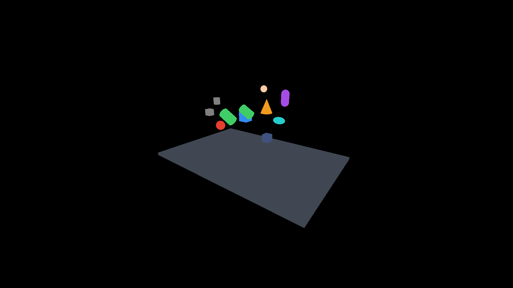
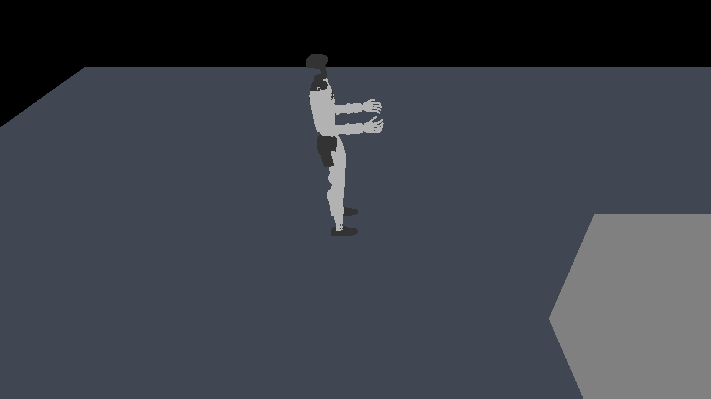
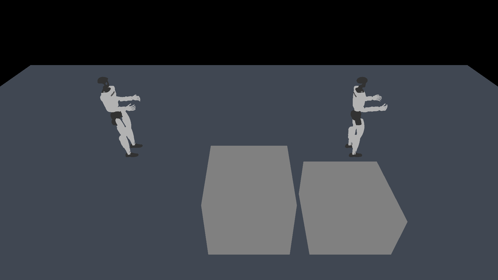

# Godot / MuJoCo viewer 性能对照

类型：正式采样。完整采样：是。

| 负载 | 画面 | 测试 | Godot | 原生 | 比值 | 门槛 |
|---|---|---|---:|---:|---:|---|
| g1-dual | common | paused | 8.008 ms p95 | 0.797 ms p95 | 10.053 | 参考 |
| g1-dual | common | physics | 6031.489 steps/s | 6839.882 steps/s | 0.882 | 未达到 |
| g1-dual | common | running | 11.840 ms p95 | 1.012 ms p95 | 11.702 | 未达到 |
| g1-dual | common | static | 1.791 ms p95 | 0.795 ms p95 | 2.254 | 未达到 |
| g1-dual | default | running | 489.276 ms p95 | 1.025 ms p95 | 477.469 | 参考 |
| g1-single | common | paused | 4.154 ms p95 | 0.536 ms p95 | 7.747 | 参考 |
| g1-single | common | physics | 14746.495 steps/s | 16809.572 steps/s | 0.877 | 未达到 |
| g1-single | common | running | 5.582 ms p95 | 0.641 ms p95 | 8.713 | 未达到 |
| g1-single | common | static | 1.181 ms p95 | 0.536 ms p95 | 2.205 | 未达到 |
| g1-single | default | running | 231.153 ms p95 | 0.630 ms p95 | 366.619 | 参考 |
| gallery | common | paused | 0.912 ms p95 | 0.085 ms p95 | 10.762 | 参考 |
| gallery | common | physics | 39559.923 steps/s | 43585.707 steps/s | 0.908 | 通过 |
| gallery | common | running | 1.586 ms p95 | 0.111 ms p95 | 14.264 | 未达到 |
| gallery | common | static | 0.462 ms p95 | 0.088 ms p95 | 5.260 | 未达到 |
| gallery | default | running | 1.956 ms p95 | 0.103 ms p95 | 18.964 | 参考 |

## 测量口径

- 共同画面关闭阴影、反射、天空、抗锯齿，采用无光照基础材质；相机、视口和可见 geom ID 相同。
- 原生基线是使用官方 mjv_updateScene/mjr_render 的独立最小 viewer，不包含 simulate 面板、历史采集或独立物理线程。
- 两端均隐藏 UI 绘制；Godot 保留现有示例的 UI/隐藏碰撞更新工作。默认画面的灯光、天空、材质并不等价，只作参考。
- static 为纯绘制：Godot 场景运行回调冻结。paused 保留暂停状态下的现有回调，作为一次额外诊断；running 保留完整运行路径。
- 共同画面关闭 Godot 自动鼠标拾取，以对应原生无点击时的行为；默认画面保留原设置，鼠标固定在视口中心，另计 ray_ms。
- 物理测试使用相同初态、固定步数和零额外噪声。Godot 保留每个物理 tick 的真实后端分组、接触整理和 mj_forward，原生直接循环 mj_step。
- CSV 的 frame_ms 是完整帧间墙钟时间；render_cpu_ms 只是 CPU 准备/提交时间，不能当作 GPU 完成时间。
- 原生 GPU 时间使用异步 GL_TIME_ELAPSED，Godot 使用 viewport GPU timer；零或不可用值不参与 GPU 汇总。
- source-files.json、source.patch、fixtures/ 和每次运行的元数据保存来源、模型、状态、环境和原始样本。
- 独立原生 viewer 的成绩不能直接代表嵌入 Godot 后的性能。本报告不自动更换渲染架构。

## 开销分解

| 负载/画面/模式 | 后端 | 步进 p95 ms | 状态字典 p95 ms | 状态栏读取 p95 ms | 射线查询 p95 ms | 节点同步 p95 ms | GPU p95 ms | 峰值 RSS MiB |
|---|---|---:|---:|---:|---:|---:|---:|---:|
| g1-dual/common/paused | godot | 0.003 | 0.503 | 0.191 | 0.000 | 5.815 | 1.963 | 786.0 |
| g1-dual/common/paused | native | 0.000 | — | — | — | — | 0.736 | 304.5 |
| g1-dual/common/running | godot | 2.097 | 0.502 | 1.528 | 0.000 | 6.064 | 3.239 | 786.6 |
| g1-dual/common/running | native | 0.705 | — | — | — | — | 0.781 | 304.9 |
| g1-dual/common/static | godot | 0.003 | 0.000 | 0.000 | 0.000 | 0.000 | 1.572 | 787.3 |
| g1-dual/common/static | native | 0.000 | — | — | — | — | 0.733 | 304.9 |
| g1-dual/default/running | godot | 15.063 | 3.398 | 1.047 | 428.461 | 40.367 | 12.041 | 786.9 |
| g1-dual/default/running | native | 0.717 | — | — | — | — | 0.783 | 304.9 |
| g1-single/common/paused | godot | 0.002 | 0.297 | 0.243 | 0.000 | 2.966 | 1.021 | 555.8 |
| g1-single/common/paused | native | 0.000 | — | — | — | — | 0.470 | 176.0 |
| g1-single/common/running | godot | 0.822 | 0.222 | 0.939 | 0.000 | 2.870 | 1.250 | 555.7 |
| g1-single/common/running | native | 0.379 | — | — | — | — | 0.479 | 176.0 |
| g1-single/common/static | godot | 0.002 | 0.000 | 0.000 | 0.000 | 0.000 | 0.972 | 555.9 |
| g1-single/common/static | native | 0.000 | — | — | — | — | 0.470 | 176.2 |
| g1-single/default/running | godot | 6.607 | 2.264 | 0.621 | 196.792 | 21.866 | 6.857 | 554.8 |
| g1-single/default/running | native | 0.379 | — | — | — | — | 0.479 | 176.1 |
| gallery/common/paused | godot | 0.000 | 0.046 | 0.124 | 0.000 | 0.000 | 0.213 | 352.5 |
| gallery/common/paused | native | 0.000 | — | — | — | — | 0.009 | 129.0 |
| gallery/common/running | godot | 0.267 | 0.048 | 0.429 | 0.000 | 0.391 | 0.221 | 343.6 |
| gallery/common/running | native | 0.000 | — | — | — | — | 0.014 | 129.6 |
| gallery/common/static | godot | 0.000 | 0.000 | 0.000 | 0.000 | 0.000 | 0.161 | 438.2 |
| gallery/common/static | native | 0.000 | — | — | — | — | 0.009 | 135.1 |
| gallery/default/running | godot | 0.283 | 0.061 | 0.523 | 0.014 | 0.491 | 0.532 | 338.2 |
| gallery/default/running | native | 0.000 | — | — | — | — | 0.011 | 129.7 |

RSS 为进程峰值，包含夹具初始化、截图和样本缓存，不代表稳定渲染内存。默认画面及 paused 为参考项；少于十帧时 p95 仅供粗略诊断。

## 默认画面逐轮拾取观测

自动拾取开关开启，不保证窗口持续收到悬停事件。查询密集、稀疏及零查询轮次必须分开解释；上方默认画面汇总不用于验收。少数查询帧的停顿可能落在 p95 之外。不同指标的 p95 不可相加。

| 负载 | 轮次 | 帧 p95 ms | 最大帧 ms | 有查询帧占比 | 射线 p95 ms | 最大射线 ms | 射线占采样墙钟 | 射线次数 |
|---|---:|---:|---:|---:|---:|---:|---:|---:|
| gallery | 1 | 1.946 | 4.881 | 6.68% | 0.014 | 0.086 | 0.14% | 1800 |
| g1-single | 1 | 238.021 | 244.678 | 100.00% | 201.451 | 203.933 | 83.48% | 1136 |
| g1-dual | 1 | 489.276 | 497.659 | 100.00% | 429.143 | 439.511 | 86.53% | 536 |
| gallery | 2 | 1.956 | 4.890 | 6.71% | 0.014 | 0.065 | 0.14% | 1800 |
| g1-single | 2 | 231.153 | 235.886 | 100.00% | 196.792 | 201.895 | 84.26% | 1168 |
| g1-dual | 2 | 14.132 | 513.261 | 0.68% | 0.000 | 456.568 | 21.73% | 136 |
| gallery | 3 | 2.356 | 9.951 | 7.73% | 0.016 | 0.193 | 0.15% | 1800 |
| g1-single | 3 | 228.419 | 232.587 | 100.00% | 195.366 | 200.102 | 84.42% | 1176 |
| g1-dual | 3 | 491.819 | 496.454 | 100.00% | 428.461 | 436.821 | 86.42% | 536 |

原始数据复核通过：78 次运行、6946867 个图形帧；相机投影、模型/状态/二进制指纹及物理轨迹详见 [audit.json](audit.json)。

## 实时推进

| 负载/画面 | 后端 | 仿真时间 / 墙钟时间 |
|---|---|---:|
| g1-dual/common | godot | 1.000× |
| g1-dual/common | native | 1.000× |
| g1-dual/default | godot | 0.297× |
| g1-dual/default | native | 1.000× |
| g1-single/common | godot | 1.000× |
| g1-single/common | native | 1.000× |
| g1-single/default | godot | 0.646× |
| g1-single/default | native | 1.000× |
| gallery/common | godot | 1.000× |
| gallery/common | native | 1.000× |
| gallery/default | godot | 1.000× |
| gallery/default | native | 1.000× |

## 同机位截图

gallery / godot：
gallery / native：
g1-single / godot：
g1-single / native：
g1-dual / godot：
g1-dual / native：
