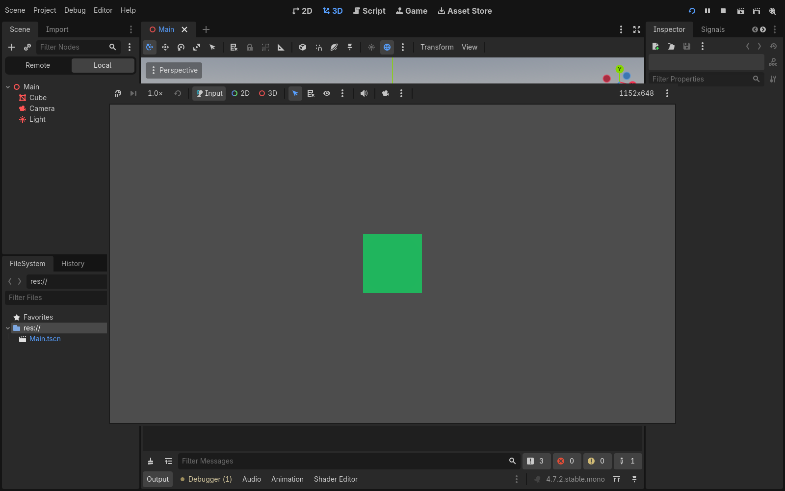
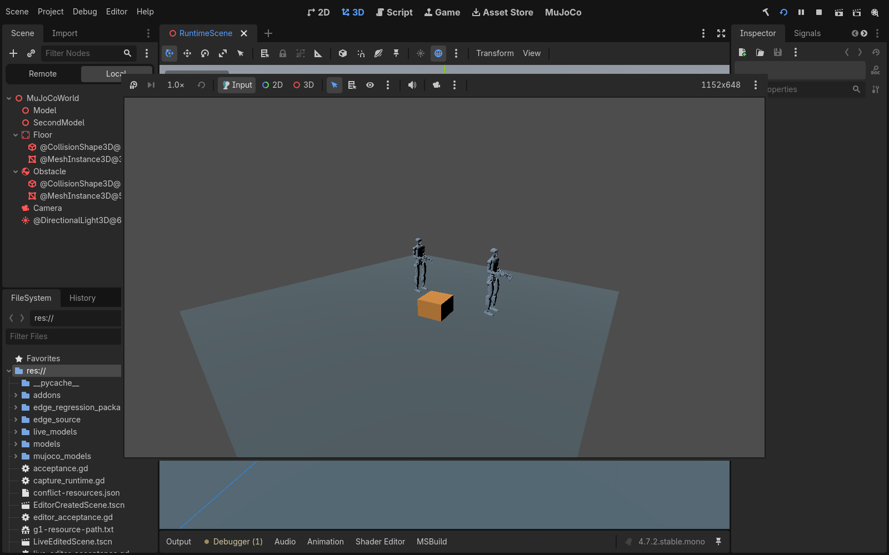
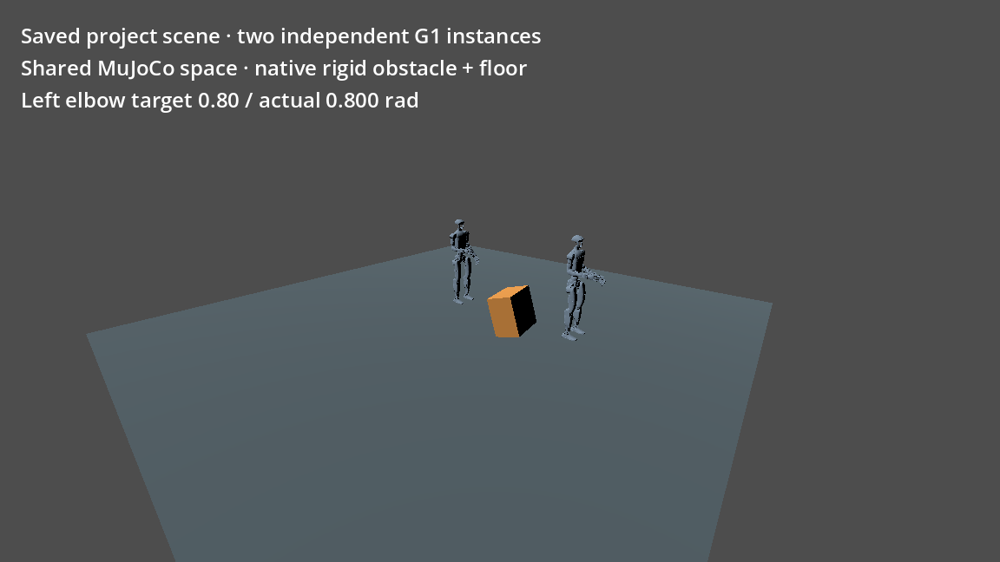
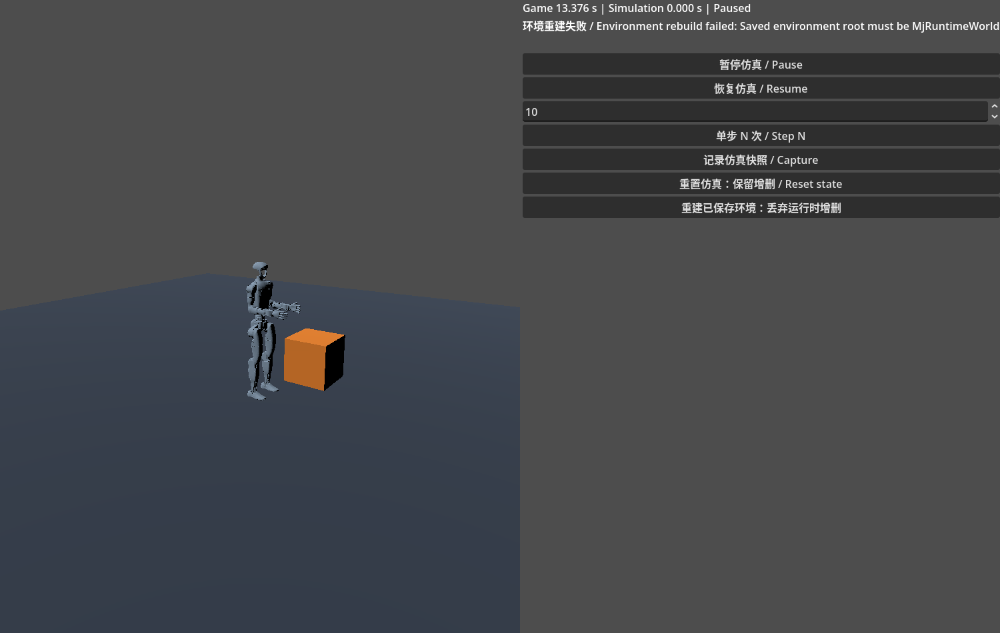
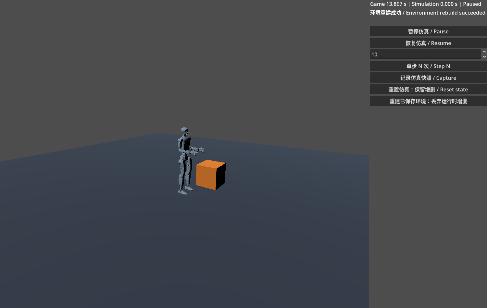

# 2d7ec745 全量回归与下一步计划

本轮总体结论：**FAIL，不能发布为稳定基线**。运行时和多数自动功能组通过，但图形编辑器仍产生 Vulkan ERROR；原始 MjWorld smoke 将预期错误混入正例；dot 的真实鼠标操作仍能使 pending hinge 在树中失去选择高亮。后者是应用 UI 缺陷，本轮只记录、不修产品代码。

## 固定对象与执行方式

- 原始候选：`2d7ec74514758b1fc7922a3560c837897df5f5ab`，tree `451161fb4ca59a2ad95c581864d5bf669590b19f`，分支 `codex/freebase-simulation-controls`。
- main 保持 `bb1294e4f1d074d2a7c6a3852b428d83020ae5b3`。所有远端写入采用 GitHub MCP，无 SSH，无合并 main。
- 官方 Godot `4.7.2.stable.mono.official.ed1daf0bf`、MuJoCo 3.16.0、Linux x86_64。没有修改引擎或开展受阻的冷导入补丁研究。
- 先验证远端与本地，再冻结 318 个 tracked 文件 SHA256；clean build 后再次核验无源码差异。36 个 Unitree 原始文件与上游 manifest 全部一致。
- 串行运行，两个 CPU affinity，nice 10，逐组 timeout 与子进程清理；保留预先存在的 Project Manager/Xorg。精确命令、退出码、时长与 F5 子进程参数见 `commands.json`。
- 新建各组 project 是该目录的首次 import，但复用本机 SDK/XDG 缓存；运行阶段使用该次导入产生的缓存。不能称为全新 XDG 冷启动稳定性证明。专用重复冷导入压力没有重跑，既有 139 独立保留。

## 功能结果

|组|检查结果|严格判定|
|---|---|---|
|clean build|`--clean-first -j2`，exit 0|PASS|
|native|3 × (44 body/ray + 25 primitives + 80 rotation) = 447|PASS|
|dynamic|86；动态增删、事务、跨 space 隔离|PASS|
|G1 native|59 cases、236000 steps、58 saturation checks|PASS|
|G1 GDScript / C#|各 60 trials、240000 steps|PASS|
|editor headless|160；数值/派生字段/undo/save/reload/尺寸规则|PASS；不涵盖真实鼠标顺序|
|freebase|44；真实 free root、重新入树恢复 authored pose|PASS|
|clock / feedback|118 + C#；精确步进、暂停恢复、快照、重建失败/重试/信号生命周期|PASS|
|live|84 + editor flow 9；安全边界重建/状态迁移/失败回滚|PASS|
|portable assets|3 轮，原路径不可用|PASS|
|portable runtime|每轮 30 + relocation 30 + live 84 + editor 9 + recovery 41 + C#/保存重启，共 3 轮|PASS|
|portable 负例|每轮独立进程 6/8 检查，严格预期错误审计；审计器 2 tests|PASS，与正例分开|
|运行压力|3 × 371 = 1113；共 90 topology cycles、30 world reentries|PASS|
|真实图形编辑器|5 × 163 assertions，均 exit 0，每轮两条 Vulkan ERROR|**FAIL**|
|原始 HeadlessTest|exit 0、SMOKE TEST PASS，但错误 qpos 产生 ERROR|**FAIL**|
|原始 chaos / debug data|使用本轮已导入项目，各 exit 0，无 ERROR/泄漏|PASS（cached runtime）|

正例日志没有忽略 ERROR 的白名单。独立预期失败测试只接受准确匹配的错误数量/文本与成功检查标记；额外错误、泄漏、超时、崩溃仍失败。`audit.json` 保存逐组严格判定与错误位置，原始日志压缩包保存全部证据。

## 实际图形运行与 F5 对照

Xorg :91、llvmpipe、OpenGL Compatibility、Dummy audio。普通场景、双固定基座 G1+普通刚体、自由基座 playground 独立窗口均 exit 0，无 ERROR/泄漏。playground 使用实际 Button 的 pressed 信号与可见 Label，验证暂停、精确 10 步、自由下落、reset、候选错误保留旧环境、成功重试；这不是鼠标端到端覆盖。截图保留失败文本和成功文本。

F5 使用 XTEST 真实按键，记录 `--editor-pid`、`--wid`、主场景和参数。普通场景默认项目音频 1 轮、项目显式 Dummy 3 轮、MuJoCo 3 轮；首轮等待 2/15/60 秒（默认音频只到 15 秒），后两轮重入，包含窗口 resize、F8。编辑器启动本身带 Dummy 参数，因此默认项目音频对照不能证明物理音频设备可用。直接抓父窗口会遗漏独立嵌入子窗口而出现黑块；根窗口截图实际显示绿色方块和双 G1。此取证差异不等于 dot 灰屏根因。

本机能显示 F5 不代表 dot 的持续灰屏已修复。每个图形编辑器进程仍有 `Required Vulkan instance extension VK_KHR_surface not found` 及 `err != OK`，严格 GUI gate 为 FAIL。独立窗口是已验证运行设置，关闭嵌入不是修复成功。F5 子进程被 F8 结束，其退出码无法由该脚本直接 wait，保留参数、合并日志与消失记录，不虚报 child exit 0。

## dot 独立结果与未解决 UI 缺陷

以下来自父线程转述，不能冒充本机复跑或原始截图附件已收齐：dot cached runtime clock118+C#、额外33断言、native单轮44+25+80、chaos/debug-data通过。此前 freebase exit137 原因不明；fresh clock import139 未进入功能测试。云端 cgroup 没有 OOM 事件不能解释另一台机器的137，也不能覆盖139。

**选择缺陷复现**：选择 hinge，damping 改为0.2但不 Apply，真实鼠标点击树中上方父 body arm，再移开鼠标。面板仍为 hinge、draft保留，但树没有选中高亮，可重复；点击后面的 sphere body 则恢复 hinge 高亮。因此之前树修复仅 PARTIAL。160 自动检查直接触发 Tree signal，没有覆盖真实鼠标事件顺序；事件排序只是待证假设。dot 保存了无悬停/对照截图，本轮尚未收到附件。禁止以自动检查通过覆盖这项 FAIL。

父线程后续补充：dot GUI worker 因 preview limit 于10:27停止。停止前**真实轻量GUI**已通过球/柱尺寸与undo、Step9=0.018秒、仿真暂停时UI继续、快照重置、环境重建、编辑器运行Apply与PD控制、scene赋值undo/redo及保存重启。树高亮缺陷仍存在，**G1 GUI未完成**。这些是独立实际GUI覆盖，不能合并写成全部GUI通过。最新补充见[dot最终覆盖记录](evidence/full-2d7ec/dot-final-addendum.json)；raw-evidence.zip中的dot-findings是更早快照。

## 已授权的测试隔离修正

仅把错误长度 qpos 从 `demo/scripts/headless_smoke_test.gd` 移入 `tests/mjworld_smoke/invalid_qpos.gd`。正例仍验证模型加载、运动、传感器、VFS、多文件、名称与 step(0)。新负例独立进程验证加载、拒绝错误长度与状态不变；7 个审计器测试覆盖额外/重复错误、泄漏、非零退出、缺失/重复/失败结果。没有放宽正例要求，没有修改 native/model/editor 产品代码。

修正后的 smoke 结果与提交见报告末尾。原始2d7失败永久保留；不能把原版本整个矩阵自动归到测试修正提交名下。

## 完成程度与优先级

- 三阶段核心能力已实现：F5 参数/项目对照与证据；关键物理属性/合法性/尺寸规则和视口编辑；设计资源到运行实例的同步事务、安全边界、revision/dirty、失败重试、保存设计状态。已有文档说明属性支持范围和设计状态/仿真快照的区别。
- **尚不能称为三阶段全部 GUI 验收完成或稳定发布**。F5 dot灰屏、图形编辑器错误、真实鼠标选择缺陷、独立 fresh import139/exit137 仍是阻碍。
- P1：另开明确授权产品修复，补真实鼠标点击上方/下方节点、移开鼠标、重复点击、Apply/Discard/切换对象的回归，再修 Tree 高亮缺陷。先验证根因，不能只加 synthetic signal 测试。
- P1：dot 在固定官方 binary 下保存最小普通场景/MuJoCo 的实际 F5 全桌面录屏、参数、日志、显示/音频设置；定位宿主差异与 Vulkan gate。不改引擎、不以独立窗口替代嵌入验收。
- P1：独立复验137并采集进程/内存/退出信号证据；保留139为官方/环境独立限制，在允许范围内跟踪官方支持，不恢复受阻内存补丁研究。
- P2：将本轮严格串行 runner 与真实鼠标回归整理为可复用测试入口，统一陈旧 README 计数，去除旧脚本 GUI ERROR 豁免；增加每次图形运行独立 child 状态采集。
- P2：已批准范围内完善用户文档与复验清单，只有全部 gate 与 dot GUI复验通过后才讨论发布。不扩展 Area/CharacterBody/fulljoints/地形或站立步行，不自行合并 main。

## 交付与资源记录

测试修正 commit：`5b9b7af47782065c123b2f42687e0502ca788194`，tree：`6504cf20e9ad65e00a739e210e4957d0a6d8e2c8`。该提交的新目录首次 import、正例 exit0、独立负例 exit0（3 checks）、审计器7 tests均通过；只重跑本次测试修改相关组，没有宣称整个新提交矩阵 fresh通过。native共享库 SHA256仍与 frozen记录一致。

命令账本共43项：34 PASS、9 FAIL。9项为5轮图形编辑器、3组F5编辑器和原始smoke；另有dot报告的实际选择缺陷独立列出。所有43项命令返回0不代表严格通过；退出码与诊断必须同时审查。未见非预期泄漏。F5 children每次F8后均消失，编辑器正常关闭且未强制终止。最终进程核对未残留本轮新增Godot进程。

cgroup限额16GiB，起始约3.52GB、单次中途样本约5.81GB、结束约5.03GB；不是峰值内存测量，也不是持续资源采样。前后 memory.events 的 oom/oom_kill/max 均0。本轮没有137/139，不能据此抹去dot独立失败。

- [逐组严格结果与诊断](evidence/full-2d7ec/summary.json)
- [精确命令、退出码、时长、F5子进程参数](evidence/full-2d7ec/commands.json)
- [源码/engine/extension冻结哈希](evidence/full-2d7ec/frozen.json)
- [源码与36资产核验](evidence/full-2d7ec/source-verification.json)
- [测试修正后唯一既有文件变更](evidence/full-2d7ec/source-verification-after-test-fix.json)
- [dot反馈记录](evidence/full-2d7ec/dot-findings.json)
- [452份日志、结果、脚本、原始截图与资源/进程记录](evidence/full-2d7ec/raw-evidence.zip)
- [交付文件SHA256](evidence/full-2d7ec/manifest.json)

## dot 下一轮 GUI 操作

1. 分别用普通场景和 RuntimeScene F5，记录全桌面2/15/60秒、日志与实际子进程参数；F8后重复三次并 resize。独立窗口使用 Compatibility + Dummy 作对照，单独记录，不替代F5验收。
2. 在顶部MuJoCo工作区导入MJCF；hinge damping=0.2未Apply时真实鼠标点击上方arm并移开鼠标，记录panel/draft/tree高亮；再点击下方sphere作对照。复现即FAIL。之后分别Apply、Discard、undo/redo、保存重开核对设计状态。
3. 在playground暂停、单步10、恢复、暂停、reset；编辑多实例资源并请求应用，核对ID/revision/dirty、另一个实例状态与物理时间；错误候选应可见失败且旧状态保留，正确候选重试成功。反复删除/重加、撤销保存和重新启动核对设计状态与仿真快照区别。
4. 全程保留日志；任何非隔离预期ERROR或泄漏即FAIL。fresh import崩溃单列，不能缓存重试后声称fresh通过。
