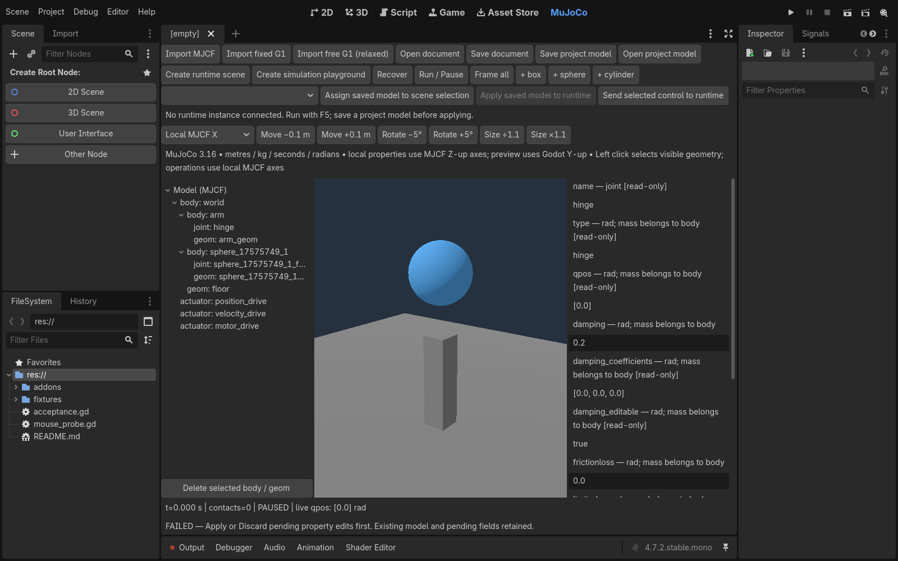
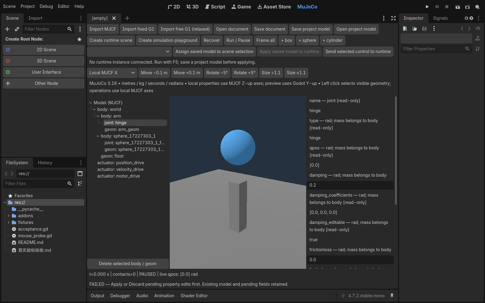
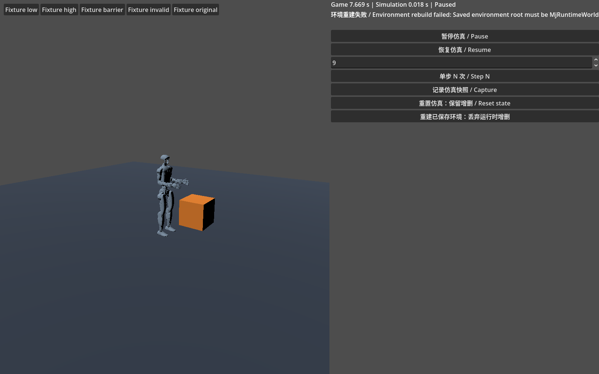
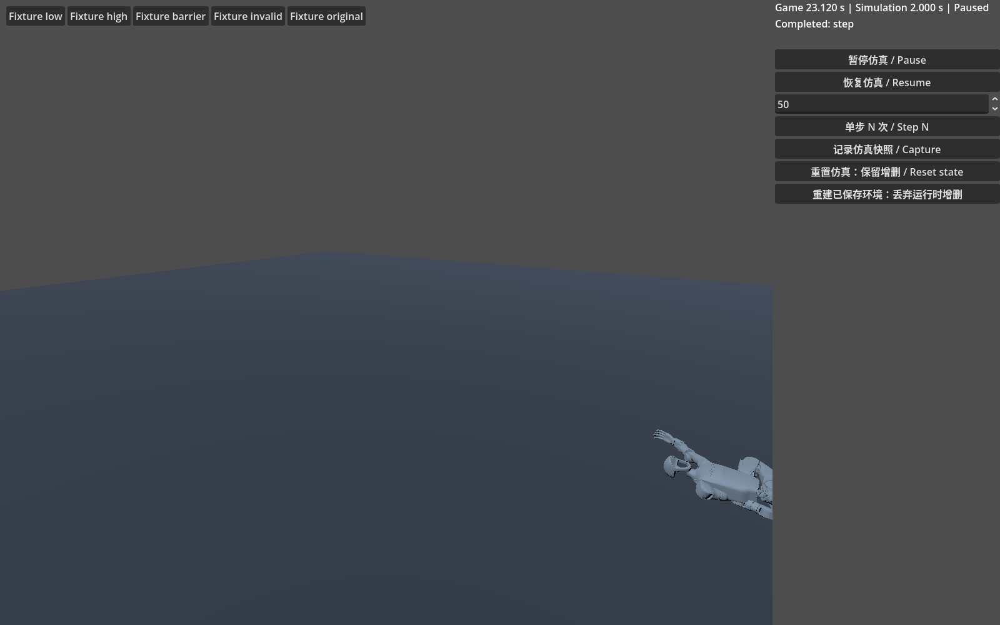
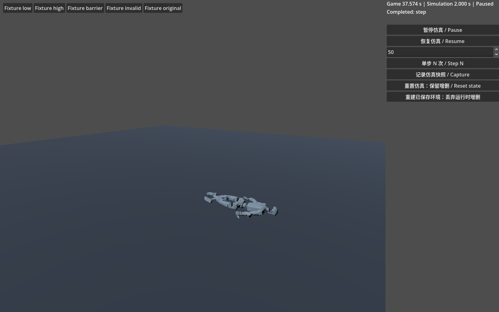
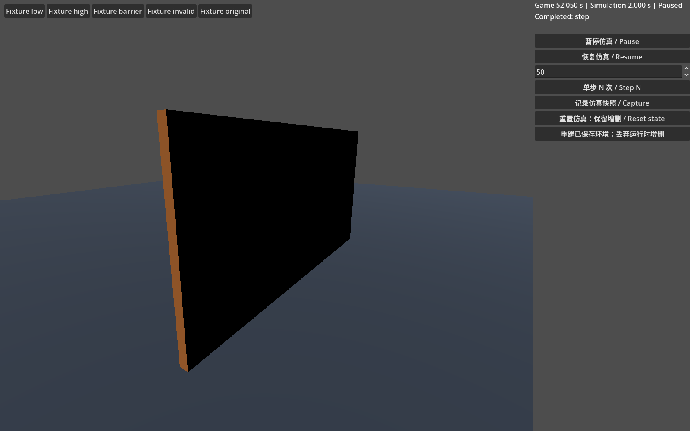
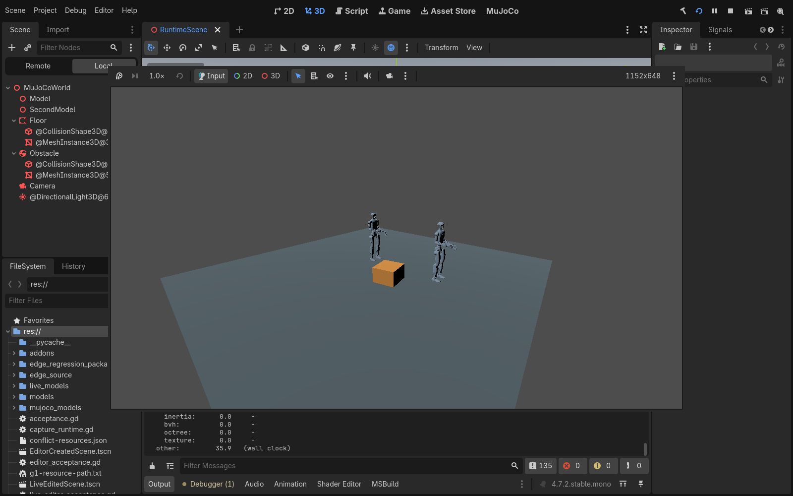

# 真实鼠标选择修复与 G1 GUI 回归

**结论：真实鼠标Tree缺陷已在云端复现并修复，最终受影响GUI复验通过且零ERROR/泄漏；不发布稳定基线，等待父任务与dot独立门槛核实。**

本轮从 `dd7639c3865febffcd6c38463495ce3726a8d4cf` 继续。应用修复仅7行：pending字段阻止选择切换时，除原有同步恢复外，在输入分发结束后再恢复Tree高亮；执行延迟回调时重新检查pending、当前selection和Tree有效性，不持有可能失效的TreeItem。未修改Godot引擎、native物理算法、原始Unitree资产或日志门禁。

修复候选 `370dc334cbda7f7ded8891ed8cc5d3c7c5cf0037`，tree `6ed5396e7cfbf079a3c1937d1f4a2cad5cef9d2e`。该候选包含新增真实XTEST输入回归；测试观测器的退出清理修正及最终证据提交在文末列出。main未合并。

## 复现与最小修复

固定官方Godot4.7.2.NET / MuJoCo3.16.0，云端Xorg :91、1600×1000、Mesa llvmpipe。修复前用真实鼠标选择hinge、输入damping=0.2，点击上方arm并移开鼠标：面板仍为hinge，原草稿控件与0.2保留，但每个TreeItem的is_selected都为false。连续三次上方点击失败，两次下方sphere点击恢复高亮。保存了无悬停全桌面截图和JSON状态，复现与dot报告一致。

同步恢复发生在Tree自身鼠标处理回调内；实际输入结束后它的结果仍会被覆盖。延迟到该输入分发之后恢复解决了方向相关问题。保留同步恢复兼容现有直接信号调用，但验收依据是XTEST真实输入，不是合成item_selected。

新的真实输入覆盖：上方/下方/重复/当前节点点击与移开鼠标；草稿控件身份和编译XML不变；Discard后切换；无效JSON失败保留状态；Apply与重复Apply；Ctrl+Z/Ctrl+Shift+Z；实际Save/Open对话框；第二个编辑器进程重新打开文件。另补真实三维视口选择、球体尺寸及undo、圆柱移动/旋转/尺寸，保持球模拟为球、圆柱只使用radius/half-height。

## 图形宿主配置对照

旧宿主只有Vulkan loader，没有Vulkan ICD，`mesa-vulkan-drivers`未安装，`/usr/share/vulkan/icd.d`不存在。仅指定`--rendering-method gl_compatibility`或额外`--rendering-driver opengl3`都仍有两条Vulkan ERROR；旧日志继续严格FAIL。

采用[Debian官方mesa-vulkan-drivers包](https://packages.debian.org/trixie/amd64/mesa-vulkan-drivers/download)，版本25.0.7-2+deb13u1，与本机Mesa一致。下载包SHA256：`caf2f7d296b7522efe74e40a74bce762a3ce84c33b53b5e54e1248ac2e0a13a5`，与官方页面一致。只提取到工作区，没有替换Godot或修改系统文件。依据[Vulkan loader标准配置](https://vulkan.lunarg.com/doc/view/latest/linux/LoaderDriverInterface.html)，启动测试时使用：

```sh
export VK_DRIVER_FILES=/workspace/shared/tools/vulkan/root/usr/share/vulkan/icd.d/lvp_icd.json
export LD_LIBRARY_PATH=/workspace/shared/tools/vulkan/root/usr/lib/x86_64-linux-gnu
```

这是为无GPU云端显式提供官方软件Vulkan驱动的宿主修正，不是应用必须硬编码的路径，也不是过滤错误。正常工作站应使用已安装的受支持驱动。同一官方Godot在该配置下的新增图形编辑器测试不再产生上述ERROR；最终组别结果见下表。此结论不能替代dot宿主验收。dot此前双G1 F5全桌面、轻量F6嵌入已经证明可渲染；历史单宿主窗口灰图不能证明当前渲染失败。

## G1 实际 GUI

通过真实鼠标操作产品SimulationControls，测试夹具仅选择候选已保存环境；重建仍走产品请求/安全边界/候选编译/提交或回滚。观测器不从UI写正在step的model/data。

- 暂停时游戏UI时间继续，仿真时间不变；Step9精确0.018秒；继续/暂停。
- 记录快照后运行，再Reset恢复精确qpos与仿真时间。
- 无效环境候选显示具体失败，旧world身份/qpos/time保留；正确候选重试成功，替换world并保持暂停。
- 原始G1派生出低摩擦、高摩擦、普通Godot障碍物三个夹具；通过Step N分段推进1000物理步（2秒）。记录脚底接触、障碍接触对、有限状态、零MuJoCo警告与采样穿透深度。原始36资产不改。
- 低/高摩擦阈值仍为位移差大于0.05米。测量为约2.904159米与1.123301米；障碍接触成立。这是自由基座被动动力学，不是站立或行走。

## 测试脚本迭代与失败记录

保留所有前期失败，不将后续结果覆盖原始日志：

1. 鼠标脚本最初未纳入原生弹窗坐标、未滚动完全可见的Apply、未使用.gmj.json后缀，以及在窗口映射前点击；逐项修正观测/输入定位，未修改产品以适配测试。最终等待目标PID窗口可见，实际点击弹窗并使用正确文档后缀。
2. 第一版G1 GUI只测0.24秒，未达到原有2秒摩擦回归的位移阈值；保留FAIL，把GUI补到同样的2秒，阈值未降低。
3. 观测器曾在world替换后、可见成功提示更新前就采样；改为同时等world身份变化、time=0与最终成功提示，超时仍失败。
4. 新测试观测器退出时仍接收一帧回调，产生访问已释放host的SCRIPT ERROR。即使进程exit0也记FAIL；最后仅修测试清理并重跑受影响GUI组，不豁免ERROR。

## 回归边界

完整矩阵串行、每组有timeout、nice10和双CPU affinity；只清理本轮拥有的子进程，不结束预先存在的Project Manager/Xorg。新建各组project并执行首次import，运行使用该次import产生的缓存；复用本机SDK/XDG缓存，不代表独立全新XDG冷导入稳定性。native源未改，本轮构建为增量检查；此前clean build证据与本轮库SHA256分别保留。

已知cold import139不开展引擎调试，不通过缓存重试改写fresh结果。dot历史137原因未明，本机内存观测不用于猜测其原因。dot的preview limit没有被解除，本轮云端真实GUI不是dot复验。即使本机新增严格组通过，仍不自行宣称稳定基线或合并main；交父任务复核独立验收门槛。

## 最终逐组结果与提交

|组别|结果|严格判定|
|---|---|---|
|增量build|exit0，1.54秒；native源未改|PASS；不称fresh clean build|
|native|447（3×(44 body/ray + 25 primitives + 80 rotation)）|PASS|
|dynamic|86|PASS|
|G1 native / GDScript / C#|59 cases / 60 trials / 60 trials；236000 / 240000 / 240000 steps|PASS|
|editor headless|160|PASS；与真实鼠标另列|
|freebase / clock|44 / 118 + C#|PASS|
|live|84 + 编辑器/运行子进程流程（零失败）|PASS|
|portable assets/runtime|3轮；每轮runtime30、relocation30、live84、editor9、recovery41、C#/保存重启|PASS|
|隔离负例|portable各轮6/8；审计器2 tests；MjWorld正例零ERROR、负例3 checks、审计器7 tests|PASS；预期错误仅存在独立进程|
|压力|1113；90次拓扑循环、30次world重入|PASS|
|真实图形编辑器|5×163；每轮exit0、零ERROR/泄漏|PASS（正常驱动配置）|
|真实鼠标编辑器|30；另有进程重启2项|PASS；最终修正测试脚本后30项再次PASS|
|G1真实GUI首次完整矩阵|20/20，游戏exit0，但退出观测回调SCRIPT ERROR|**FAIL，永久保留**|
|G1真实GUI清理修正后|新OUT：headless44 + GUI20；mouse/game exit0，零ERROR/泄漏|PASS|
|legacy chaos/debug data|各exit0、零ERROR/泄漏|PASS（本轮已导入项目上的cached runtime）|
|F5普通场景首次|焦点BadMatch，首轮未成功启动child，editor exit0|**FAIL，永久保留**|
|F5 MuJoCo短观察|15秒图仍灰色，child稍晚启动；日志无ERROR|**PARTIAL，不声称持续灰屏或显示通过**|
|F5最终对照|普通场景15秒绿色方块；MuJoCo60秒双G1与刚体可见；各两轮F5/F8含resize，editor exit0，零ERROR/泄漏|PASS；实际child参数含--wid，F8后child消失|

账本共42项：39 PASS、2历史FAIL、1短观察PARTIAL；修正后对应组均通过，没有删除历史失败。F5 child由F8停止，未直接wait取得其退出码；仅记录编辑器exit0、child参数/消失和合并日志，不能虚报child exit0。最终没有本轮新增Godot进程残留。

应用修复/完整矩阵源：`370dc334cbda7f7ded8891ed8cc5d3c7c5cf0037`，tree `6ed5396e7cfbf079a3c1937d1f4a2cad5cef9d2e`。

测试清理提交：`df049af78999ab60b0e102191bd6842a00021fbd`，tree `2310f2d81cbe55914864b371981840b7983afb79`。相对完整矩阵只改两个测试文件：G1观测器退出前断开process_frame，以及XTEST/截图读取DISPLAY。应用/原生库/资产完全相同。该提交重新执行两个受影响GUI入口，分别30/30与44+20通过；没有把整个原矩阵改标为在新提交重新fresh运行。本文与附件所在提交仅补文档/证据。

主矩阵冻结347个跟踪文件并核验无变化，36个原始Unitree资产SHA256全部一致。主矩阵0.4秒间隔采样的cgroup内存峰值9,807,171,584字节（约9.13GiB），限额16GiB；最终oom/oom_kill/max事件均0。该数据不解释dot历史137。

## 交付证据

- [逐组严格结果](evidence/mouse-gui-fix/summary.json) · [命令、退出码、时长及F5参数](evidence/mouse-gui-fix/commands.json)
- [源码/引擎/库与环境冻结](evidence/mouse-gui-fix/frozen.json) · [347文件与36资产核验](evidence/mouse-gui-fix/integrity.json)
- [测试清理的精确差异边界](evidence/mouse-gui-fix/test-cleanup-delta.json) · [前期测试脚本尝试](evidence/mouse-gui-fix/preflight-checks.json)
- [640份日志、结果、脚本、最终GUI截图和关键失败截图](evidence/mouse-gui-fix/raw-evidence.zip) · [文件校验清单](evidence/mouse-gui-fix/manifest.json)
- [鼠标复验入口说明](../tests/editor_plugin/真实鼠标验收.md) · [G1 GUI入口说明](../tests/freebase/README.md)

原始完整工作目录为`/workspace/shared/validation/mouse-fix`。仓库压缩包保留所有选定日志/JSON和最终截图，省略重复的中间截图及无关系统进程命令；本地原记录不改。










## 剩余限制与基线门槛

1. dot需独立拉取最终开发提交，复验pending上/下节点、Apply/Discard/undo/save/reopen和G1完整GUI；preview limit没有恢复。当前Tree缺陷在云端已修复，不再把旧提交上的dot失败写作新提交已确认失败。
2. cold import139仍为已知独立限制，专用冷导入稳定性压力未在本轮重跑，未恢复受阻研究。新项目首次import通过不等于独立冷环境稳定性证明。
3. dot历史137仍原因未明；应在可用环境恢复后采集退出信号/资源证据，不能猜OOM。
4. 云端正常驱动配置解决了本机Vulkan日志错误，不承诺适用于所有Linux宿主。官方引擎binary未改变，main仍为bb1294e4f1d074d2a7c6a3852b428d83020ae5b3。
5. 仅交付可核验开发候选。父任务确认上述独立门槛前，不打稳定标签、不合并main；没有新增站立/行走、fulljoints、Area、CharacterBody或地形。
